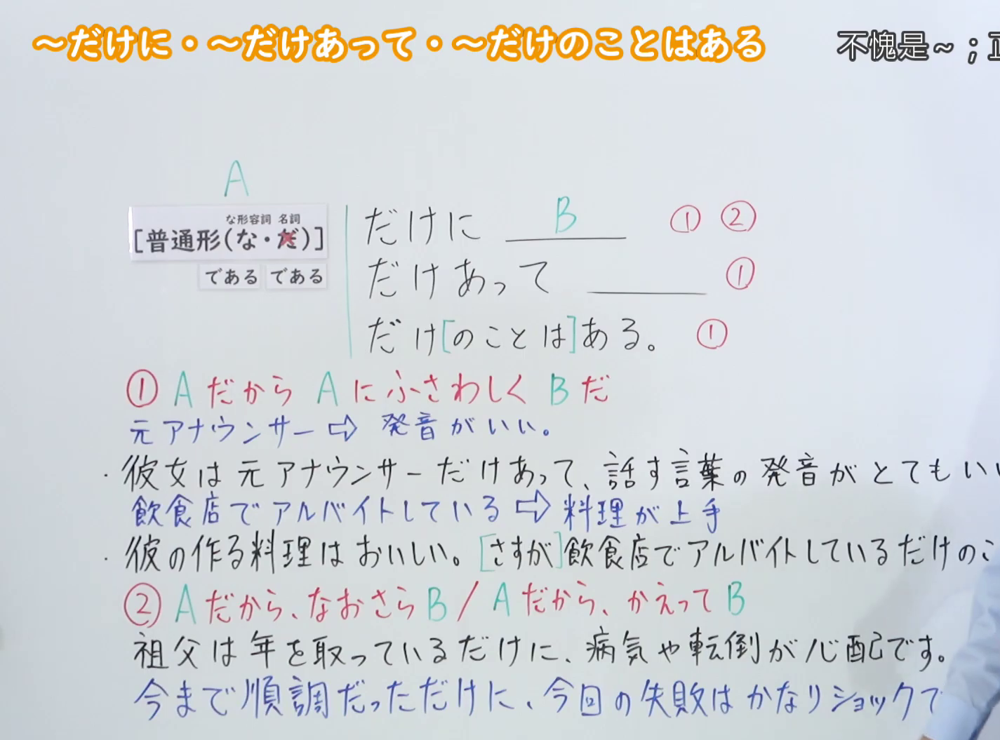
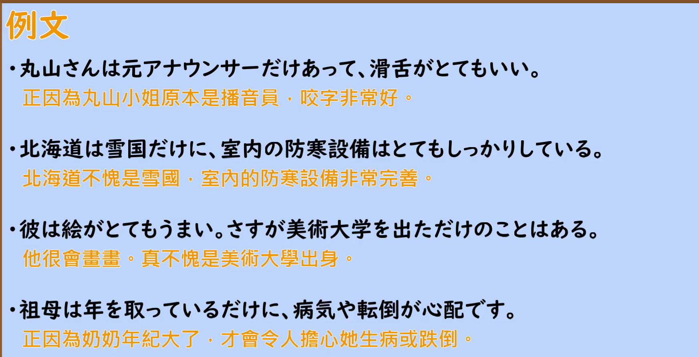

---
{
  "id": "N2-G-0032",
  "kind": "grammar",
  "level": "N2",
  "title": "～だけに・～だけあって・～だけのことはある（不愧是～；正因为～）",
  "card_revision": 1,
  "schema_version": 1,
  "source": {
    "lesson": "N2 第32个语法",
    "material": "出口日語原视频板书、日语自动字幕与 Hagoromo 文型検索正文",
    "video": "https://www.youtube.com/watch?v=cvi8jfADA2A",
    "screenshot": "assets/grammar/n2/N2-G-0032-connection.png",
    "screenshot_seconds": 250,
    "screenshot_crop": {
      "x": 0,
      "y": 0,
      "width": 1425,
      "height": 1055
    }
  },
  "tags": [
    "原因・理由",
    "評価",
    "N2"
  ],
  "confusions": [
    "～とあって（表示「因为是～这种特殊状况」，多见于新闻报道，后项为特别情形）",
    "～ばかりに（表示「正因为～才导致坏结果」，只接负面结果，本课的三个形式多用于正面评价）",
    "～だけあって 与 ～だけのことはある（后者常与「さすがに」呼应，强调「果然没有白费」，评价语气更强）"
  ]
}
---

# ～だけに・～だけあって・～だけのことはある

## 视频学习资料整理

- 视频：[出口日語「[N2 Grammar] ～Dake ni, ～Dake atte, ～Dake no koto wa aru」](https://www.youtube.com/watch?v=cvi8jfADA2A)
- 接续图：实拍于 0:04:10（第250秒）。原视频画面 1920×1080，裁切区域 (x, y, 宽, 高) = (0, 0, 1425, 1055)，固定左上角、收拢右下角，裁去右侧人像。板书含标题「～だけに・～だけあって・～だけのことはある／不愧是～；正因為～」、接续「A［普通形（な・名）］＋だけに／だけあって／だけ[のことは]ある」及①②用法标记、红色说明①「A だから A にふさわしく B だ」与②「A だから、なおさら B／A だから、かえって B」、蓝色对照「元アナウンサー⇔発音がいい」「飲食店でアルバイトしている⇔料理が上手」及四条例句，接续与两条说明均完整。
- 遮挡说明：教师站在板书右侧，「彼女は元アナウンサーだけあって…」「彼の作る料理は…」「今まで順調だっただけに…」三条例句的句尾以及标题中文释义的末尾在其身后被遮挡，保留可见部分。
- 替换 0:01 画面的原因：0:01 时上述例句句尾与教师身体重叠更严重，板书不完整，故改用第250秒画面；不把第250秒标作 0:01。
- 例句图：实拍于 0:05:55（第355秒）。原视频画面 1920×1080，裁切区域 (x, y, 宽, 高) = (45, 12, 1790, 905)，裁去幻灯片外围边框与底部空白。

# 核心

## 功能一：正因为A，所以才与A相称地B

**最上位意味カテゴリー：**

- **だけに：** ものごとの関係（事物的关系）
- **だけあって：** 考え・感情（思考与感情）
- **だけのことはある：** ものごとの関係（事物的关系）

**中位意味カテゴリー：**

- **だけに：** 原因・理由（原因与理由）
- **だけあって：** 主張・断定的評価（主张与断定式评价）
- **だけのことはある：** 原因・理由（原因与理由）

**意味：**

- **だけに：** 評価の理由（评价的理由）
- **だけあって：** 評価（评价）
- **だけのことはある：** 評価の理由（评价的理由）

**くわしい意味記述：**

- **だけに：** XにはYという当然の状態・特性があるからという意味。前文脈に「しかし」や「が」といった逆接表現が来ることが多い。「Xを知っているだけに・わかっているだけに」「XはYである」といった状態や属性を表す使い方が多い。「時期が時期だけに」といった時を指定した因果関係も見られる。（表示「X本来就有Y这种理所当然的状态或特性」之意。前文常出现「しかし」「が」等逆接表达。多用于「Xを知っているだけに・わかっているだけに」「XはYである」这类表示状态或属性的情形，也能见到「時期が時期だけに」这种限定时间的因果关系。）
- **だけあって：** 「〜だけあって」の「〜」で示される地位，経験，努力，才能などにふさわしいと感心したりほめたりするときに使う。（用于对「〜だけあって」中「〜」所示的地位、经验、努力、才能等表示佩服或称赞，认为其与这些相称时。）
- **だけのことはある：** XにはYという当然の価値・才能・特徴があるという意味。プラス評価が多い。「Xは，さすがに＋Vた/Vている＋だけのことはある」という使い方が多い。似たような言い方に，「Xだけある」「Xだけあって」「Xだけに」「Xとあって」がある。（表示「X具有Y这种理所当然的价值、才能或特征」之意，多用于正面评价。常见用法是「Xは，さすがに＋Vた/Vている＋だけのことはある」。类似的说法有「Xだけある」「Xだけあって」「Xだけに」「Xとあって」。）

**派生語：**

- **だけに：** 未列出
- **だけあって：** さすが（に）〜だけあって，
- **だけのことはある：** 未列出

### 例句

1. リサさんは10年も日本にいただけに、日本語がぺらぺらだ。

   （丽莎在日本待了整整十年，正因如此，日语说得非常流利。）

2. 彼は横綱だけあって、本当に強い。

   （他不愧是横纲，真的很强。）

3. 彼女の包丁の使い方は、さすがチャンピオンだけのことはある。

   （她的刀工果然不愧为冠军，的确有两下子。）

4. さすがに高額のコースを頼んだだけあって、期待以上の味を堪能することができた。

   （到底不愧是点了高价的套餐，品尝到了超出期待的美味。）

## 功能二：正因为A，所以更加B

**最上位意味カテゴリー：**

- **だけになおさら：** ものごとの関係（事物的关系）
- **だけにかえって：** ものごとの関係（事物的关系）

**中位意味カテゴリー：**

- **だけになおさら：** 原因・理由（原因与理由）
- **だけにかえって：** 原因・理由（原因与理由）

**意味：**

- **だけになおさら：** 期待（期待）
- **だけにかえって：** 期待（期待）

**くわしい意味記述：**

- **だけになおさら：** Xだから，もっと。予想していたこととは逆の結果になって，その分なお一層という意味。（表示「正因为是X，所以更加…」。结果与原本预想的相反，正因如此程度更甚。）
- **だけにかえって：** Xだから，より一層。予想していたこととは逆の結果になって，その分もっと，という意味。（表示「正因为是X，所以越发…」。结果与原本预想的相反，正因如此程度更甚。）

**派生語：**

- **だけになおさら：** 未列出
- **だけにかえって：** 未列出

### 例句

1. 自分が始めた会社だけになおさら、倒産するのは悲しい。

   （是自己创办的公司，正因如此，倒闭了格外令人难过。）

2. 優秀な人だっただけにかえって挫折を乗り越えられなかったのだろう。

   （大概正因为原本是很优秀的人，反而没能跨越那次挫折吧。）

3. 不安定な国内状況が、民主的手続きを欠いた強権政治を誘いかねないだけになおさらだ。

   （不稳定的国内局势有可能招致缺乏民主程序的强权政治，正因如此就更是如此。）

# 来源

- [出口日語原视频「[N2 Grammar] ～Dake ni, ～Dake atte, ～Dake no koto wa aru」](https://www.youtube.com/watch?v=cvi8jfADA2A)
- [Hagoromo 文型検索「だけに」](https://www.hagoromo-text.work/lookup?vid=689)（查询日期：2026-09-23）
- [Hagoromo 文型検索「だけあって」](https://www.hagoromo-text.work/lookup?vid=685)（查询日期：2026-09-23）
- [Hagoromo 文型検索「だけのことはある」](https://www.hagoromo-text.work/lookup?vid=693)（查询日期：2026-09-23）
- [Hagoromo 文型検索「だけになおさら」](https://www.hagoromo-text.work/lookup?vid=691)（查询日期：2026-09-23）
- [Hagoromo 文型検索「だけにかえって」](https://www.hagoromo-text.work/lookup?vid=690)（查询日期：2026-09-23）
- 功能一对应板书①，三个形式同属「评价的理由」，合并为一个功能；功能二对应板书②的「なおさら／かえって」。
- 例句取自上述条目的实际用例（含博客、报纸等文体）。
