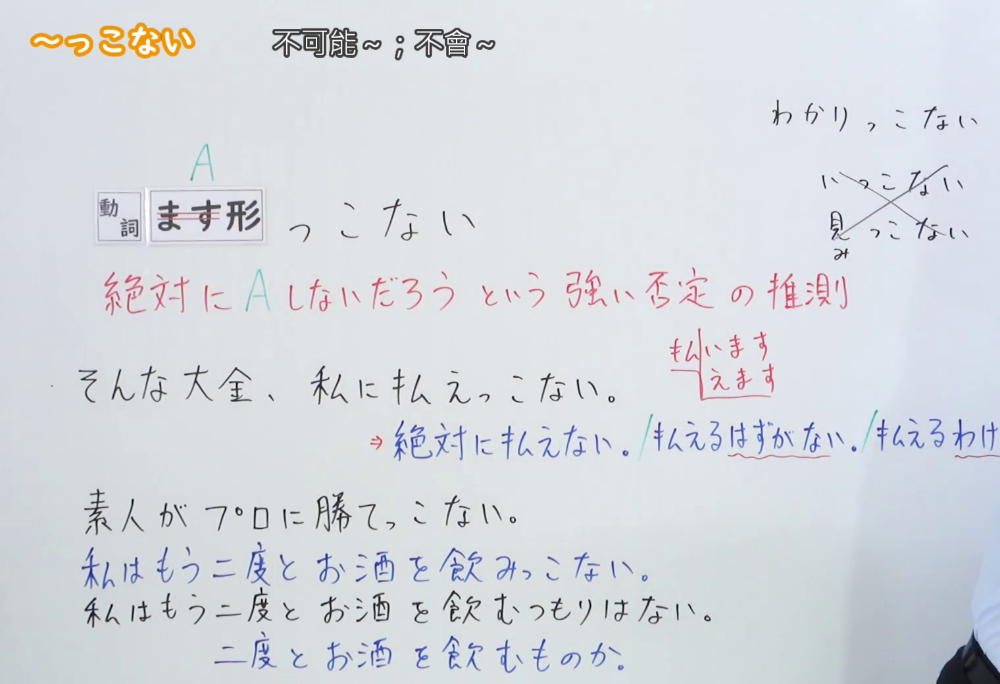
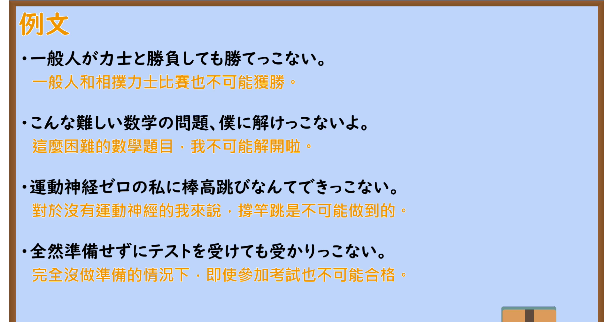

---
{
  "id": "N2-G-0033",
  "kind": "grammar",
  "level": "N2",
  "title": "～っこない（不可能～；不會～）",
  "card_revision": 1,
  "schema_version": 1,
  "source": {
    "lesson": "N2 第33个语法",
    "material": "出口日語原视频板书、日语自动字幕与Hagoromo正文",
    "video": "https://www.youtube.com/watch?v=Q-xbY9HRrdY",
    "screenshot": "assets/grammar/n2/N2-G-0033-connection.png",
    "screenshot_seconds": 205,
    "screenshot_crop": {
      "x": 0,
      "y": 0,
      "width": 1520,
      "height": 1040
    }
  },
  "tags": [
    "否定推測",
    "口语",
    "N2"
  ],
  "confusions": [
    "わけがない／はずがない（近义的否定确信表达，っこない 更口语）",
    "～つもりはない／～ものか（表达说话人自己的意志，本句型不用于此）",
    "いっこない／みっこない（单音节动词的ます形一般不用本句型）"
  ]
}
---

# 【Ｎ２文法】～っこない

# 视频学习资料整理

- 视频：[出口日語「【Ｎ２文法】～っこない」](https://www.youtube.com/watch?v=Q-xbY9HRrdY)（日语授课，时长约 6 分 41 秒）
- 接续图：原视频真实时间 **0:03:25**（第 205 秒），原图 1920×1080，裁切区域 `x=0, y=0, width=1520, height=1040`（固定左上角、收拢右下角，裁去右侧人物与底部空白）。替换原因：0:01 的画面中教师头部遮住红色解释的结尾「推測」，0:03:25 时教师退至画面右侧、板书完整，故改用该时点，不将其标为 0:01。画面为白板板书，含「動詞 ます形 っこない」、红色解释「絶対にＡしないだろう という強い否定の推測」，以及例句「そんな大金、私に払えっこない。」「素人がプロに勝てっこない。」「私はもう二度とお酒を飲みっこない。」和右侧单音节动词的注意（わかります→わかりっこない／いっこない／見ます→みっこない）。右上角为教师署名水印，属原视频画面。

  

- 例句图：原视频真实时间 **0:05:40**（第 340 秒），原图 1920×1080，裁切区域 `x=0, y=0, width=1890, height=1008`（固定左上角、收拢右下角，裁去底部桌面与右侧边框）。画面为课程「例文」页，列出四条日语例句及其中文翻译。

  

# 核心

## 功能一：绝对不会有 A 吧——强烈的否定推测

**最上位意味カテゴリー：**

- **Vっこない：** ものごとの様子（事物的情形）

**中位意味カテゴリー：**

- **Vっこない：** 否定（否定）

**意味：**

- **Vっこない：** 否定強調（否定强调）

**くわしい意味記述：**

- **Vっこない：** Vの可能性を強く否定するときに使う。Vには可能表現が来ることが多い。くだけた表現。（用于强烈否定 V 的可能性；V 的位置多为可能表现；属于较口语的表达。）

**派生語：** 未列出

### 例句

1. 優秀なあなたには、勉強ができない子の気持ちなんかわかりっこないでしょ。

   （像你这么优秀的人，根本不可能理解学习不好的孩子的心情吧。）

2. この１年でできなかったことがね、来年できっこないよ。

   （这一年都没能做到的事情，明年也不可能做到啊。）

3. そんな親がありっこないじゃん。

   （怎么可能有那样的父母嘛。）

4. もういいんだったら、釣れっこないわよ。

   （要是你已经无所谓了，那可钓不上来的哦。）

# 来源

- [出口日語「【Ｎ２文法】～っこない」](https://www.youtube.com/watch?v=Q-xbY9HRrdY)
- [Hagoromo 文型検索「Vっこない」](https://www.hagoromo-text.work/lookup?vid=775)（查询日期：2026-09-23）
- [Hagoromo 例句「Vっこない」](https://www.hagoromo-text.work/get_reibun?vid=775)（查询日期：2026-09-23）
