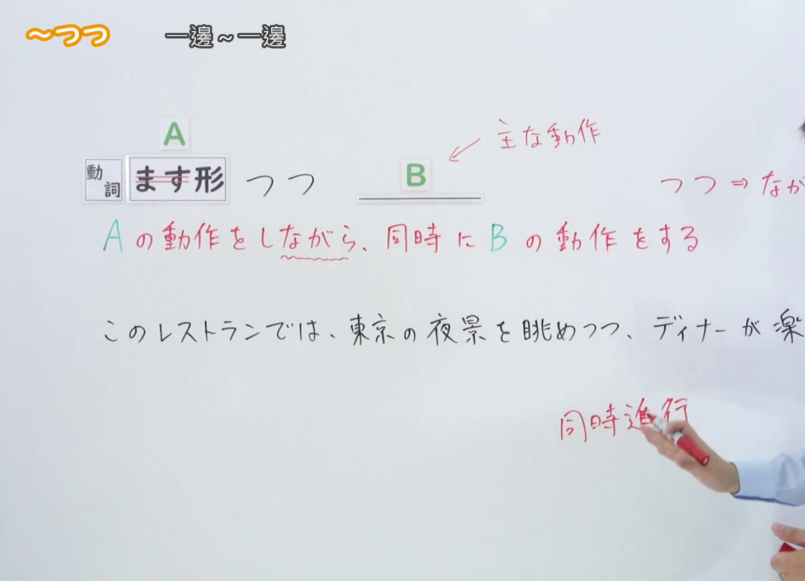
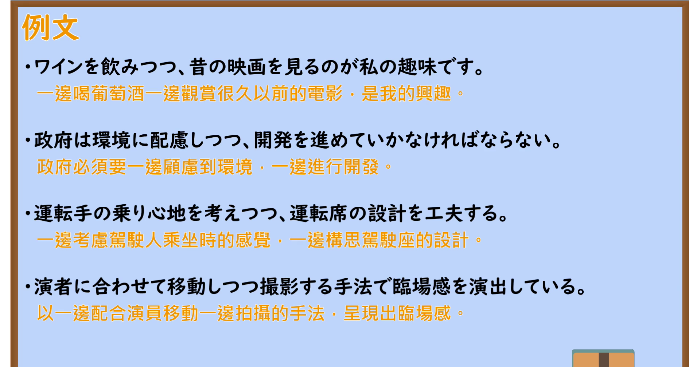

---
{
  "id": "N2-G-0034",
  "kind": "grammar",
  "level": "N2",
  "title": "～つつ（一邊～一邊）",
  "card_revision": 1,
  "schema_version": 1,
  "source": {
    "lesson": "N2 第34个语法",
    "material": "出口日語原视频板书、日语自动字幕与Hagoromo正文",
    "video": "https://www.youtube.com/watch?v=sS-g4EFO4sM",
    "screenshot": "assets/grammar/n2/N2-G-0034-connection.png",
    "screenshot_seconds": 124,
    "screenshot_crop": {
      "x": 0,
      "y": 0,
      "width": 1440,
      "height": 1040
    }
  },
  "tags": [
    "同時進行",
    "書き言葉",
    "N2"
  ],
  "confusions": [
    "～ながら（近义；ながら 口语与书面语都用，つつ 更书面、更生硬）",
    "～つつある（表示动作或变化正在进行，不是同时进行两个动作）",
    "～つつも（つつ 的逆接用法，表示「虽然…却…」，本次课程不涉及）"
  ]
}
---

# 【Ｎ２文法】～つつ

# 视频学习资料整理

- 视频：[出口日語「【Ｎ２文法】～つつ」](https://www.youtube.com/watch?v=sS-g4EFO4sM)（日语授课，时长约 4 分 14 秒）
- 接续图：原视频真实时间 **0:02:04**（第 124 秒），原图 1920×1080，裁切区域 `x=0, y=0, width=1440, height=1040`（固定左上角、收拢右下角，裁去右侧人物与底部空白）。替换原因：0:01 的画面中教师头部遮住红色解释的结尾与例句，0:02:04 时教师退至画面右侧、板书完整，故改用该时点，不将其标为 0:01。画面为白板板书，含「動詞 ます形 つつ Ｂ」、「← 主な動作」（标注 Ｂ 为主动作）、红色解释「Ａ の動作をしながら、同時に Ｂ の動作をする」、「つつ ⇒ ながら」、用法标签「同時進行」，以及例句「このレストランでは、東京の夜景を眺めつつ、ディナーが楽しめます。」。受右侧裁切边界影响，该例句与「つつ ⇒ ながら」的末尾文字不完整。板书另标注本句型有「同時進行」与「逆接」两种用法，视频只讲解同时进行用法，教师说明逆接用法留待其他视频。

  

- 例句图：原视频真实时间 **0:02:50**（第 170 秒），原图 1920×1080，裁切区域 `x=0, y=0, width=1890, height=1008`（固定左上角、收拢右下角，裁去底部桌面与右侧边框）。画面为课程「例文」页，列出四条日语例句及其中文翻译。

  

# 核心

## 功能一：一边做 A 的动作，同时做 B 的动作

**最上位意味カテゴリー：**

- **つつ：** 場所・時間（场所与时间）

**中位意味カテゴリー：**

- **つつ：** 時間的前後（时间上的前后）

**意味：**

- **つつ：** 付帯状況（附带状况）

**くわしい意味記述：**

- **つつ：** 一人の人が二つの動作を同じ時に一緒に行うことを表す。「〜ながら」と同じ意味だが，「〜つつ」は書きことばでよく使われる。（表示同一个人在同一时间一起进行两个动作；与「〜ながら」意思相同，但「〜つつ」多用于书面语。）

**派生語：** 未列出

### 例句

1. 山をのぼりつつ考えた。

   （一边爬山一边思考。）

2. 政治空白の長期化を避けつつ、責任のある政策決定ができる安定政権を生み出すことが必要である。

   （有必要在避免政治空白长期化的同时，打造能够做出负责任决策的稳定政权。）

3. 今はただ、後悔と反省の日々を過ごしつつ、遙か遠い旅の空から、貴女様の幸せなご結婚をお祈りしております。

   （如今只是一边度过充满后悔与反省的日子，一边从遥远旅途的天空，为您的幸福婚姻祈祷。）

4. いわゆる「カップル等間隔の法則」を横目で検証しつつ、向こう岸に見える街並みを眺めつつ、の〜んびり歩く贅沢な時間も京都観光のいちコースとしておすすめである。

   （一边斜眼验证所谓的“情侣等距法则”，一边眺望对岸可见的街景，这样悠闲漫步的奢侈时光，也是京都观光的一条推荐路线。）

# 来源

- [出口日語「【Ｎ２文法】～つつ」](https://www.youtube.com/watch?v=sS-g4EFO4sM)
- [Hagoromo 文型検索「つつ」（同時進行）](https://www.hagoromo-text.work/lookup?vid=779)（查询日期：2026-09-23）
- [Hagoromo 例句「つつ」（同時進行）](https://www.hagoromo-text.work/get_reibun?vid=779)（查询日期：2026-09-23）
