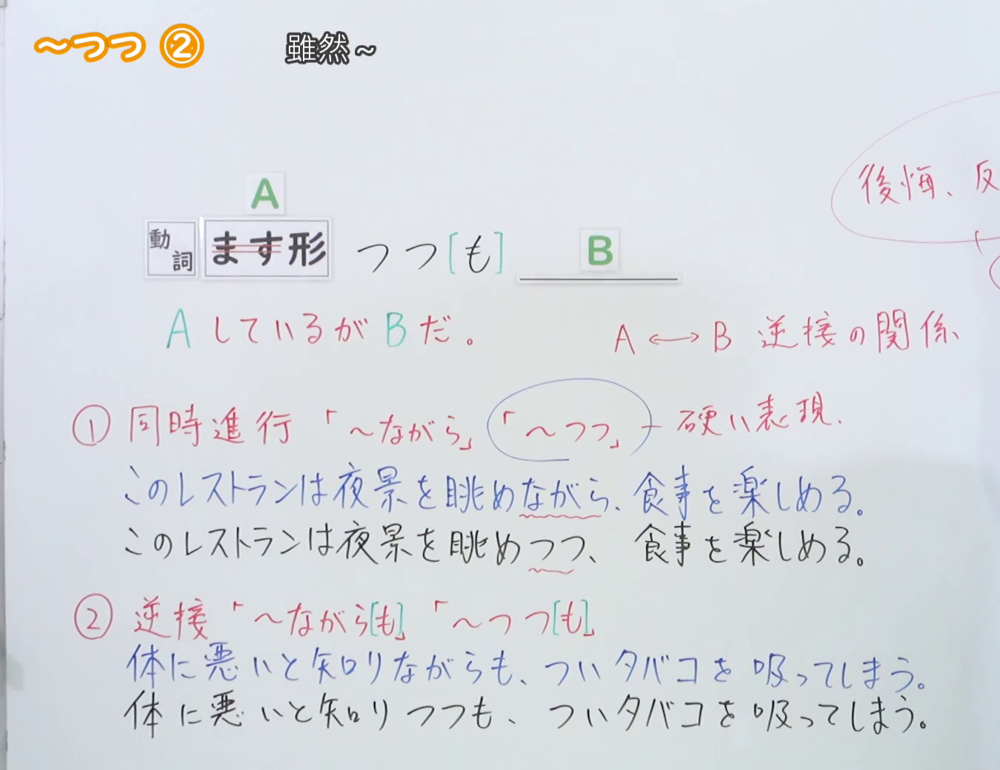
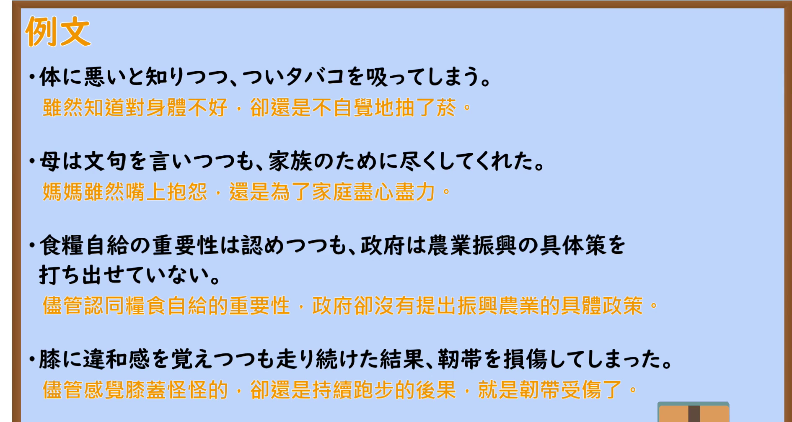

---
{
  "id": "N2-G-0035",
  "kind": "grammar",
  "level": "N2",
  "title": "～つつ・～つつも（雖然～）",
  "card_revision": 1,
  "schema_version": 1,
  "source": {
    "lesson": "N2 第35个语法",
    "material": "出口日語原视频板书、日语自动字幕与Hagoromo正文",
    "video": "https://www.youtube.com/watch?v=MSXKOSIyeLU",
    "screenshot": "assets/grammar/n2/N2-G-0035-connection.png",
    "screenshot_seconds": 230,
    "screenshot_crop": {
      "x": 0,
      "y": 0,
      "width": 1350,
      "height": 1040
    }
  },
  "tags": [
    "逆接",
    "書き言葉",
    "N2"
  ],
  "confusions": [
    "～ながらも（近义；ながら 的接续范围更广，逆接时名词、い形容词、な形容词也可接）",
    "～つつ（同時進行用法）（与「～つつも」同形，但表示同时进行两个动作）",
    "～つつある（表示动作或变化正在进行，不是逆接）"
  ]
}
---

# 【Ｎ２文法】～つつ ①

# 视频学习资料整理

- 视频：[出口日語「【Ｎ２文法】～つつ ①」](https://www.youtube.com/watch?v=MSXKOSIyeLU)（日语授课，时长约 7 分 11 秒）
- 清单中本课标题为「【Ｎ２文法】～つつ ①」，而板书记为「～つつ ②」；②指 つつ 的第二个用法（逆接），本课只讲解该用法。
- 接续图：原视频真实时间 **0:03:50**（第 230 秒），原图 1920×1080，裁切区域 `x=0, y=0, width=1350, height=1040`（固定左上角、收拢右下角，裁去右侧人物与底部空白）。替换原因：0:01 的画面中教师占据右侧较大面积，且板书尚未写全（缺「Ａ ←→ Ｂ 逆接の関係」与常用内容的红色圈注），故改用教师已离开板书、内容完整的 0:03:50，不将其标为 0:01。画面为白板板书，含「動詞 ます形 つつ［も］ Ｂ」、「Ａ しているが Ｂ だ。」、「Ａ ←→ Ｂ 逆接の関係」、红色圈注「後悔、反省、自責」「多い」，以及教师整理的 ① 同時進行「～ながら」「～つつ」＋硬い表現 与 ② 逆接「～ながらも」「～つつも」两组例句对比。受右侧裁切边界影响，「後悔、反省、自責」的圈注文字不完整。教师并说明：ながら 在逆接用法下还可接名词、い形容词、な形容词，つつ／つつも 只接动词ます形，且 つつ 属较生硬的书面表达。

  

- 例句图：原视频真实时间 **0:05:31**（第 331 秒），原图 1920×1080，裁切区域 `x=0, y=0, width=1890, height=1008`（固定左上角、收拢右下角，裁去底部桌面与右侧边框）。画面为课程「例文」页，列出四条日语例句及其中文翻译。

  

# 核心

## 功能一：虽然处于 A 的状态，但 B

**最上位意味カテゴリー：**

- **つつ：** ものごとの関係（事物之间的关系）
- **つつも：** ものごとの関係（事物之间的关系）

**中位意味カテゴリー：**

- **つつ：** 逆接・譲歩（逆接与让步）
- **つつも：** 逆接・譲歩（逆接与让步）

**意味：**

- **つつ：** 逆接（逆接）
- **つつも：** 逆接（逆接）

**くわしい意味記述：**

- **つつ：** 「〜しているが，しかし」の意味。動詞には「言う」「思う」など，発言や気持ちを表すものが用いられ，その後にその気持ちや言葉と反対の行動を表すことが多い。言動の不一致を表すのに使われる表現。また，前の動詞はテイル形にはならない。(*知っていつつも)「つつも」という形もよく用いられる。（意思是「虽然处于…状态，但是…」。前项动词多用「言う」「思う」等表示发言或心情的词，后项多表示与该心情或话语相反的行动，是表达言行不一致的说法。另外，前项动词不能变成テイル形（*知っていつつも）。也常用「つつも」这一形式。）
- **つつも：** 「〜しているが，しかし」の意味。動詞には「言う」「思う」など，発言や気持ちを表すものが用いられ，その後にその気持ちや言葉と反対の行動を表すことが多い。言動の不一致を表すのに使われる表現。また，前の動詞はテイル形にはならない。(*知っていつつ)「つつ」という形もよく用いられる。（意思与上一条相同，同为「虽然处于…状态，但是…」，用于表达言行不一致；前项动词不能变成テイル形（*知っていつつ）。也常用「つつ」这一形式。）

**派生語：** 未列出

### 例句

1. 悪いと知りつつ、やってしまった。

   （虽然知道不好，还是做了。）

2. 旧友に手紙を書こうと思いつつも、つい遅くなってしまった。

   （虽然想着要给老朋友写封信，却不知不觉拖晚了。）

3. もう働かなくともいいだろうと思いつつ、家族たちにもそう言われたが、それでも鳥部さんは、シルバー人材センターに登録して、働き口を探した。

   （虽然心想「已经不用再工作了吧」，家人也这样对他说，但鸟部先生还是登记了银发人才中心，去寻找工作。）

4. 第１節で見てきた２０世紀のライフスタイルでは、品目は移り変わりつつも所有する「もの」の増大が豊かさの一つの指標でした。

   （在第一節所考察的 20 世纪生活方式中，虽然物品种类不断变化，但所拥有的「物」的增多曾是富裕的一个指标。）

5. これでいいのだろうか？と思いつつ便利なものには逆らえないのが辛いところだ。

   （一边想着「这样真的好吗？」，一边又无法抗拒便利的东西，这正是难受的地方。）

# 来源

- [出口日語「【Ｎ２文法】～つつ ①」](https://www.youtube.com/watch?v=MSXKOSIyeLU)
- [Hagoromo 文型検索「つつ」（逆接）](https://www.hagoromo-text.work/lookup?vid=780)（查询日期：2026-09-23）
- [Hagoromo 例句「つつ」（逆接）](https://www.hagoromo-text.work/get_reibun?vid=780)（查询日期：2026-09-23）
- [Hagoromo 文型検索「つつも」（逆接）](https://www.hagoromo-text.work/lookup?vid=782)（查询日期：2026-09-23）
- [Hagoromo 例句「つつも」（逆接）](https://www.hagoromo-text.work/get_reibun?vid=782)（查询日期：2026-09-23）
