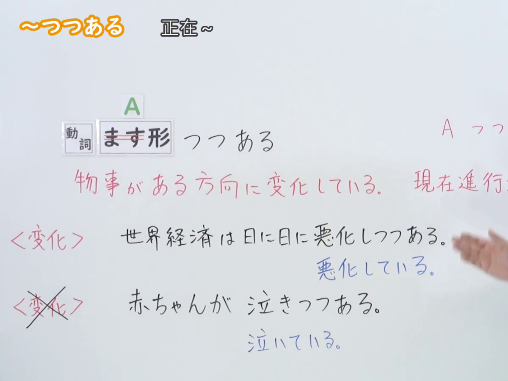
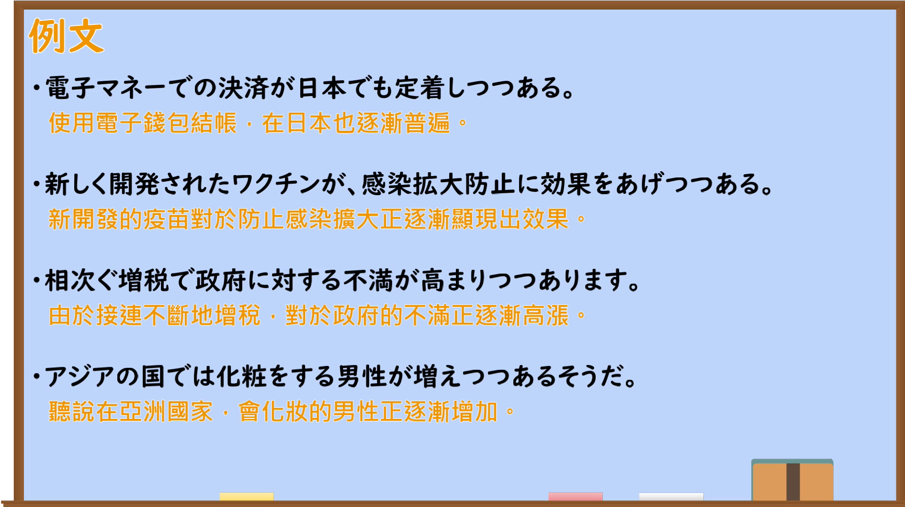

---
{
  "id": "N2-G-0036",
  "kind": "grammar",
  "level": "N2",
  "title": "～つつある：事物正朝某一方向变化",
  "card_revision": 1,
  "schema_version": 1,
  "source": {
    "lesson": "N2 第36个语法",
    "material": "出口日語原视频板书、日语自动字幕与毎日のんびり日本語教師正文",
    "video": "https://www.youtube.com/watch?v=YZFlUq8fruM",
    "screenshot": "assets/grammar/n2/N2-G-0036-connection.png",
    "screenshot_seconds": 60.0,
    "screenshot_crop": {
      "x": 0,
      "y": 0,
      "width": 1200,
      "height": 900
    }
  },
  "tags": [
    "～つつある",
    "变化进行",
    "N2"
  ],
  "confusions": [
    "～ている：可表示一般正在进行的动作或结果状态；～つつある聚焦于朝某一方向持续变化的过程",
    "～つつ／～つつも：分别表示同时进行或逆接，不等同于～つつある"
  ]
}
---

# N2 第36个语法：～つつある

# 视频学习资料整理

- 课程：[出口日語「【Ｎ２文法】～つつある」](https://www.youtube.com/watch?v=YZFlUq8fruM)
- 接续图：视频 60.00 秒；原图 `1920×1080`；从左上角固定裁切为 `(x=0, y=0, width=1200, height=900)`，保留接续、含义及正确／错误对照板书，裁去右侧讲师与多余画面。

- 例句图：视频 211.83 秒；原图 `1920×1080`；从左上角固定裁切为 `(x=0, y=0, width=1890, height=1060)`，保留四条例句，收拢右侧与底部边缘。

# 核心

## 功能一：事物正朝某一方向变化

**くわしい意味記述：**

- **～つつある：** 何らかの変化が一定の方向に進展していることを表します。基本的には、変化を表す動詞にしか接続できません。似た意味の文法に「～ている」があります。「死んでいる」は既に死んだ状態を表すのに対し、「死につつある」は死へと近づいていく様子を表せます。つまり「～つつある」は変化におけるある局面の短い時間を引き延ばしてそこフォーカスする機能があります。（表示某种变化正朝着一定方向发展。原则上只能接表示变化的动词。相近语法有「～ている」：「死んでいる」表示已经死亡的状态，而「死につつある」表示正在逐渐接近死亡。也就是说，「～つつある」具有把变化过程中的某个短暂阶段拉长，并聚焦于该阶段的功能。）

### 例句

1. 信頼してた人に裏切られて人間不信になりつつある。

   （遭到信任之人的背叛后，我正逐渐变得不再信任别人。）

2. 少し休んだおかげで体調が戻りつつある。

   （多亏稍微休息了一下，身体状况正在逐渐恢复。）

3. 最近早寝早起きが習慣化して定着しつつある。

   （最近早睡早起已成为习惯，并正逐渐稳定下来。）

4. 季節が変わりつつある。

   （季节正在逐渐更替。）

5. 職場でインフルエンザが流行りつつある。

   （流感正在公司里逐渐蔓延。）

# 来源

- [出口日語原视频「【Ｎ２文法】～つつある」](https://www.youtube.com/watch?v=YZFlUq8fruM)
- [毎日のんびり日本語教師「【Ｎ２文法】～つつある」](https://mainichi-nonbiri.com/grammar/n2-tutuaru/)（查询日期：2026-09-23）
