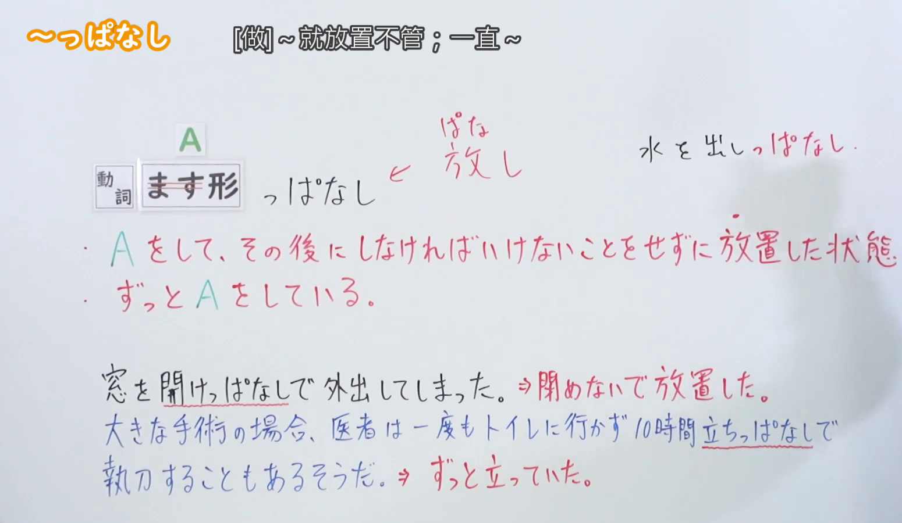
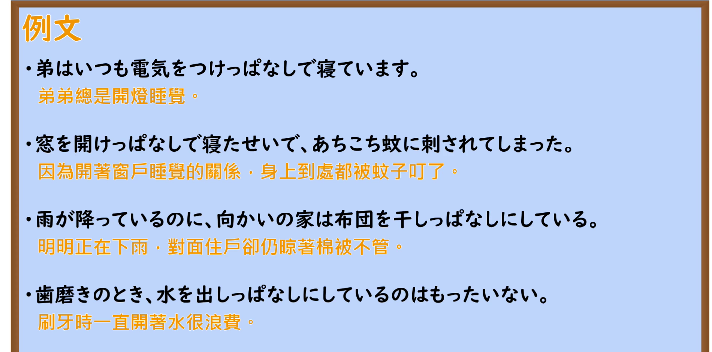

---
{
  "id": "N2-G-0037",
  "kind": "grammar",
  "level": "N2",
  "title": "～っぱなし：做完后放置不管；一直处于某种状态",
  "card_revision": 1,
  "schema_version": 1,
  "source": {
    "lesson": "N2 第37个语法",
    "material": "出口日語原视频板书、日语自动字幕与 Hagoromo 文型检索正文",
    "video": "https://www.youtube.com/watch?v=JUzdzmSNBnc",
    "screenshot": "assets/grammar/n2/N2-G-0037-connection.png",
    "screenshot_seconds": 80,
    "screenshot_crop": {
      "x": 0,
      "y": 0,
      "width": 1550,
      "height": 900
    }
  },
  "tags": [
    "っぱなし",
    "放置",
    "持续",
    "N2"
  ],
  "confusions": [
    "～たまま：也表示状态保持不变，但不一定含有说话人对疏忽、放任或持续过久的负面评价"
  ]
}
---

# N2 第37个语法：～っぱなし

# 视频学习资料整理

- 课程：[出口日語「【Ｎ２文法】～っぱなし」](https://www.youtube.com/watch?v=JUzdzmSNBnc)（视频 ID：`JUzdzmSNBnc`，时长：248 秒）。
- 接续图：原视频 `00:01:20.00`；原图 `1920×1080`，从左上角固定裁切为 `x=0, y=0, width=1550, height=900`。画面保留了 `Vます形＋っぱなし`、两项红色意义说明及板书例句；右侧人物与多余画面已尽量裁去。

  

- 例句图：原视频 `00:03:05.40`；原图 `1920×1080`，从左上角固定裁切为 `x=0, y=0, width=1900, height=940`。画面保留了四个课程例句及原视频中的中文提示。

  

# 核心

## 功能一：做了 A 之后，不做本来必须做的事，任其保持原状

**最上位意味カテゴリー：**

- **Vっぱなしだ：** 場所・時間（场所与时间）

**中位意味カテゴリー：**

- **Vっぱなしだ：** 限界・範囲（界限与范围）

**意味：**

- **Vっぱなしだ：** 範囲（范围）

**くわしい意味記述：**

- **Vっぱなしだ：** 「〜したままで，当然しなければならないことをしないでいる」という意味を表す。その状態が続くことを表す。マイナス評価になることが多い。（表示“做了某事后维持原状，没有去做理应完成的后续事项”。也表示该状态持续下去，多带有负面评价。）

**派生語：** 未列出

### 例句

1. 彼はドアを開けっぱなしで行ってしまった。

   （他没关门就走掉了。）

2. 息子の部屋に脱ぎっぱなしの靴下が落ちていた。

   （儿子的房间里扔着脱下来后就没收拾的袜子。）

3. たとえば、ＦＥＮの英語放送を一日中つけっぱなしにしておくのもいいでしょう。

   （例如，让 FEN 的英语广播开着播一整天也不错吧。）

4. 新しい制度も一度作ったら作りっぱなしにするのではなく、不断の改善努力を続けなければならない。

   （新制度一旦制定，也不能就此丢着不管，而必须不断努力改进。）

## 功能二：一直在做 A

**最上位意味カテゴリー：**

- **Vっぱなしだ：** 場所・時間（场所与时间）

**中位意味カテゴリー：**

- **Vっぱなしだ：** 限界・範囲（界限与范围）

**意味：**

- **Vっぱなしだ：** 範囲（范围）

**くわしい意味記述：**

- **Vっぱなしだ：** 「〜したままで，当然しなければならないことをしないでいる」という意味を表す。その状態が続くことを表す。マイナス評価になることが多い。（表示“做了某事后维持原状，没有去做理应完成的后续事项”。也表示该状态持续下去，多带有负面评价。）

**派生語：** 未列出

### 例句

1. さっきからずっと立ちっぱなしなんだよ。

   （从刚才起就一直站着呢。）

2. ぶっちゃけた話、いつも振られっぱなしなんだから。

   （说白了，我总是一直被人甩。）

3. 視線を避ける文化といっても、初めから終りまで他者の視線を避けっぱなしというのでは、わたしたちはお互いに、正常な人間関係を結ぶことは不可能である。

   （虽说是回避视线的文化，但如果从头到尾都一直避开他人的目光，我们彼此就不可能建立正常的人际关系。）

4. かなりの「プロ」ないしは熟練者とおぼしき中高年齢の男性が、ほとんど一日パチンコ台の前にすわりっぱなしになっているような状況におめにかかることもある。

   （有时也会看到这样的情形：看起来颇像职业玩家或熟练玩家的中老年男性，几乎一整天都坐在弹珠机前。）

# 来源

- [出口日語原视频](https://www.youtube.com/watch?v=JUzdzmSNBnc)
- [Hagoromo 文型检索「Vっぱなしだ」](https://www.hagoromo-text.work/lookup?vid=149)（查询日期：2026-09-23）
