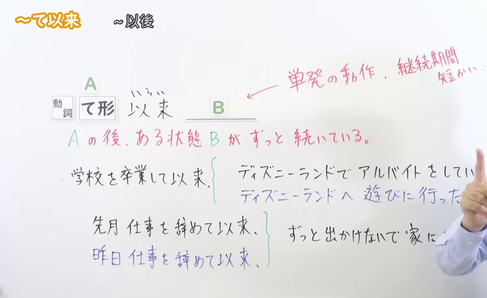
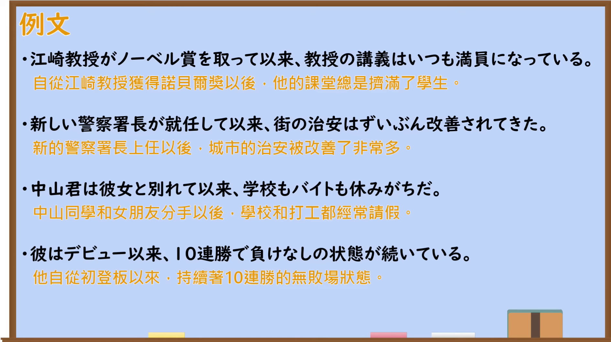

---
{
  "id": "N2-G-0038",
  "kind": "grammar",
  "level": "N2",
  "title": "～て以来／～以来：自从……以后一直……",
  "card_revision": 1,
  "schema_version": 1,
  "source": {
    "lesson": "N2 第38个语法",
    "material": "出口日語原视频板书、日语自动字幕与日本語NET正文",
    "video": "https://www.youtube.com/watch?v=m1B0UAdCyx4",
    "screenshot": "assets/grammar/n2/N2-G-0038-connection.png",
    "screenshot_seconds": 40.0,
    "screenshot_crop": {
      "x": 0,
      "y": 0,
      "width": 1500,
      "height": 920
    }
  },
  "tags": [
    "～て以来",
    "～以来",
    "持续状态",
    "N2"
  ],
  "confusions": [
    "～てから：可用于之后发生一次的动作；～て以来强调从过去某时点起一直持续到现在，不能用于后项只发生一次的动作",
    "～てからというもの：意思近似，但只接动词て形；～以来还可以直接接名词"
  ]
}
---

# N2 第38个语法：～て以来／～以来

# 视频学习资料整理

- 课程：[出口日語「[N2 Grammar] Since then」](https://www.youtube.com/watch?v=m1B0UAdCyx4)
- 接续图：视频 40.00 秒；原图 `1920×1080`；从左上角固定裁切为 `(x=0, y=0, width=1500, height=920)`，保留接续、核心含义及“一次性动作／持续时间过短”的限制板书。右缘仍有讲师手势，板书中的两条对比例句末尾在原画面中被讲师遮挡，未作补写或重绘。

- 例句图：视频 208.23 秒；原图 `1920×1080`；从左上角固定裁切为 `(x=0, y=0, width=1890, height=1060)`，保留四条例句，收拢右侧与底部边缘。

# 核心

## 功能一：在 A 之后，某种状态 B 一直持续

**くわしい意味記述：**

- **～て以来／～以来：** ～してから、今までずっと。「～てから」とだいたい同じ意味だが、「～て以来」は過去からずっと続いていることを表すので、後の行動が１回だけのことには使わない。近い過去から現在までのことを話す場合は使えない。未来のことを表すことができない。（表示从某事发生后一直持续到现在。意思与「～てから」大致相同，但「～て以来」表示从过去起一直持续，因此不能用于后项只发生一次的情况；也不能用于从很近的过去持续到现在的事情，或表示未来的事情。）

### 例句

1. 日本に来て以来、毎日家族にメールを送っている。

   （自从来到日本以后，我每天都给家人发邮件。）

2. 学校を卒業して以来、田中さんとは一度も会っていません。

   （自从学校毕业以后，我一次也没有见过田中先生。）

3. 一人暮らしを始めて以来、ずっと外食が続いている。

   （自从开始独自生活以后，我一直都在外面吃饭。）

4. 入社以来、彼とは毎日のように相談し合っている。

   （自从进入公司以来，我几乎每天都和他互相商量事情。）

5. この商品は、発売以来、多くのお客様に愛されてきました。

   （这款商品自上市以来，一直深受众多顾客喜爱。）

# 来源

- [出口日語原视频「[N2 Grammar] Since then」](https://www.youtube.com/watch?v=m1B0UAdCyx4)
- [日本語NET「【JLPT N2】文法・例文：〜以来」](https://nihongokyoshi-net.com/2018/03/27/jlptn2-grammar-irai)（查询日期：2026-09-23）
