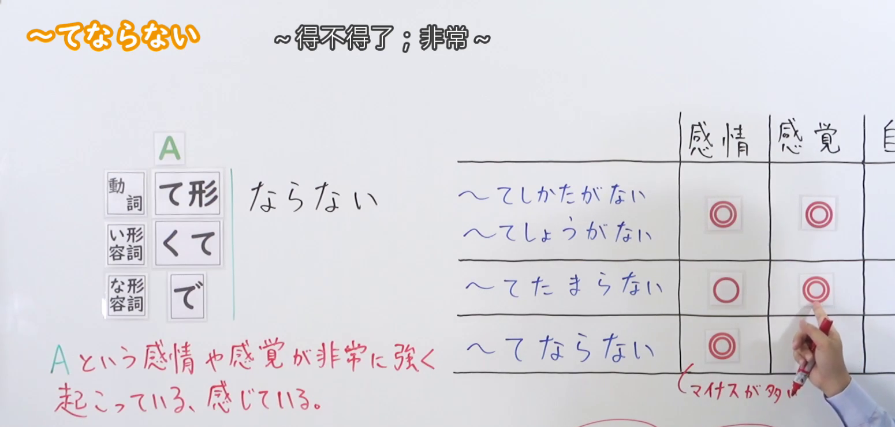
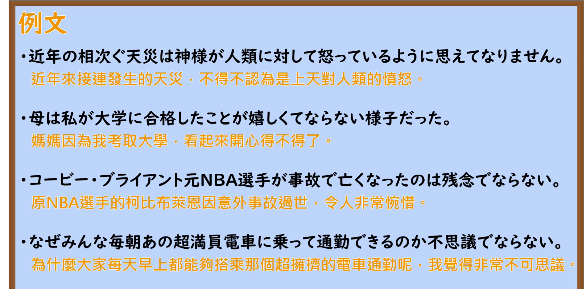

---
{
  "id": "N2-G-0039",
  "kind": "grammar",
  "level": "N2",
  "title": "～てならない：强烈得无法抑制",
  "card_revision": 1,
  "schema_version": 1,
  "source": {
    "lesson": "N2 第39个语法",
    "material": "出口日語原视频板书、日语自动字幕与 Hagoromo 文型检索正文",
    "video": "https://www.youtube.com/watch?v=R1wsk7Vwp4o",
    "screenshot": "assets/grammar/n2/N2-G-0039-connection.png",
    "screenshot_seconds": 210,
    "screenshot_crop": {
      "x": 0,
      "y": 0,
      "width": 1550,
      "height": 740
    }
  },
  "tags": [
    "てならない",
    "感情",
    "感觉",
    "N2"
  ],
  "confusions": [
    "～てしかたがない／～てしょうがない：同样表示无法抑制，使用范围更广，口语感也更强",
    "～てたまらない：主要表示强烈的感情或身体感觉，通常不用于自发产生的判断"
  ]
}
---

# N2 第39个语法：～てならない

# 视频学习资料整理

- 课程：[出口日語「～てならない」](https://www.youtube.com/watch?v=R1wsk7Vwp4o)（视频 ID：`R1wsk7Vwp4o`，时长：431 秒）。
- 接续图：原视频 `00:03:30.00`；原图 `1920×1080`，从左上角固定裁切为 `x=0, y=0, width=1550, height=740`。画面保留了三类接续、红色意义说明，以及与 `～てしかたがない`、`～てしょうがない`、`～てたまらない` 的比较表；右侧人物和下方多余板书已尽量裁去。

  

- 例句图：原视频 `00:06:06.08`；原图 `1920×1080`，从左上角固定裁切为 `x=0, y=0, width=1900, height=940`。画面保留了四个课程例句及原视频中的中文提示。

  

# 核心

## 功能一：A 这种感情或感觉非常强烈地涌现、被感受到

**最上位意味カテゴリー：**

- **てならない：** 考え・感情（想法与感情）

**中位意味カテゴリー：**

- **てならない：** 避けられない心情・行動（无法避免的心情与行为）

**意味：**

- **てならない：** 心情（心情）

**くわしい意味記述：**

- **てならない：** ある感情や感覚が自然に起こってきて抑えられないという話し手の状態を表す。（表示说话人的某种感情或感觉自然产生，并且无法抑制的状态。）

**派生語：** 未列出

### 例句

1. 給与が下がってしまい、悲しくてならない。

   （工资降了，难过得不得了。）

2. 折角チケットを買ったのに、コンサートが中止になって残念でならない。

   （好不容易买了票，演唱会却取消了，实在遗憾得不得了。）

3. 働くことが面白くないからこそ、逆に一瞬の閃光のように輝いて過ぎる「面白さ」が気になってならないのだ。

   （正因为工作本身并不有趣，反而无法不在意那种如一瞬闪光般绽放后即逝的“趣味”。）

4. 犯行の裏に、強い憎しみが感じられてならない。

   （总让人强烈地感觉到，这起犯罪背后有深深的憎恨。）

# 来源

- [出口日語原视频](https://www.youtube.com/watch?v=R1wsk7Vwp4o)
- [Hagoromo 文型检索「てならない」](https://www.hagoromo-text.work/lookup?vid=833)（查询日期：2026-09-23）
