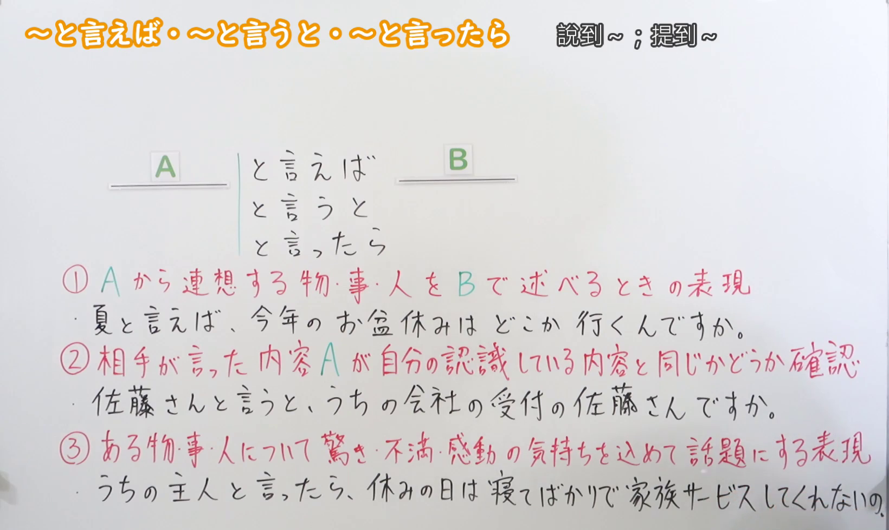
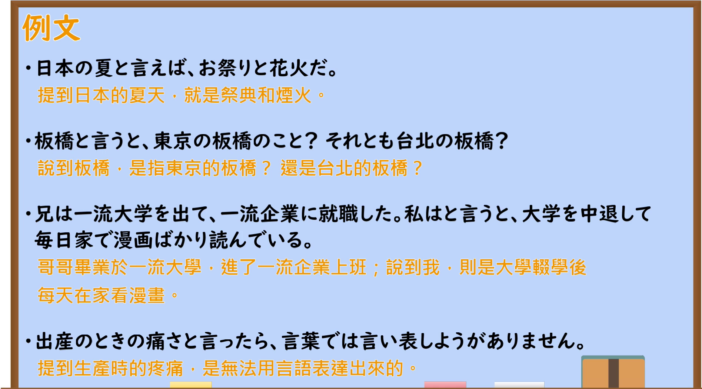

---
{
  "id": "N2-G-0040",
  "kind": "grammar",
  "level": "N2",
  "title": "といえば・というと・といったら｜说到、提到",
  "card_revision": 1,
  "schema_version": 1,
  "source": {
    "lesson": "N2 第40个语法",
    "material": "出口日語原视频板书、日语自动字幕与日本語NET、Japanese Exercises、日本語教育ナビ正文",
    "video": "https://www.youtube.com/watch?v=kyUkRNbNZt4",
    "screenshot": "assets/grammar/n2/N2-G-0040-connection.png",
    "screenshot_seconds": 193,
    "screenshot_crop": {"x": 0, "y": 0, "width": 1640, "height": 980}
  },
  "tags": ["といえば", "というと", "といったら", "N2"],
  "confusions": ["联想用法与というと的确认用法", "といったら的感情强调用法"]
}
---

# N2 第40个语法：といえば・というと・といったら

# 视频学习资料整理

- 课程：[出口日語原视频](https://www.youtube.com/watch?v=kyUkRNbNZt4)（时长 5:33）。
- 接续与讲解板书：原视频 3:13（193 秒）；原图 1920×1080，固定左上角裁切区域 x=0、y=0、宽=1640、高=980。0:01 画面中的教师遮挡部分板书，因此改用此帧；保留三种形式及三条完整的红色用法说明。原画面右侧教师遮挡第三条下方例句的末尾，未据此补写文字。

- 课程例句页：原视频 4:20（260 秒）；原图 1920×1080，固定左上角裁切区域 x=0、y=0、宽=1895、高=1050。保留四句日语例句和画面原有中文译文。

# 核心

## 功能一：把从 A 联想到的物、事或人用 B 表述

**くわしい意味記述：**

- **といえば（日本語NET）：** Ｎ２は、Ｎ１と聞いて、すぐに連想できる物や事柄。話題の提供や、話の切り替え時に使用されることが多い。（N2 是听到 N1 后立刻联想到的事物；这一形式也常用于引出话题或转换话题。）
- **というと（Japanese Exercises）：** その言葉から～をイメージする（由那个词联想到某事物。）
- **といったら（日本語NET）：** N1といったらN2：N1と聞いたり、見たりすると、すぐにN2を連想する。（说到 N1 就会想到 N2：听到或看到 N1 时，立刻联想到 N2。）

### 例句

1. 日本の春といえば、桜だろう。

   （说到日本的春天，应该就是樱花吧。）

2. 日本の料理というと、やっぱり寿司だよね。

   （说到日本料理，果然还是寿司吧。）

3. 日本の夏といったら、やっぱり花火大会だよね。

   （说到日本的夏天，果然还是烟花大会吧。）

## 功能二：确认对方所说的 A 是否与自己的理解相同

**くわしい意味記述：**

- **というと（日本語教育ナビ）：** 相手の発言を受けて、それが自分が思っている内容と同じかを確かめるときに使われます。（接住对方的话，确认其所说内容是否与自己理解的一致时使用。）

### 例句

1. 佐藤さんというと、先月入社した佐藤さんのことですか？

   （你说的佐藤先生，是上个月入职的那位佐藤先生吗？）

2. 修正ができないというと、もう原稿が完成しているのでしょうか？

   （你说不能修改，是指稿件已经定稿了吗？）

3. 来週というと、具体的には何日のことですか。

   （你说下周，具体是指哪一天？）

## 功能三：带着惊讶、不满或感动的心情提起某物、某事或某人

**くわしい意味記述：**

- **といったら（日本語NET）：** 驚きや、感動した気持ちの程度を話題にするときに使う。（谈及惊讶或感动的心情达到何种程度时使用。）

### 例句

1. 富士山の頂上から見た日の出の美しさといったら、今でも忘れられません。

   （从富士山顶看到的日出美得令人难忘，至今仍记忆犹新。）

2. このお店のハンバーグの美味しさといったら、言葉では表現できません。

   （这家店的汉堡肉排美味得无法用言语形容。）

3. 日本の朝の電車といったら、人が多すぎて動けないほどだ。

   （说起日本的早班电车，人多得连动都动不了。）

# 来源

- [出口日語原视频](https://www.youtube.com/watch?v=kyUkRNbNZt4)
- [日本語NET「〜といえば」](https://nihongokyoshi-net.com/2018/04/27/jlptn3-grammar-toieba/)（联想用法；查询日期：2026-09-23）
- [日本語NET「〜といったら」](https://nihongokyoshi-net.com/2019/05/30/jlptn2-grammar-toittara/)（联想与感情强调用法；查询日期：2026-09-23）
- [Japanese Exercises「〜といえば／というと／といったら」](https://japaneseexercises.com/2023/06/29/%E3%80%90jlpt-n3-%EF%BD%9E%E3%81%A8%E3%81%84%E3%81%88%E3%81%B0%EF%BC%8F%E3%81%A8%E3%81%84%E3%81%86%E3%81%A8%EF%BC%8F%E3%81%A8%E3%81%84%E3%81%A3%E3%81%9F%E3%82%89%E3%80%80%E6%96%87%E6%B3%95%E8%A7%A3/)（というと的联想用法；查询日期：2026-09-23）
- [日本語教育ナビ「確認を表す『というと』」](https://japanese-language-education.com/for-overseas-learners/toiuto-kakunin/)（确认用法；查询日期：2026-09-23）