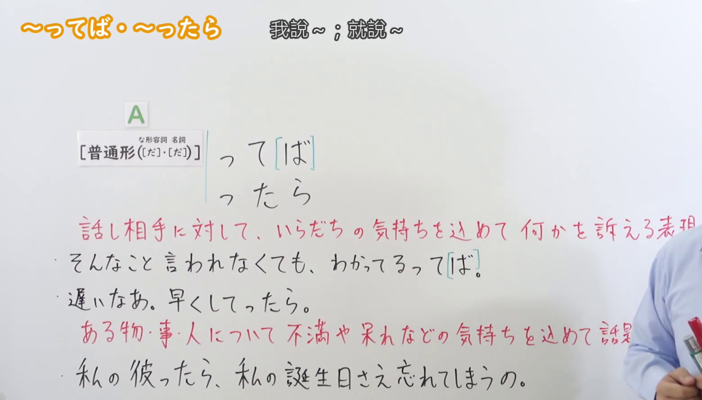
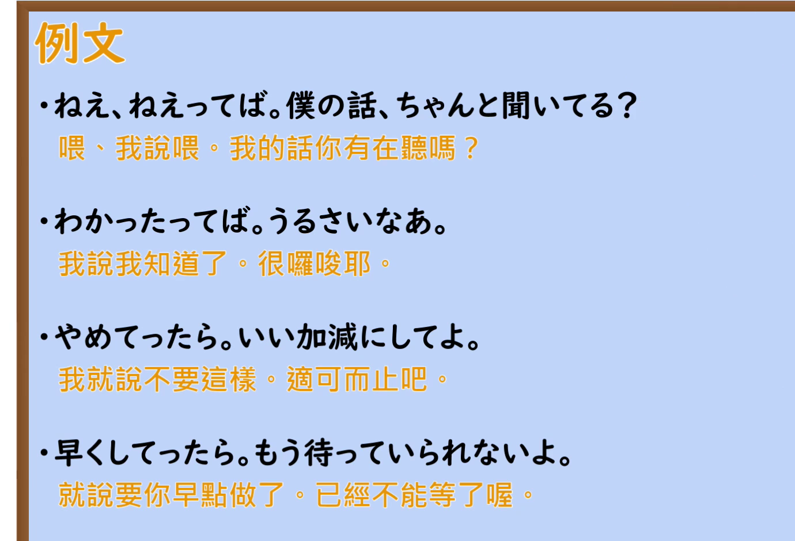

---
{
  "id": "N2-G-0041",
  "kind": "grammar",
  "level": "N2",
  "title": "～ってば・～ったら（含着焦躁的情绪向对方诉求／怀着不满、无奈把某人某事当作话题）",
  "card_revision": 1,
  "schema_version": 1,
  "source": {
    "lesson": "N2 第41个语法",
    "material": "出口日語原视频板书、日语自动字幕与Hagoromo文型検索正文",
    "video": "https://www.youtube.com/watch?v=CePgw4ytv6s",
    "screenshot": "assets/grammar/n2/N2-G-0041-connection.png",
    "screenshot_seconds": 90.65,
    "screenshot_crop": {
      "x": 0,
      "y": 0,
      "width": 1560,
      "height": 890
    }
  },
  "tags": [
    "ってば",
    "ったら",
    "口语终助词",
    "N2"
  ],
  "confusions": [
    "「～たら」（仮定条件の「たら」）",
    "「～といったら」（と同じく話題提示だが，感動・驚きの気持ちを込める）",
    "「～てば／～ってば」と「～ってよ／～てよ」（同じく強い要求だが，後者は相手への要求だけを表す）"
  ]
}
---

# N2 第41个语法：～ってば・～ったら

## 视频学习资料整理

本课没有学习者个人输出，以下直接整理原视频材料。

- 原视频：[出口日語 第41个语法 ～ってば・～ったら](https://www.youtube.com/watch?v=CePgw4ytv6s)
- 接续图：截取自原视频 **1:30.65**（0:01 的画面中老师头部遮住第一条红色说明末尾的「表現」，故改用整块板书都可见的时点）。原图 1920×1080，裁切区域 x=0, y=0, 宽 1560, 高 890。第二条红色说明的结尾部分被老师身体遮挡，无法从画面确认。
- 例句图：截取自原视频 **2:50.00** 的「例文」页。原图 1920×1080，裁切区域 x=0, y=0, 宽 1380, 高 940。

# 核心

## 功能一：对听话对象怀着焦躁的情绪倾诉诉求的表达

**最上位意味カテゴリー：**

- **ってば：** 考え・感情（思想与感情）

**中位意味カテゴリー：**

- **ってば：** 主張・断定的評価（主张与断定性的评价）

**意味：**

- **ってば：** 主張（主张）

**くわしい意味記述：**

- **ってば：** 話し手が強く主張するときに使う。相手を非難する気持ちを表すことが多い。くだけた話し言葉。（说话人强烈主张时使用。多用来表达责备对方的心情。是随便的口语表达。）

**派生語：** 未列出

### 例句

1. 母：電車に間に合うの？　子：だから、急いでるんだってば。

   （妈妈：赶得上电车吗？　孩子：所以我不是说了我在赶时间嘛。）

2. だめだってば。

   （我说了不行嘛。）

3. そういう使い方しないんだってば。

   （我说了不是那样用的嘛。）

## 功能二：对某物、某事或某人怀着不满、无奈等情绪将其作为话题谈论时的表达

**最上位意味カテゴリー：**

- **ったら：** ものごとの関係（事物之间的关系）

**中位意味カテゴリー：**

- **ったら：** 話題（话题）

**意味：**

- **ったら：** 主題（主题）

**くわしい意味記述：**

- **ったら：** 相手も知っている物事をとりあげ，その属性を述べる。くだけた話し言葉だが，上品な印象で現実にはあまり使われない。（提出对方也知道的事物，叙述它的属性。是随便的口语表达，但给人优雅的印象，现实中不太使用。）

**派生語：** 未列出

### 例句

1. 田中先生ったら、本当にいつも冗談が多いよね。

   （田中老师呀，真是老爱开玩笑呢。）

2. 満男ったら本堂でチャンバラなんかして、御前様にしかられてんのよ

   （满男呀，在本堂里玩什么打打杀杀，被老爷骂了呢。）

3. その女の顔ったら、こんな顔しちゃってさ、フランスの洋服、着てんだけど、ぜんぜん似合わないんだから

   （那女人的脸呀，摆出这副样子，穿着法国衣服，可一点都不相称呢。）

# 来源

- [出口日語 第41个语法 ～ってば・～ったら 原视频](https://www.youtube.com/watch?v=CePgw4ytv6s)
- [Hagoromo 文型検索「ってば」](https://www.hagoromo-text.work/lookup?vid=786)（查询日期：2026-09-23）
- [Hagoromo 文型検索「ったら」](https://www.hagoromo-text.work/lookup?vid=776)（查询日期：2026-09-23）
