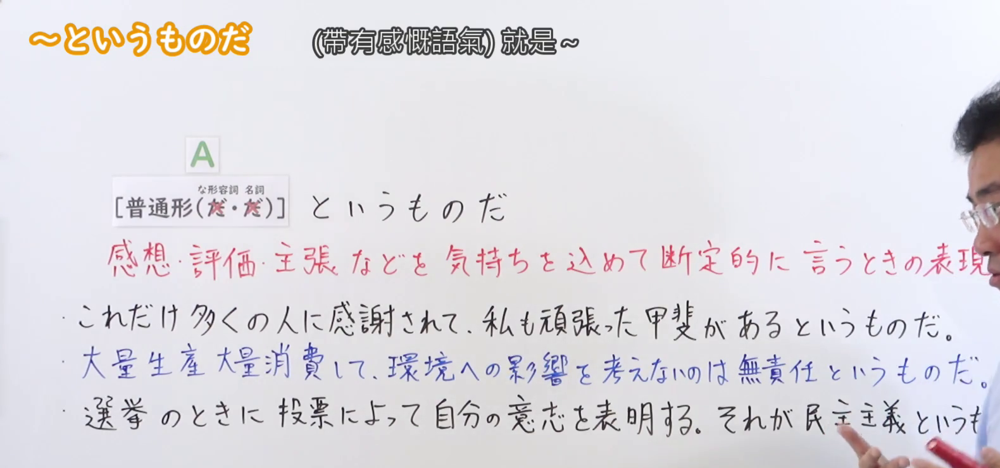
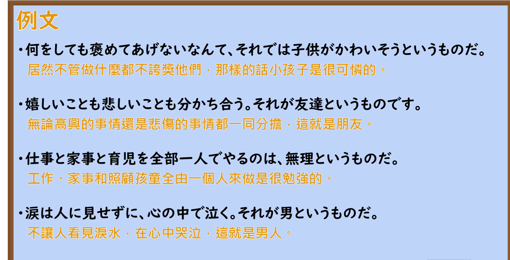

---
{
  "id": "N2-G-0042",
  "kind": "grammar",
  "level": "N2",
  "title": "～というものだ（带有感慨语气：把感想、评价、主张等断定地说出来）",
  "card_revision": 1,
  "schema_version": 1,
  "source": {
    "lesson": "N2 第42个语法",
    "material": "出口日語原视频板书、日语自动字幕与Hagoromo文型検索正文",
    "video": "https://www.youtube.com/watch?v=fjCnCn3XeMM",
    "screenshot": "assets/grammar/n2/N2-G-0042-connection.png",
    "screenshot_seconds": 135.0,
    "screenshot_crop": {
      "x": 0,
      "y": 0,
      "width": 1580,
      "height": 740
    }
  },
  "tags": [
    "というものだ",
    "断定的評価",
    "形式名詞",
    "N2"
  ],
  "confusions": [
    "「～ものだ」（同じ「もの」を使うが，感嘆・本性・回想などを表す）",
    "「～ということだ」（伝聞や結論の要約を表し，断定の主張ではない）",
    "「～というものではない」（全体を否定する言い方で，意味が異なる）"
  ]
}
---

# N2 第42个语法：～というものだ

## 视频学习资料整理

本课没有学习者个人输出，以下直接整理原视频材料。

- 原视频：[出口日語 第42个语法 ～というものだ](https://www.youtube.com/watch?v=fjCnCn3XeMM)
- 接续图：截取自原视频 **2:15.00**（0:01 的画面中老师头部遮住红色说明末尾的「の表現」，故改用整块板书都可见的时点）。原图 1920×1080，裁切区域 x=0, y=0, 宽 1580, 高 740。第三条例句「それが民主主義というものだ。」的末尾「のだ。」被老师手臂遮挡，无法从画面确认。
- 例句图：截取自原视频 **2:32.00** 的「例文」页。原图 1920×1080，裁切区域 x=0, y=0, 宽 1880, 高 960。

# 核心

## 功能一：带着感情，把感想、评价、主张等断定地说出来时的表达

**最上位意味カテゴリー：**

- **というものだ：** 考え・感情（思想与感情）

**中位意味カテゴリー：**

- **というものだ：** 主張・断定的評価（主张与断定性的评价）

**意味：**

- **というものだ：** 評価（评价）

**くわしい意味記述：**

- **というものだ：** ある事実や状況について，話し手が断定的に意見や考えを言うときに使う。（针对某个事实或状况，说话人断定地说出自己的意见或想法时使用。）

**派生語：** 未列出

### 例句

1. これでは不公平というものだ。

   （这样可就太不公平了。）

2. 遅く来て、いい席に座ろうなんて、自分勝手というものだ。

   （来晚了还想坐好位子，这太自私了。）

3. 困ったときには助け合う、それが人間というものだ。

   （遇到困难时互相帮助，这才是人。）

# 来源

- [出口日語 第42个语法 ～というものだ 原视频](https://www.youtube.com/watch?v=fjCnCn3XeMM)
- [Hagoromo 文型検索「というものだ」](https://www.hagoromo-text.work/lookup?vid=927)（查询日期：2026-09-23）
