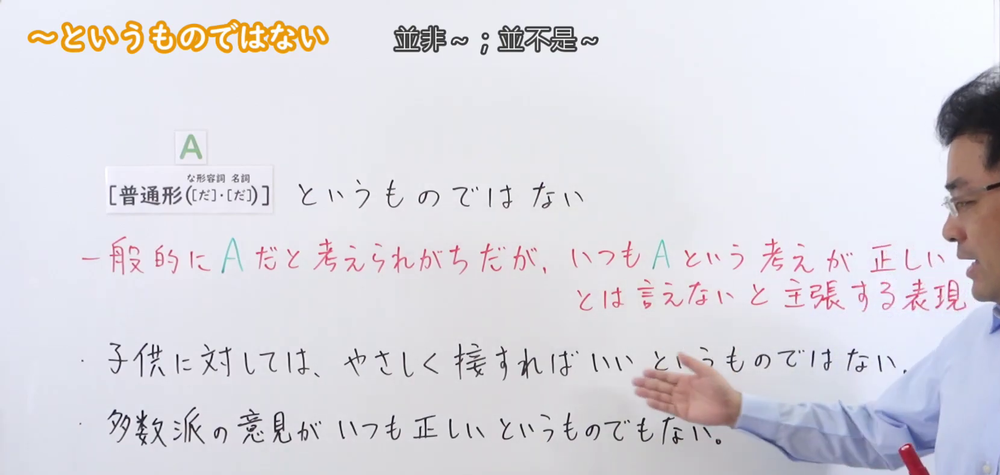
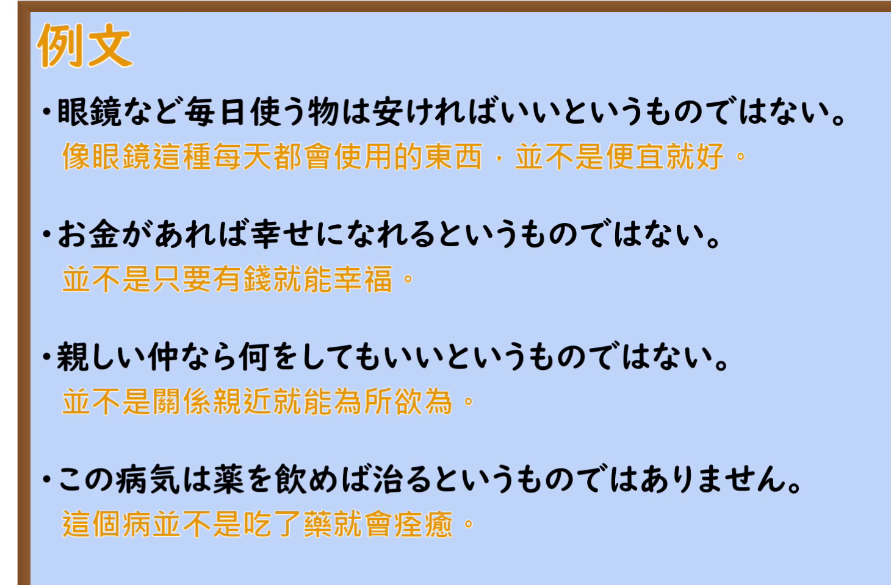

---
{
  "id": "N2-G-0043",
  "kind": "grammar",
  "level": "N2",
  "title": "～というものではない（并非～；并不是说～）",
  "card_revision": 1,
  "schema_version": 1,
  "source": {
    "lesson": "N2 第43个语法",
    "material": "出口日語原视频板书、日语自动字幕与Hagoromo文型検索正文",
    "video": "https://www.youtube.com/watch?v=vtDaCeCqZtY",
    "screenshot": "assets/grammar/n2/N2-G-0043-connection.png",
    "screenshot_seconds": 80.0,
    "screenshot_crop": {
      "x": 0,
      "y": 0,
      "width": 1660,
      "height": 790
    }
  },
  "tags": [
    "というものではない",
    "部分否定",
    "形式名詞",
    "N2"
  ],
  "confusions": [
    "「～というものだ」（同形の肯定表現で，断定的に主張する）",
    "「～というものでもない」（Hagoromo で派生語とされる，より婉曲な部分否定）",
    "「～わけではない」（部分否定を表す別の形式）"
  ]
}
---

# N2 第43个语法：～というものではない

## 视频学习资料整理

本课没有学习者个人输出，以下直接整理原视频材料。

- 原视频：[出口日語 第43个语法 ～というものではない](https://www.youtube.com/watch?v=vtDaCeCqZtY)
- 接续图：截取自原视频 **1:20.00**（0:01 的画面中老师头部遮住红色说明第一行末尾的「が正しい」，故改用整块板书都可见的时点）。原图 1920×1080，裁切区域 x=0, y=0, 宽 1660, 高 790。
- 例句图：截取自原视频 **3:12.04** 的「例文」页。原图 1920×1080，裁切区域 x=0, y=0, 宽 1460, 高 960。

# 核心

## 功能一：对通常容易被认为A的情况，主张并不总是A这种想法就正确的表达

**最上位意味カテゴリー：**

- **というものではない：** ものごとの様子（事物的样态）

**中位意味カテゴリー：**

- **というものではない：** 否定（否定）

**意味：**

- **というものではない：** 部分否定（部分否定）

**くわしい意味記述：**

- **というものではない：** 「〜というものではない」の「〜」の部分を，遠回しに否定する時に使う。「いつも必ず〜とはいえない」という意味。（用于委婉地否定「〜というものではない」中「〜」的部分。意思是「并不总是、并非一定～」。）

**派生語：** というものでもない

### 例句

1. 長く生きればよいというものではない。生活の質が大切だ。

   （并不是活得久就好。生活的质量很重要。）

2. 食べ物はたくさんあればよいというものでもない。食べすぎは体に良くない。

   （食物并不是越多越好。吃太多对身体不好。）

3. しかし、ただ削減すればいい、というものではない。

   （但是，并不是削减就好。）

4. 国際的な仕事というのは、なんといっても人と人との直接接触が前提となるのである。そして、これはだれでもできるというものではない。

   （所谓国际性的工作，不管怎么说都以人与人之间的直接接触为前提。而且，这并不是谁都能做的。）

# 来源

- [出口日語 第43个语法 ～というものではない 原视频](https://www.youtube.com/watch?v=vtDaCeCqZtY)
- [Hagoromo 文型検索「というものではない」](https://www.hagoromo-text.work/lookup?vid=928)（查询日期：2026-09-23）
