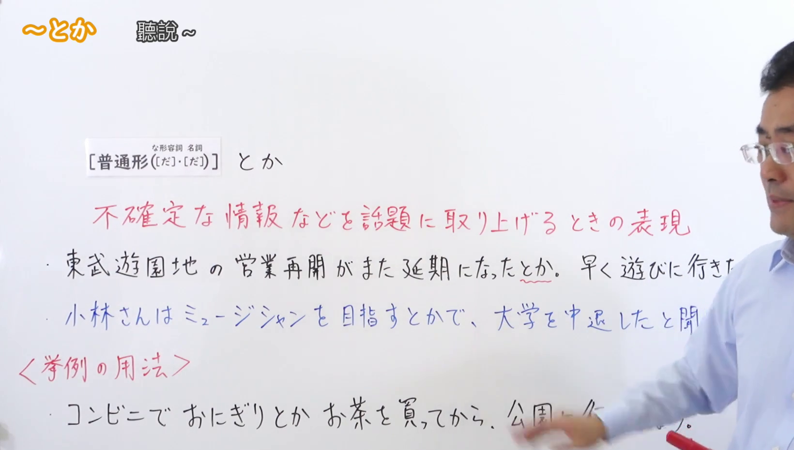
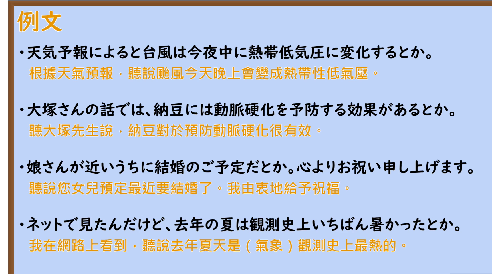

---
{
  "id": "N2-G-0044",
  "kind": "grammar",
  "level": "N2",
  "title": "～とか（听说～：把不确定的信息等作为话题提出来的表达）",
  "card_revision": 1,
  "schema_version": 1,
  "source": {
    "lesson": "N2 第44个语法",
    "material": "出口日語原视频板书、日语自动字幕与Hagoromo文型検索正文",
    "video": "https://www.youtube.com/watch?v=EDDW1yBK_YA",
    "screenshot": "assets/grammar/n2/N2-G-0044-connection.png",
    "screenshot_seconds": 90.0,
    "screenshot_crop": {
      "x": 0,
      "y": 0,
      "width": 1640,
      "height": 930
    }
  },
  "tags": [
    "とか",
    "とかで",
    "伝聞",
    "N2"
  ],
  "confusions": [
    "「～とか」（初級で習う例示の用法で，名詞などを並べる。本課の伝聞の用法とは別）",
    "「～とかいう」（名詞について，聞いた内容を人に伝える別の形式）",
    "「～とかいうことだ」（聞いた内容が不確かであることを表す別の形式）"
  ]
}
---

# N2 第44个语法：～とか

## 视频学习资料整理

本课没有学习者个人输出，以下直接整理原视频材料。

- 原视频：[出口日語 第44个语法 ～とか](https://www.youtube.com/watch?v=EDDW1yBK_YA)
- 接续图：截取自原视频 **1:30.00**（0:01 的画面中老师身体挡住例句右半部分，故改用遮挡相对最少的时点）。原图 1920×1080，裁切区域 x=0, y=0, 宽 1640, 高 930。三条例句超出可见范围的部分（第一条例句的「…行きたいな。」、第二条例句的「…と聞きました。」、第三条例句的「…行きましょう」）在本课画面中始终被老师身体遮挡，无法从画面确认。
- 例句图：截取自原视频 **3:19.24** 的「例文」页。原图 1920×1080，裁切区域 x=0, y=0, 宽 1720, 高 960。

# 核心

## 功能一：把不确定的信息等作为话题提出时的表达

**最上位意味カテゴリー：**

- **とか：** ものごとの関係（事物之间的关系）
- **とかで：** ものごとの関係（事物之间的关系）

**中位意味カテゴリー：**

- **とか：** 伝聞・引用（传闻与引用）
- **とかで：** 原因・理由（原因与理由）

**意味：**

- **とか：** 伝聞（传闻）
- **とかで：** 原因・理由（原因与理由）

**くわしい意味記述：**

- **とか：** 伝聞を表す。私的な文脈で用いられることが多い。（表示传闻。多用于私人性的语境。）
- **とかで：** 「〜という理由で」という意味。人から聞いたことを言うときに使う。くだけた表現で，話し言葉でよく使う。（意思是「以〜为理由」。用于转述从别人那里听来的事。是随便的表达，常用于口语。）

**派生語：** とか：未列出／とかで：未列出

### 例句

1. 北海道は昨日大雪だったとか。

   （听说北海道昨天下了大雪。）

2. 列車事故があったとかで、運転中止が続いている。

   （听说是发生了列车事故，所以一直停运。）

3. そしたらゴルフに行ってなさるとかで。

   （结果听说是去打高尔夫了。）

4. 本堂が修理中とかで３分の１くらいは見れず…

   （听说是正殿正在维修，大约三分之一看不到……）

# 来源

- [出口日語 第44个语法 ～とか 原视频](https://www.youtube.com/watch?v=EDDW1yBK_YA)
- [Hagoromo 文型検索「とか」](https://www.hagoromo-text.work/lookup?vid=977)（查询日期：2026-09-23）
- [Hagoromo 文型検索「とかで」](https://www.hagoromo-text.work/lookup?vid=983)（查询日期：2026-09-23）
