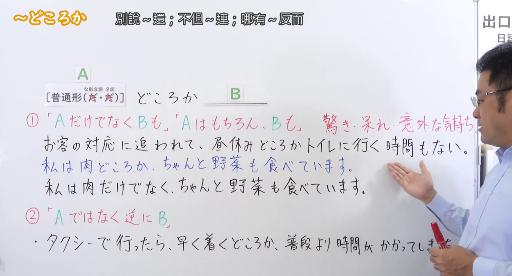
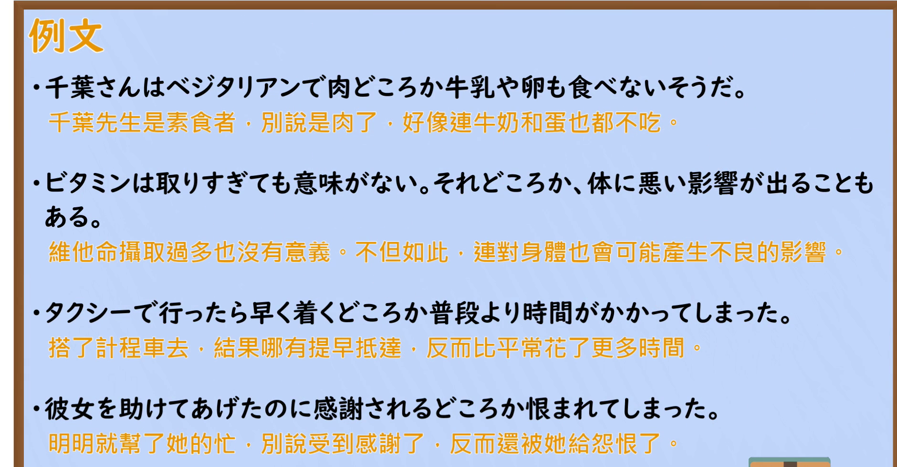

---
{
  "id": "N2-G-0045",
  "kind": "grammar",
  "level": "N2",
  "title": "～どころか（不仅是A、B也／不是A，反而是B）",
  "card_revision": 1,
  "schema_version": 1,
  "source": {
    "lesson": "N2 第45个语法",
    "material": "出口日語原视频板书、日语自动字幕与Hagoromo文型検索正文",
    "video": "https://www.youtube.com/watch?v=ub6r4TY5K60",
    "screenshot": "assets/grammar/n2/N2-G-0045-connection.png",
    "screenshot_seconds": 50.0,
    "screenshot_crop": {
      "x": 0,
      "y": 0,
      "width": 1760,
      "height": 950
    }
  },
  "tags": [
    "どころか",
    "それどころか",
    "対比",
    "N2"
  ],
  "confusions": [
    "「～だけでなく」（単純な添加で，驚き・呆れ・意外の気持ちを込めない）",
    "「～ばかりか」（同様の添加・逆接を表す別の形式）",
    "「～どころではない」（「〜している余裕はない」という別の意味になる）"
  ]
}
---

# N2 第45个语法：～どころか

## 视频学习资料整理

本课没有学习者个人输出，以下直接整理原视频材料。

- 原视频：[出口日語 第45个语法 ～どころか](https://www.youtube.com/watch?v=ub6r4TY5K60)
- 接续图：截取自原视频 **0:50.00**（0:01 的画面中老师身体挡住第①条红色说明与例句，故改用遮挡最少的时点）。原图 1920×1080，裁切区域 x=0, y=0, 宽 1760, 高 950。②的下方例句末尾「…かかってしまった」的「った」在全部取样画面中都被老师手中的笔遮挡，无法从画面确认。
- 例句图：截取自原视频 **3:33.03** 的「例文」页。原图 1920×1080，裁切区域 x=0, y=0, 宽 1880, 高 980。

# 核心

## 功能一：不仅是A、B也／A自不必说、B也（带着惊讶、无奈、意外的心情）

**最上位意味カテゴリー：**

- **どころか：** ものごとの関係（事物之间的关系）
- **それどころか：** ものごとの関係（事物之间的关系）

**中位意味カテゴリー：**

- **どころか：** 対比（对比）
- **それどころか：** 対比（对比）

**意味：**

- **どころか：** 対比（对比）
- **それどころか：** 対比（对比）

**くわしい意味記述：**

- **どころか：** 「それだけでなく，他にもある」「そんなことでは済まずに，逆に」「かえって」という意味を表す。「それどころか」といった表現もある。（表示「不仅是那样，还有其他」「不会就此了结，反而」「反倒」的意思。也有「それどころか」这样的说法。）
- **それどころか：** 「それだけでなく，他にもある」「さらに」，「そんなことでは済まずに，逆に」「かえって」という意味を表す。同じようなことを付け加えていくが，後のほうが程度が激しいことを表す表現。「そればかりか」「それだけでなく」といった言い方もある。（表示「不仅是那样，还有其他」「进一步」，「不会就此了结，反而」「反倒」的意思。是不断添加同类内容、后半程度更激烈的表达。也有「そればかりか」「それだけでなく」这样的说法。）

**派生語：** どころか：未列出／それどころか：未列出

### 例句

1. 彼は漢字どころかひらがなも書けない。

   （他别说汉字了，连平假名都不会写。）

2. それどころかこの頃は顔も見せない。

   （岂止如此，最近连面都不露了。）

3. それどころか、憲法改正を口にすること自体がタブーであるかのような政治的・社会的雰囲気が続いた。

   （岂止如此，当时持续着一种仿佛连提修宪本身就属于禁忌的政治与社会氛围。）

## 功能二：不是A，反而是B

**最上位意味カテゴリー：**

- **どころか：** ものごとの関係（事物之间的关系）
- **それどころか：** ものごとの関係（事物之间的关系）

**中位意味カテゴリー：**

- **どころか：** 対比（对比）
- **それどころか：** 対比（对比）

**意味：**

- **どころか：** 対比（对比）
- **それどころか：** 対比（对比）

**くわしい意味記述：**

- **どころか：** 「それだけでなく，他にもある」「そんなことでは済まずに，逆に」「かえって」という意味を表す。「それどころか」といった表現もある。（表示「不仅是那样，还有其他」「不会就此了结，反而」「反倒」的意思。也有「それどころか」这样的说法。）
- **それどころか：** 「それだけでなく，他にもある」「さらに」，「そんなことでは済まずに，逆に」「かえって」という意味を表す。同じようなことを付け加えていくが，後のほうが程度が激しいことを表す表現。「そればかりか」「それだけでなく」といった言い方もある。（表示「不仅是那样，还有其他」「进一步」，「不会就此了结，反而」「反倒」的意思。是不断添加同类内容、后半程度更激烈的表达。也有「そればかりか」「それだけでなく」这样的说法。）

**派生語：** どころか：未列出／それどころか：未列出

### 例句

1. それどころか、民衆娯楽の王座をしめるゲームとしてますます隆盛をほこっているのである。

   （岂止没有消亡，作为占据民众娱乐王座的游戏反而越来越兴盛。）

2. 否、それどころか、かえってこの宇宙時代においてこそ、神と仏のテーマはよりいっそう切実な意味をおびてわれわれに迫ってくるのではないであろうか。

   （不，岂止如此，反而正是在这个宇宙时代，神与佛的主题才带着更加切实的意义逼近我们。）

3. それどころか会談後の西ベルリンは、東ベルリンからの亡命者がふえるにつれて過熱状態となり、戦争の危険さえ高まってきた。

   （岂止如此，会谈后的西柏林随着来自东柏林的逃亡者增多而陷入过热状态，甚至连战争的危险都升高了。）

# 来源

- [出口日語 第45个语法 ～どころか 原视频](https://www.youtube.com/watch?v=ub6r4TY5K60)
- [Hagoromo 文型検索「どころか」](https://www.hagoromo-text.work/lookup?vid=995)（查询日期：2026-09-23）
- [Hagoromo 文型検索「それどころか」](https://www.hagoromo-text.work/lookup?vid=647)（查询日期：2026-09-23）
