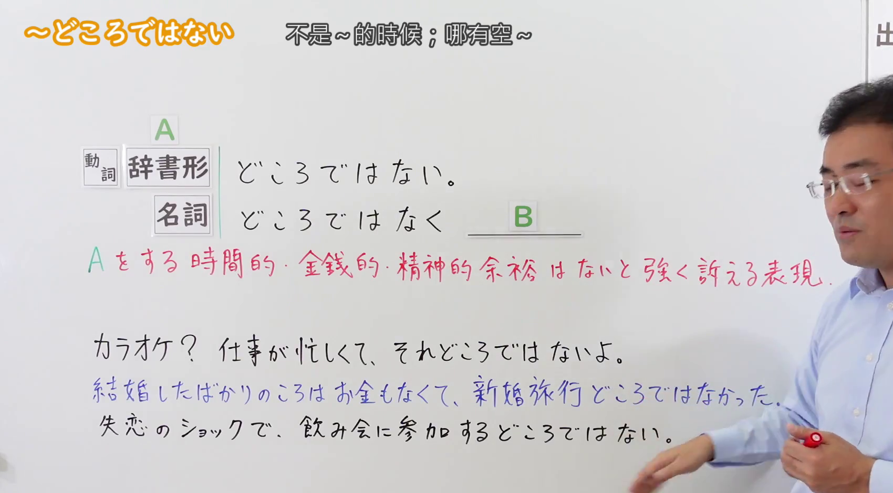
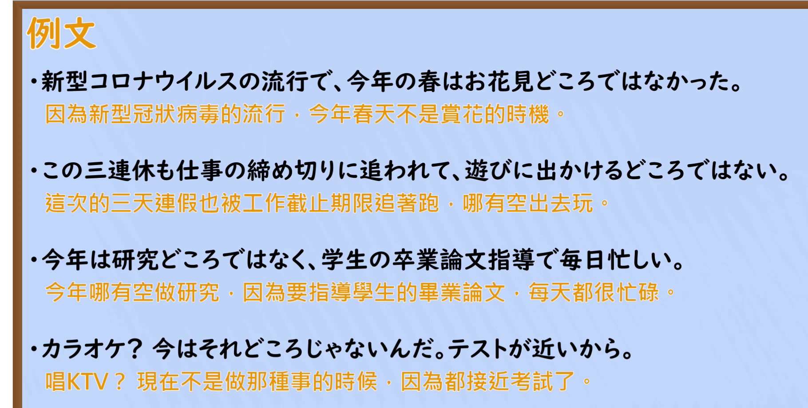

---
{
  "id": "N2-G-0046",
  "kind": "grammar",
  "level": "N2",
  "title": "～どころではない（哪有空～／不是～的时候）",
  "card_revision": 1,
  "schema_version": 1,
  "source": {
    "lesson": "N2 第46个语法",
    "material": "出口日語原视频板书、日语自动字幕与Hagoromo文型検索正文",
    "video": "https://www.youtube.com/watch?v=8ZtJ0uohZ0s",
    "screenshot": "assets/grammar/n2/N2-G-0046-connection.png",
    "screenshot_seconds": 65.0,
    "screenshot_crop": {
      "x": 0,
      "y": 0,
      "width": 1700,
      "height": 940
    }
  },
  "tags": [
    "どころではない",
    "余裕はない",
    "強調",
    "N2"
  ],
  "confusions": [
    "「～どころか」（AだけでなくBも／Aではなく逆にB を表す対比の表現で，形は似るが意味が異なる）",
    "「～場合ではない」（「Vている場合ではない」で，余裕がないことを表す別の言い方）",
    "「～どころではない」のくだけた形「～どころじゃない」は意味は同じで，話し言葉でよく使う"
  ]
}
---

# N2 第46个语法：～どころではない

## 视频学习资料整理

本课没有学习者个人输出，以下直接整理原视频材料。

- 原视频：[出口日語 第46个语法 ～どころではない](https://www.youtube.com/watch?v=8ZtJ0uohZ0s)
- 接续图：截取自原视频 **1:05.00**（在 0:01、30、45、55、65、80、90、100、110、120、128、135 秒中板书全部文字都无遮挡的一帧）。原图 1920×1080，裁切区域 x=0, y=0, 宽 1700, 高 940。
- 例句图：截取自原视频 **2:28.00** 的「例文」页。原图 1920×1080，裁切区域 x=0, y=0, 宽 1820, 高 920。

# 核心

## 功能一：强烈诉说没有做A的时间、金钱或精神上的余裕的表达

**最上位意味カテゴリー：**

- **どころではない：** 考え・感情（思想与感情）

**中位意味カテゴリー：**

- **どころではない：** 軽重の強調（轻重的强调）

**意味：**

- **どころではない：** 重の強調（重的强调）

**くわしい意味記述：**

- **どころではない：** VやNをする余裕はない，という強い否定を表す。話者の主観が感じられる表現。「Vている場合ではない」という言い方もある。（表示没有做V或N的余裕这一强烈的否定。是能感受到说话人主观的表达。也有「Vている場合ではない」这样的说法。）

**派生語：** 未列出

### 例句

1. 今は忙しくて花見どころではない。

   （现在很忙，哪有空赏花。）

2. とたんに残業が多くなり、英語の勉強どころではなくなった。

   （一下子加班多了起来，就根本没空学英语了。）

3. 理論を理解するどころではなかった。

   （根本谈不上理解理论。）

4. 紛争や国造りに追われ、スポーツどころではない他の海外からの選手・役員も平和の味をかみしめたことだろう。

   （因纷争和国家建设而奔波、根本谈不上体育运动的其他海外选手与工作人员，想必也品味到了和平的滋味吧。）

# 来源

- [出口日語 第46个语法 ～どころではない 原视频](https://www.youtube.com/watch?v=8ZtJ0uohZ0s)
- [Hagoromo 文型検索「どころではない」](https://www.hagoromo-text.work/lookup?vid=999)（查询日期：2026-09-23）
