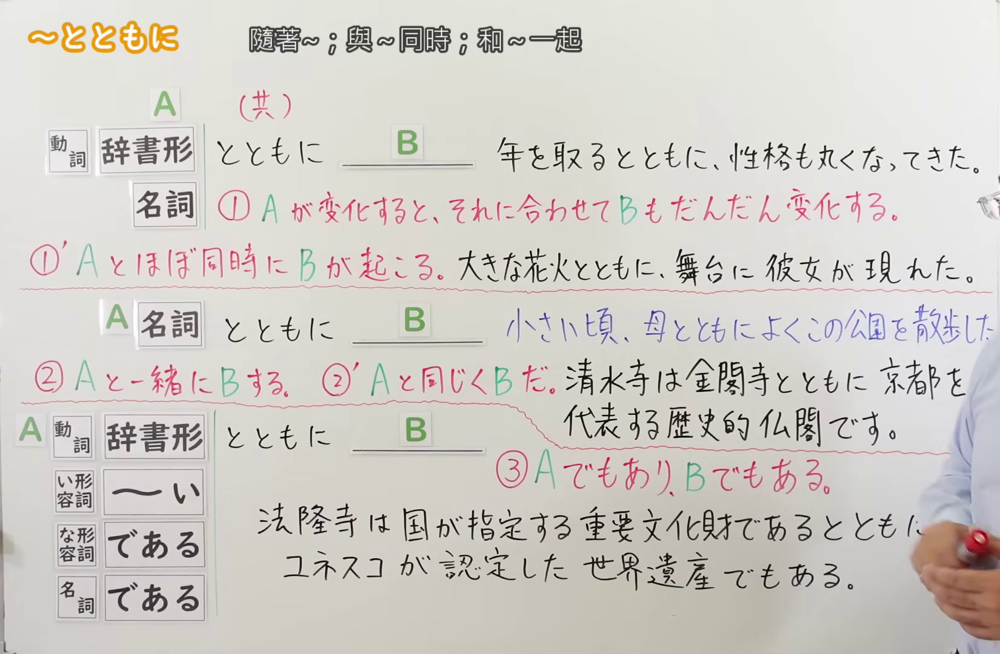
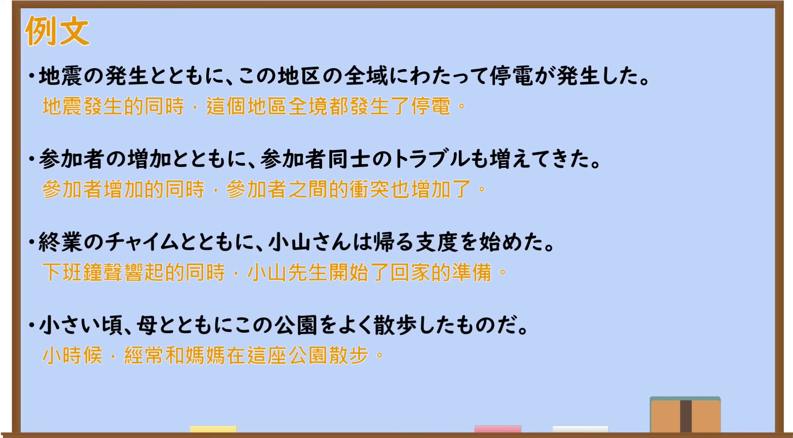

---
{
  "id": "N2-G-0047",
  "kind": "grammar",
  "level": "N2",
  "title": "〜とともに(〜と共に)：伴随变化、共同与同时",
  "card_revision": 1,
  "schema_version": 1,
  "source": {
    "lesson": "N2 第47个语法",
    "material": "出口日語原视频板书、日语自动字幕与毎日のんびり日本語教師正文",
    "video": "https://www.youtube.com/watch?v=TOr-pnXz27Q",
    "screenshot": "assets/grammar/n2/N2-G-0047-connection.png",
    "screenshot_seconds": 240,
    "screenshot_crop": {
      "x": 0,
      "y": 0,
      "width": 1650,
      "height": 1080
    }
  },
  "tags": [
    "とともに",
    "伴随变化",
    "共同",
    "同时",
    "N2"
  ],
  "confusions": [
    "〜につれて",
    "〜にしたがって",
    "〜にともなって"
  ]
}
---

# N2 第47个语法：〜とともに(〜と共に)

# 视频学习资料整理

- 原视频：[出口日語「〜とともに」](https://www.youtube.com/watch?v=TOr-pnXz27Q)
- 接续图：240.00 秒；原图 1920×1080；从左上角固定裁切为 `(0, 0, 1650, 1080)`。该时点三组接续、红色意义说明与必要例句完整可读；教师位于最右侧，裁切后仅保留少量不可避免的手部遮挡。

- 例句图：433.98 秒；原图 1920×1080；从左上角固定裁切为 `(0, 0, 1915, 1060)`，去除右侧与底部多余边缘，四条例句完整无遮挡。

# 核心

## 功能一：A 发生变化时，B 也随之逐渐变化

**くわしい意味記述：**

- **〜とともに(〜と共に)：** 何らかの変化と同時に、他のことも徐々に変化することを表す用法。名詞に接続する時は、変化を含む動作性の名詞である必要があります。（表示随着某种变化发生，另一事物也逐渐变化。接名词时，该名词必须是包含变化的动作性名词。）

### 例句

1. 人々の考え方は時代の流れとともに変わっていくものなのかもしれない。

   （人们的想法也许会随着时代的发展而改变。）

2. 年と共に涙脆くなってきた。

   （随着年龄增长，我变得越来越容易落泪。）

3. 日本は少子高齢化とともに本格的な人口減少社会を迎えている。

   （随着少子老龄化加剧，日本正全面进入人口减少社会。）

4. スマホの普及と共に、ながらスマホなどの問題も出てきている。

   （随着智能手机普及，边做别的事边看手机等问题也逐渐出现。）

## 功能二：与 A 一起做 B

**くわしい意味記述：**

- **〜とともに(〜と共に)：** 「～と一緒に」を表す用法。人や物等を表す名詞に接続します。この言い方はやや硬く書き言葉です。（表示“与……一起”。接表示人或物等的名词；这种说法稍显正式，多用于书面语。）

### 例句

1. 小学校の頃からペットの猫とともに生きてきた。

   （从小学时起，我就一直和宠物猫共同生活。）

2. 荷物と共に実家へ帰る。

   （带着行李回老家。）

3. 自然と共に生きていきたい。

   （我想与自然共生。）

4. 母と共に温泉旅行へ行く。

   （和母亲一起去温泉旅行。）

## 功能三：A 与 B 同时存在或发生

**くわしい意味記述：**

- **〜とともに(〜と共に)：** 同一時間内に２つの現象や状態が存在、または発生していることを表す用法。前項と後項の動作は同時に発生します。（表示两个现象或状态在同一时间内存在或发生；前项与后项的动作同时发生。）

### 例句

1. 卒業は嬉しさと共に寂しさも感じる。

   （毕业时既感到喜悦，也感到寂寞。）

2. この曲を聴いて懐かしくなると共に、時間の流れを痛感した。

   （听到这首曲子时，既感到怀念，也深切感受到时间的流逝。）

3. 彼女が羨ましいと共に憎たらしい。

   （我既羡慕她，也觉得她可恨。）

4. ご迷惑をおかけしたことを深くお詫び申し上げると共に、今後一切このような事を起こさないよう精進してまいりますので、何卒宜しくお願い致します。

   （对于给您造成的不便，我们深表歉意；同时今后将努力避免此类事情再次发生，恳请您多多关照。）

# 来源

- [出口日語原视频](https://www.youtube.com/watch?v=TOr-pnXz27Q)
- [毎日のんびり日本語教師「【Ｎ３文法】～と共に（～とともに）」](https://mainichi-nonbiri.com/grammar/n3-totomoni/)（查询日期：2026-09-23）
