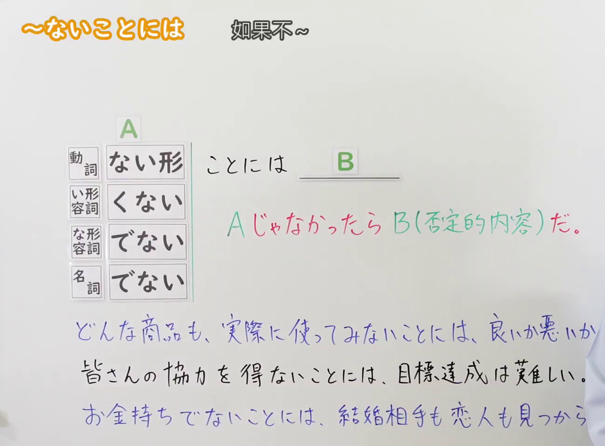
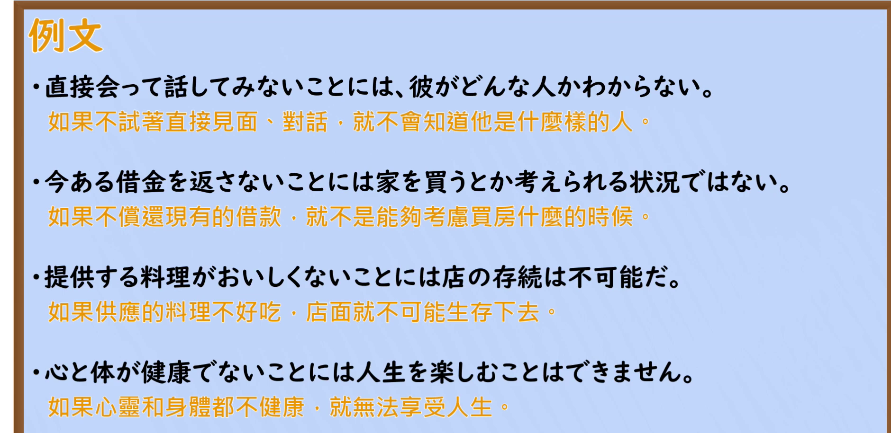

---
{
  "id": "N2-G-0048",
  "kind": "grammar",
  "level": "N2",
  "title": "～ないことには：若不……就不能……",
  "card_revision": 1,
  "schema_version": 1,
  "source": {
    "lesson": "N2 第48个语法",
    "material": "出口日語原视频板书、日语自动字幕与毎日のんびり日本語教師正文",
    "video": "https://www.youtube.com/watch?v=k6fYjYfmDeY",
    "screenshot": "assets/grammar/n2/N2-G-0048-connection.png",
    "screenshot_seconds": 1,
    "screenshot_crop": {
      "x": 0,
      "y": 0,
      "width": 1300,
      "height": 960
    }
  },
  "tags": ["条件表达", "N2"],
  "confusions": [
    "～ないことはない：部分肯定，含义与本课语法不同。",
    "～ないと～ない／～なければ～ない：也可表达必要条件，需结合语境辨析。"
  ]
}
---
# N2 第48个语法：～ないことには（若不……就不能……）

## 视频学习资料整理

- 原视频：[出口日語 N2 第48课](https://www.youtube.com/watch?v=k6fYjYfmDeY)（课程标题：`[N2 Grammar] ~nai koto ni wa (Unless...)`）。
- 接续图：原视频 0:01；原图 1920×1080；固定左上角裁切区域 `x=0, y=0, width=1300, height=960`，收拢右下方画面，保留接续、含义板书和示例。

  

- 例句图：原视频 4:10.13（250.13秒）；原图 1920×1080；固定左上角裁切区域 `x=0, y=0, width=1880, height=915`，裁去右侧边缘和底部空白，保留例句页文字。

  

# 核心

## 功能一：不做 A 的话，B 表示否定内容

**くわしい意味記述：**

- **～ないことには～ない：** まず前件の動作を行わなければ、物事の実現が難しいことを表します。後件では「分からない」「できない」などの不可能を表す内容がきます。（表示若不先做前项动作，后项所述事情就难以实现；后项通常接「不知道」「做不到」等表示不可能的内容。）
- **～てみないことには～ない：** 「～てみないことには～ない」は、物事を試しに行ってみるような場面で用いることができます。（“～てみないことには～ない”可用于试着做某事以确认结果的场合。）

### 例句

1. 何事も経験してみないことには分からないだろう。

   （任何事情不亲自经历一下，恐怕就无法了解吧。）

2. 挑戦しないことには始まらない。

   （不去挑战就无从开始。）

3. 自ら行動しないことには、自分を取り巻く環境も変わらない。

   （如果自己不主动采取行动，周围的环境也不会改变。）

4. 宝くじは買ってみないことには当たりもしない。

   （不买张彩票试试，就不可能中奖。）

5. 原因を突き止めないことには、根本的な解決もできない。

   （不查明原因，就无法从根本上解决问题。）

# 来源

- [出口日語原视频](https://www.youtube.com/watch?v=k6fYjYfmDeY)
- [毎日のんびり日本語教師「【Ｎ１文法】～ないことには～ない／てみないことには～ない」](https://mainichi-nonbiri.com/grammar/n1-naikotonihanai/)（查询日期：2026-09-23）
