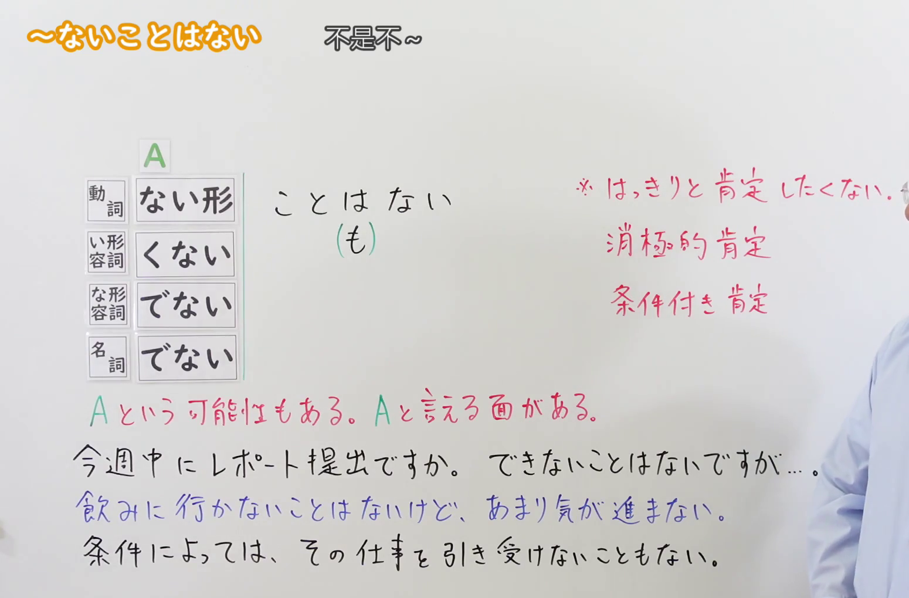
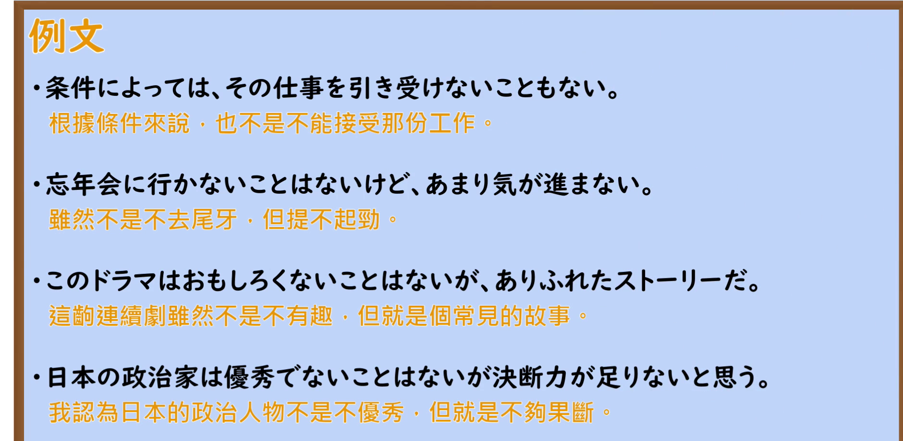

---
{
  "id": "N2-G-0049",
  "kind": "grammar",
  "level": "N2",
  "title": "〜ないことはない／〜ないこともない：不想明确肯定",
  "card_revision": 1,
  "schema_version": 1,
  "source": {
    "lesson": "N2 第49个语法",
    "material": "出口日語原视频板书、日语自动字幕与日本語NET正文",
    "video": "https://www.youtube.com/watch?v=IuxmJ_lnzfI",
    "screenshot": "assets/grammar/n2/N2-G-0049-connection.png",
    "screenshot_seconds": 8.0,
    "screenshot_crop": {
      "x": 0,
      "y": 0,
      "width": 1550,
      "height": 1020
    }
  },
  "tags": [
    "部分肯定",
    "可能性",
    "N2"
  ],
  "confusions": [
    "〜ないわけではない"
  ]
}
---

# N2 第49个语法：〜ないことはない／〜ないこともない

## 视频学习资料整理

- [出口日語原视频](https://www.youtube.com/watch?v=IuxmJ_lnzfI)，课程标题：`[N2 Grammar] ~It's not impossible`。
- 接续图：视频 0:08；原图 1920×1080，裁切区域 x=0、y=0、宽1550、高1020。画面保留了接续、含义说明及讲解板书，右边缘有少量讲师轮廓。

  

- 例句图：视频 4:34.28；原图 1920×1080，裁切区域 x=0、y=0、宽1880、高920。

  

## 核心

## 功能一：不想明确肯定

**くわしい意味記述：**

- **〜ないことはない／〜ないこともない：** 〜という可能性があるかもしれない / 絶対に〜とは言えない。断定を避けるために使われる言い方。（可能存在……的可能性／不能断言绝对不……。这是用于避免作出断言的表达方式。）

### 例句

1. A：これ、まだ食べられる？
   B：う〜ん、食べられないことはないけど、賞味期限が切れているのでやめておいた方がいいと思うよ。

   （A：这个还能吃吗？
   B：嗯，也不是不能吃，不过已经过了最佳食用期限，我觉得还是别吃比较好。）

2. A：今度、ここに引っ越そうと思っているんだけど、ここなら自転車で通えるかな？
   B：通えないこともないけど、この辺の道は車が多いし、ちょっと危険だと思うよ。

   （A：我打算搬到这里来住，你觉得从这里骑自行车通勤行吗？
   B：也不是不能骑车通勤，不过这附近车多，我觉得有点危险。）

3. A：ごめん、お客さんの要望が変わって、システムの機能を一部変更したいんだけど、できる？
   B：できないこともないですけど、少し時間をいただきたいです。

   （A：不好意思，客户的需求变了，我想修改系统的部分功能，可以吗？
   B：也不是做不到，不过希望能给我一点时间。）

4. A：新しくできたラーメン店どうだった？毎日すごい行列だよね。
   B：美味しくないこともないですけど、家の近くのラーメン店の方が安くて美味しいです。

   （A：新开的那家拉面店怎么样？每天都排好长的队吧。
   B：也不能说不好吃，不过我家附近的拉面店更便宜也更好吃。）

## 来源

- [出口日語原视频](https://www.youtube.com/watch?v=IuxmJ_lnzfI)
- [日本語NET「〜ないことはない / 〜ないこともない」](https://nihongokyoshi-net.com/2019/05/17/jlptn2-grammar-naikotowanai/)（查询日期：2026-09-23）
