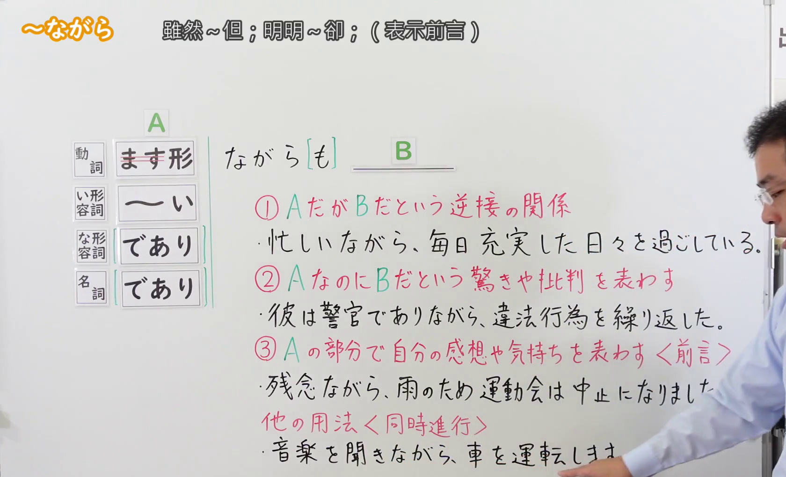
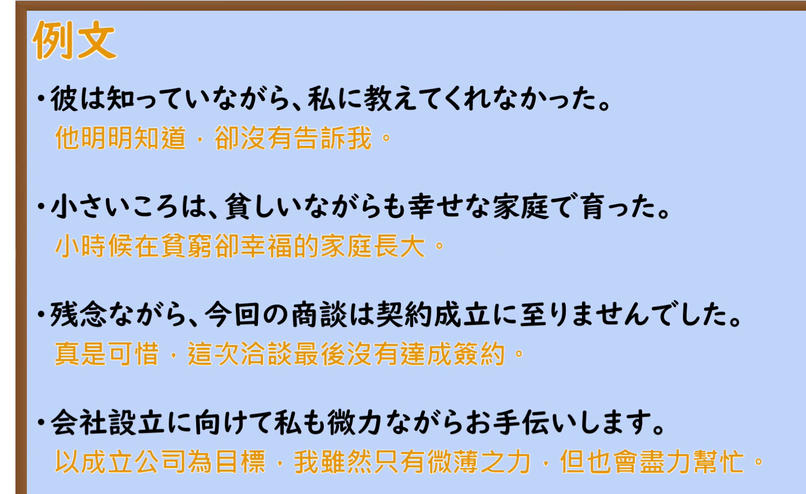

---
{
  "id": "N2-G-0050",
  "kind": "grammar",
  "level": "N2",
  "title": "〜ながら（逆接）：转折、意外或批评、表达感受",
  "card_revision": 2,
  "schema_version": 1,
  "source": {
    "lesson": "N2 第50个语法",
    "material": "出口日語原视频板书、日语自动字幕与日本語NET、毎日のんびり日本語教師正文",
    "video": "https://www.youtube.com/watch?v=jW-sCNpmoJA",
    "screenshot": "assets/grammar/n2/N2-G-0050-connection.png",
    "screenshot_seconds": 45.0,
    "screenshot_crop": {
      "x": 0,
      "y": 0,
      "width": 1680,
      "height": 1020
    }
  },
  "tags": [
    "逆接",
    "转折",
    "N2"
  ],
  "confusions": [
    "〜ながら（同时进行）",
    "〜つつ（逆接）"
  ]
}
---

# N2 第50个语法：〜ながら（逆接）

## 视频学习资料整理

- [出口日語原视频](https://www.youtube.com/watch?v=jW-sCNpmoJA)，课程标题：`【Ｎ２文法】～ながら（逆接）`。
- 接续图：视频 0:45；原图 1920×1080，裁切区域 x=0、y=0、宽1680、高1020。画面展示接续分类与讲解板书；讲师遮住右侧少量文字，裁切未覆盖该处。

  

- 例句图：视频 5:09.15；原图 1920×1080，裁切区域 x=0、y=0、宽1500、高920。

  

## 核心

## 功能一：A 与 B 构成逆接关系

**くわしい意味記述：**

- **〜ながら（逆接）：** 〜のに / 〜けれども。「〜ながら・・・」の「〜から当然予想されることとは違い、実際は・・・だ」と言いたい時に使う表現。（虽然……／尽管……。表示实际情况 B 与从 A 自然预想的结果不同。）
- **〜ながらも：** 「ながら」の後ろに「も」をつけて、「ながらも」と言う場合もあるが、意味は同じである。（也可以在「ながら」后加「も」说「ながらも」，意思相同。）

### 例句

1. ミクちゃんは子供ながら、しっかりとしている。

   （小美虽然还是孩子，却很稳重。）

2. 彼は小柄ながら、すごい力があって誰よりも強い。

   （他虽然个子不高，却力气惊人，比谁都强。）

3. この地域の人々は貧しいながらも、幸せに暮しているそうです。

   （听说这一带的人们虽然生活贫困，却过得很幸福。）

## 功能二：A 与 B 出乎预期，表达惊讶或批评

**くわしい意味記述：**

- **〜ながら（逆接）：** 「〜ながら・・・」の「〜から当然予想されることとは違い、実際は・・・だ」と言いたい時に使う表現。（用于表示实际情况与从前项预想的结果不同；本课板书将其中带有惊讶或批评的用法单列为第二项。）

### 例句

1. 彼女はダイエットすると言っておきながら、今日もケーキを食べている。

   （她明明说要减肥，可今天又在吃蛋糕。）

2. 彼は洋楽が嫌いだと言っておきながら、海外アーティストのCDをたくさん持っている。

   （他明明说不喜欢西洋音乐，却收藏了很多海外歌手的 CD。）

3. 悪いことだと知っていながら、彼は平気で嘘をつく。

   （他明知道那是不好的事，却若无其事地撒谎。）

4. 彼は新入社員でありながら、態度が偉そうだ。

   （他明明是新员工，态度却很傲慢。）

## 功能三：在前言中表达自己的感想或心情

**くわしい意味記述：**

- **残念ながら：** 「しかしながら（但是）」「残念ながら（很遗憾）」「嫌々ながら（尽管不情愿）」「遅ればせながら／今更ながら（虽为时已晚）」はこの文型を用いた慣用表現です。（「残念ながら」等是使用这一句型的惯用表达；本课板书用它在前言中表示说话人的遗憾。）

### 例句

1. アルバイトの面接に行ったが、残念ながら不採用だった。

   （我去了兼职面试，但遗憾的是没有被录用。）

2. 残念ながら、今夜の飲み会には参加できそうにない。

   （很遗憾，今晚的聚会我恐怕参加不了。）

3. 残念ながら、現実は残酷だ。

   （遗憾的是，现实很残酷。）

## 来源

- [出口日語原视频](https://www.youtube.com/watch?v=jW-sCNpmoJA)
- [日本語NET「〜ながら（逆接）」](https://nihongokyoshi-net.com/2018/11/19/jlptn2-grammar-nagara/)（查询日期：2026-09-23）
- [毎日のんびり日本語教師「〜ながら／ながらも」](https://mainichi-nonbiri.com/grammar/n3-nagara/)（功能三的惯用表达说明和例句）
