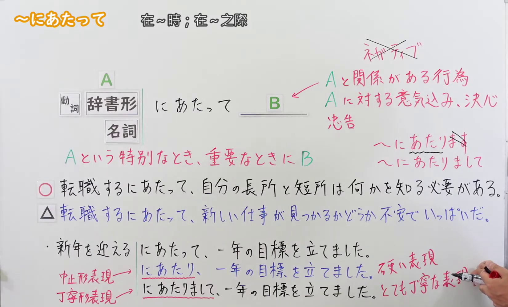

---
{
  "id": "N2-G-0051",
  "kind": "grammar",
  "level": "N2",
  "title": "にあたって／にあたり：重要な事に臨むとき",
  "card_revision": 1,
  "schema_version": 1,
  "source": {
    "lesson": "N2 第51个语法",
    "material": "出口日語原视频板书、日语自动字幕与はごろも「にあたって（状況・場合）【にあたり】」正文",
    "video": "https://www.youtube.com/watch?v=PnjDdZWPePM",
    "screenshot": "assets/grammar/n2/N2-G-0051-connection.png",
    "screenshot_seconds": 270,
    "screenshot_crop": {
      "x": 0,
      "y": 0,
      "width": 1650,
      "height": 1000
    }
  },
  "tags": [
    "重要场合",
    "N2"
  ],
  "confusions": [
    "に際して"
  ]
}
---

# にあたって／にあたり：重要な事に臨むとき

# 视频学习资料整理

- 课程：[出口日語 N2 第51课](https://www.youtube.com/watch?v=PnjDdZWPePM)。视频板书说明：在 A 这一特别或重要的时刻进行 B；B 可为与 A 相关的行动、意愿或决心。板书还展示「にあたり」和更礼貌的「にあたりまして」。
- 接续图：原视频 04:30（270.00 秒），原图 1920×1080；从左上角裁取 x=0、y=0、宽 1650、高 1000，保留接续、红字意义说明及对比例句。0:01 画面的人像遮挡了右侧板书，因此选用讲解后段的清晰画面。

- 例句图：原视频 05:41.13（341.13 秒），原图 1920×1080；从左上角裁取 x=0、y=0、宽 1890、高 1048，保留四条例句及课程翻译。

# 核心

## 功能一：在 A 这一特别或重要的时刻做 B

**最上位意味カテゴリー：**

- **にあたって：** 場所・時間（场所与时间）

**中位意味カテゴリー：**

- **にあたって：** 時点・場面（时点与场合）

**意味：**

- **にあたって：** 状況・場合（状况与场合）

**くわしい意味記述：**

- **にあたって：** ある重要なことを始めるときを表す。（表示开始某件重要事情的时候。）

**派生語：** にあたり

### 例句

1. 出発にあたって、校長先生からお話しがあります。

   （出发之际，校长有话要对大家说。）

2. 仕事を始めるにあたり、先輩から気をつけることなどを聞いた。

   （开始工作时，我向前辈请教了需要注意的事项等。）

3. 政府開発援助を実施するにあたっては、人道的配慮、相互依存の認識、環境保全、自助努力への支援を基本理念とする。

   （实施政府开发援助时，以人道关怀、相互依存意识、环境保护及支持自助努力为基本理念。）

# 来源

- [出口日語原视频](https://www.youtube.com/watch?v=PnjDdZWPePM)
- [はごろも「にあたって（状況・場合）【にあたり】」](https://www.hagoromo-text.work/)（站内文法項目检索「にあたって」；查询日期：2026-09-23）