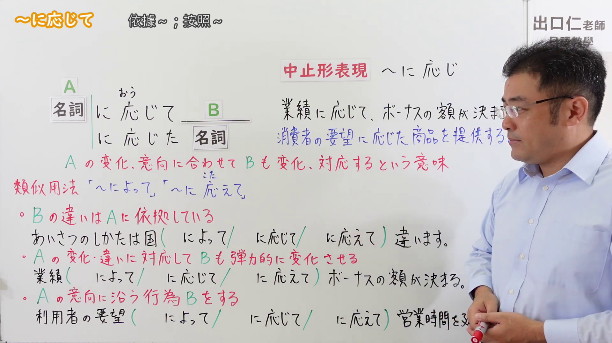

---
{
  "id": "N2-G-0052",
  "kind": "grammar",
  "level": "N2",
  "title": "～に応じて（根据情况作出相应处理）",
  "card_revision": 1,
  "schema_version": 1,
  "source": {
    "lesson": "N2 第52个语法",
    "material": "出口日語原视频板书与 Japanese Exercises「JLPT N2 ～に応じて 文法解説・問題」正文",
    "video": "https://www.youtube.com/watch?v=RlISE-Ee1lE",
    "screenshot": "assets/grammar/n2/N2-G-0052-connection.png",
    "screenshot_seconds": 58.17,
    "screenshot_crop": {
      "x": 0,
      "y": 0,
      "width": 1920,
      "height": 1080
    }
  },
  "tags": [
    "条件对应",
    "N2"
  ],
  "confusions": [
    "に応えて：主要回应希望、要求或期待；に応じて还可根据情况、能力等作相应调整。",
    "に対して：表示对象或对比关系；に応じて表示按条件作相应变化或处理。"
  ]
}
---
# N2 第52个语法：～に応じて（根据……／随着……）

# 视频学习资料整理

- 清单标题：[N2 Grammar] ~in accordance with；原视频板书标题：～に応じて。
- [出口日語原视频](https://www.youtube.com/watch?v=RlISE-Ee1lE)
- 日语字幕缓存字符损坏，未作为词形或含义依据；课题形式和讲解依据原视频板书核对。
- 接续板书图：00:58.17（原图 1920×1080；裁切区域 x=0、y=0、宽 1920、高 1080。板书延伸至画面右侧，缩窄会截断讲解；教师位于右侧并遮挡少量比较内容，目标形式与红色说明清晰可见）。

  

- 例句板书图：05:45.00（原图 1920×1080；裁切区域 x=0、y=0、宽 1710、高 1020，保留四条例句及中文板书，裁去右侧空白和底部边框）。

  

# 核心

## 功能一：随着 A 的变化或情况，B 也相应变化或作出应对

**くわしい意味記述：**

- **～に応じて：** 希望・変化・状況・能力・経験などに合わせて～する（根据希望、变化、状况、能力、经验等采取相应行动。）

### 例句

1. 社長は社員の要望に応じて、週休3日制を導入した。

   （总裁应员工的要求，实行了每周休息三天的制度。）

2. 給料は経験や能力に応じて、決めさせていただくことになります。

   （薪资将根据经验和能力来决定。）

3. このスマホは容量に応じて、価格が高くなります。

   （这款智能手机会随着容量增大而上涨价格。）

4. 収入に応じて、所得税率が変わります。

   （所得税率会根据收入变化。）

5. 天候に応じて、試合のスケジュールが変更されることがあります。

   （比赛日程有时会根据天气情况作出调整。）

# 来源

- [出口日語原视频](https://www.youtube.com/watch?v=RlISE-Ee1lE)
- [Japanese Exercises「JLPT N2 ～に応じて 文法解説・問題」](https://japaneseexercises.com/2022/12/31/%E3%80%90jlpt-n2-%EF%BD%9E%E3%81%AB%E5%BF%9C%E3%81%98%E3%81%A6%E6%96%87%E6%B3%95%E8%A7%A3%E8%AA%AC%E3%83%BB%E5%95%8F%E9%A1%8C%E3%80%91/)（查询日期：2026-09-23）
