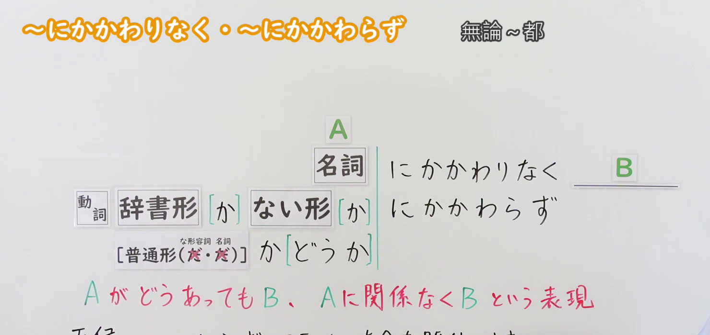
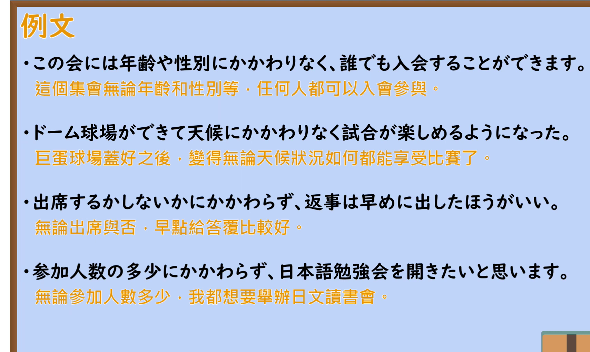

---
{
  "id": "N2-G-0053",
  "kind": "grammar",
  "level": "N2",
  "title": "～にかかわりなく・～にかかわらず（无论……／不受……影响）",
  "card_revision": 1,
  "schema_version": 1,
  "source": {
    "lesson": "N2 第53个语法",
    "material": "出口日語原视频板书、日语自动字幕与Hagoromo正文",
    "video": "https://www.youtube.com/watch?v=HrCCxT_k5Z8",
    "screenshot": "assets/grammar/n2/N2-G-0053-connection.png",
    "screenshot_seconds": 48.33,
    "screenshot_crop": {
      "x": 0,
      "y": 0,
      "width": 1480,
      "height": 700
    }
  },
  "tags": ["无关", "N2"],
  "confusions": ["にもかかわらず（尽管……）"]
}
---

# N2 第53个语法：～にかかわりなく・～にかかわらず

# 视频学习资料整理

- 课程视频：[出口日語原视频](https://www.youtube.com/watch?v=HrCCxT_k5Z8)，标题为“[N2 Grammar] Regardless of ~ / Regardless of ~”。
- 接续板书：原视频 0:48.33，原图 1920×1080；从左上角裁切，区域 x=0、y=0、宽1480、高700。画面保留语法形式、名词接续板书及红色意义说明。

  

- 例句页：原视频 4:41.80，原图 1920×1080；从左上角裁切，区域 x=0、y=0、宽1710、高1020，保留板书例句及中文说明。

  

# 核心

## 功能一：无论A如何，B都成立；B不受A影响

**最上位意味カテゴリー：**

- **にかかわりなく：** ものごとの関係（事物之间的关系）
- **にかかわらず：** ものごとの関係（事物之间的关系）

**中位意味カテゴリー：**

- **にかかわりなく：** 無関係・除外（无关／排除）
- **にかかわらず：** 無関係・除外（无关／排除）

**意味：**

- **にかかわりなく：** 無関係（无关）
- **にかかわらず：** 無関係（无关）

**くわしい意味記述：**

- **にかかわりなく：** 「Nに関係なく，後のことが成立する」と言いたい時に使う。「N」の部分は，「いい悪いにかかわりなく」「するしないにかかわりなく」のように，対立関係にある言葉の辞書形を連ねることもある。（用于表达“不受N影响，后项仍成立”。N部分也可以像「いい悪いにかかわりなく」（不论好坏）、「するしないにかかわりなく」（不论做与不做）这样，连接意思相对的词的辞书形。）
- **にかかわらず：** 「Nに関係なく，後のことが成立する」と言いたい時に使う。「N」の部分は，「いい悪いにかかわらず」「するしないにかかわらず」のように，対立関係にある言葉の辞書形を連ねることもある。（用于表达“不受N影响，后项仍成立”。N部分也可以像「いい悪いにかかわらず」（不论好坏）、「するしないにかかわらず」（不论做与不做）这样，连接意思相对的词的辞书形。）

**派生語：**

- **にかかわりなく：** にはかかわりなく，にかかわらず
- **にかかわらず：** にかかわりなく，にもかかわらず

### 例句

1. このイベントは、年齢・国籍に関わらず参加できます。

   （这个活动不论年龄、国籍，都可以参加。）

2. このような日本人の集団参加のあり方に対して、資格において集団が構成されている場合には、個人の生活の場とか、仕事のいかんにかかわらず、空間的・時間的な距離をこえて、集団はネットワークによって保持される可能性をもっている。

   （与这种日本人集体参与的形式相对，在以资格为基础组成群体的情况下，无论个人的生活场所或工作情况如何，群体都有可能跨越空间和时间的距离，通过网络得以维系。）

3. 第四に、かりにこちらに悪意はなくても、相手にとって初耳のことを申し立てるときは、よほどゆきとどいた事前準備が必要であり、そうした事前準備ぬきで事を進めることは、こちらの意図いかんにかかわらず客観的には非礼になるということである。

   （第四，即使我们并无恶意，在向对方提出其闻所未闻的事情时，也必须做好充分周密的事前准备；如果不做这样的准备就推进事情，那么无论我们的意图如何，客观上都会显得失礼。）

# 来源

- [出口日語原视频](https://www.youtube.com/watch?v=HrCCxT_k5Z8)
- [Hagoromo 文型检索「にかかわりなく」](https://www.hagoromo-text.work/)（查询日期：2026-09-23；条目 ID：1230）
- [Hagoromo 文型检索「にかかわらず」](https://www.hagoromo-text.work/)（查询日期：2026-09-23；条目 ID：1229）
