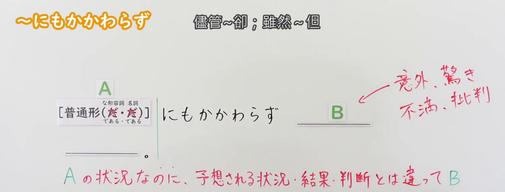
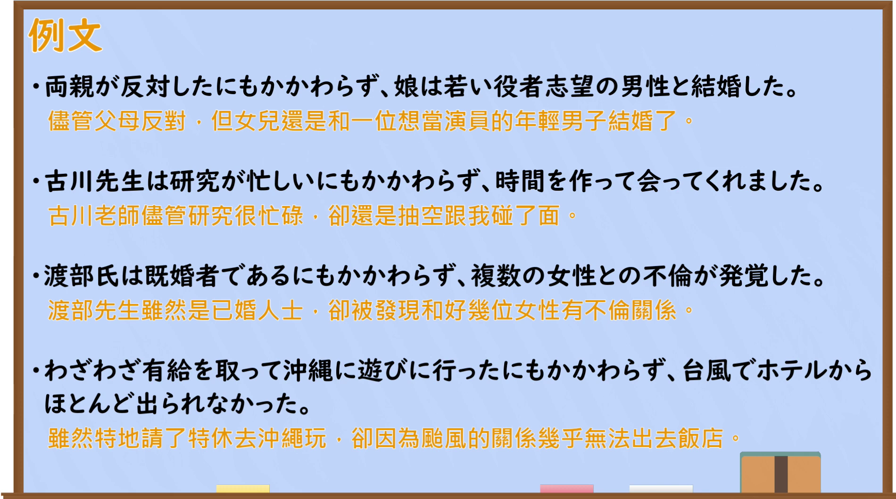

---
{
  "id": "N2-G-0054",
  "kind": "grammar",
  "level": "N2",
  "title": "～にもかかわらず（尽管……，却……）",
  "card_revision": 1,
  "schema_version": 1,
  "source": {
    "lesson": "N2 第54个语法",
    "material": "出口日語原视频板书、日语自动字幕与毎日のんびり日本語教師正文",
    "video": "https://www.youtube.com/watch?v=3bD67vBoHK8",
    "screenshot": "assets/grammar/n2/N2-G-0054-connection.png",
    "screenshot_seconds": 270.0,
    "screenshot_crop": {
      "x": 0,
      "y": 0,
      "width": 1500,
      "height": 570
    }
  },
  "tags": ["逆接", "N2"],
  "confusions": ["～にかかわらず（不论A如何／不受A影响）"]
}
---

# N2 第54个语法：～にもかかわらず

# 视频学习资料整理

- 课程视频：[出口日語原视频](https://www.youtube.com/watch?v=3bD67vBoHK8)，标题为“【Ｎ２文法】～にもかかわらず”。
- 接续板书：原视频 4:30.00，原图 1920×1080；从左上角裁切，区域 x=0、y=0、宽1500、高570。0:01 画面中讲师遮挡板书，因此选用此时点；裁切完整保留语法形式、接续关系和红色意义说明，边界收在下一行讲解开始前。

  

- 例句页：原视频 6:53.20，原图 1920×1080；从左上角裁切，区域 x=0、y=0、宽1900、高1060，保留完整例句页及中文板书。

  

# 核心

## 功能一：A的状况或状态不影响后项，B却与预想的结果／判断不同

**くわしい意味記述：**

- **にもかかわらず：** 逆接の文型です。後件には既に発生した予想外の事態が述べられます。「にもかかわらず」「それにもかかわらず」は接続詞として単独で使えます。（这是表示逆接的句型。后项叙述已经发生的意外事态。「にもかかわらず」和「それにもかかわらず」也可以单独作为接续词使用。）

### 例句

1. 彼は勤務時間にもかかわらず漫画を読んでいる。

   （虽然还在工作时间，他却在看漫画。）

2. このキャラクターは作品中にあまり登場しないのにもかかわらず、ファンから人気がある。

   （尽管这个角色在作品中很少登场，却很受粉丝欢迎。）

3. 雨にもかかわらず来ていただいた皆さんに感謝申し上げます。

   （感谢各位冒雨前来。）

4. ダイエット中にもかかわらずケーキを食べてしまった。

   （尽管正在减肥，还是没忍住吃了蛋糕。）

5. 挨拶したにもかかわらず無視された。

   （明明打了招呼，却被无视了。）

# 来源

- [出口日語原视频](https://www.youtube.com/watch?v=3bD67vBoHK8)
- [毎日のんびり日本語教師「【Ｎ２文法】～にもかかわらず」](https://mainichi-nonbiri.com/grammar/n2-nimokakawarazu/)（查询日期：2026-09-23）
