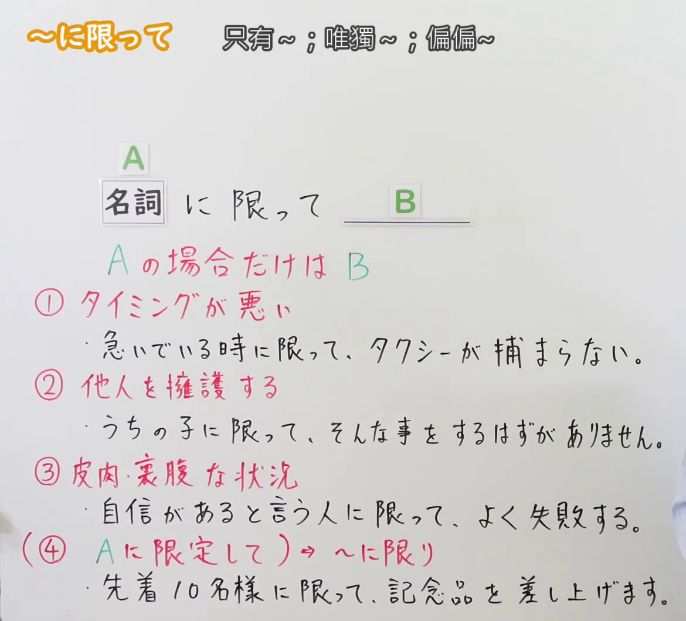
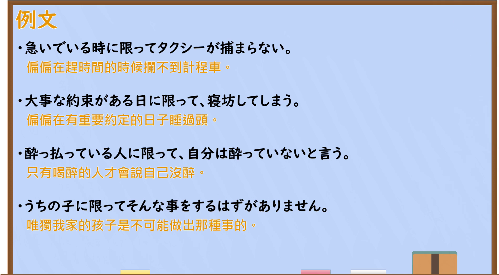

---
{
  "id": "N2-G-0055",
  "kind": "grammar",
  "level": "N2",
  "title": "～にかぎって(限って)：偏偏；唯独",
  "card_revision": 1,
  "schema_version": 1,
  "source": {
    "lesson": "N2 第55个语法",
    "material": "出口日語原视频板书、日语自动字幕与 Hagoromo、毎日のんびり日本語教師、日本語NET、Japanese Exercises 正文",
    "video": "https://www.youtube.com/watch?v=OvJJmT3457U",
    "screenshot": "assets/grammar/n2/N2-G-0055-connection.png",
    "screenshot_seconds": 1.0,
    "screenshot_crop": {"x": 0, "y": 0, "width": 1170, "height": 1060}
  },
  "tags": ["にかぎって", "限定", "N2"],
  "confusions": ["～にかぎり(限り)：通知、规定中的限定", "～にかぎらず(限らず)：不限定于某范围"]
}
---

# N2 第55个语法：～にかぎって(限って)

# 视频学习资料整理

[出口日語第55课原视频](https://www.youtube.com/watch?v=OvJJmT3457U)讲解名词后接「に限って」，板书以「Aの場合だけはB」概括，并列出时间偏巧、为人辩护和带有批评意味的倾向三种用法。字幕中的「に滾って」「に鍵て」为自动识别错误；形式以视频板书为准。

- 接续图：视频 **0:01.00**；原图 **1920 × 1080**；从左上角裁切 **(x=0, y=0, width=1170, height=1060)**。保留接续、含义和三种用法的板书。

  

- 例句图：视频 **4:46.70**；原图 **1920 × 1080**；从左上角裁切 **(x=0, y=0, width=1900, height=1050)**。保留课程例句和画面中的中文释义。

  

# 核心

## 功能一：只在 A 的情况下，偏偏发生 B

**最上位意味カテゴリー：**

- **～にかぎって(限って)：** ものごとの関係（事物之间的关系）

**中位意味カテゴリー：**

- **～にかぎって(限って)：** 限定（限定）

**意味：**

- **～にかぎって(限って)：** 限定（限定）

**くわしい意味記述：**

- **Hagoromo「にかぎって」：** 「〜だけは」の意味。状況を表す語について，「〜の時だけ，望ましくないことが起こった」という意味を表す。または，「〜さんに限って，そんなことをするはずがない」のように，誰かを弁護するときにも使う。（表示“唯独～”；接在表示状况的词语后，表示“唯独在那时发生了不希望发生的事”。也可像“唯独某人，不可能做那种事”一样，用于为人辩护。）
- **毎日のんびり日本語教師「～に限って」：** 他の場合は発生しない状況が、ある重要なときだけに偏って発生することを表します。後項では予想外のことが述べられます。（表示其他情况下不会发生的事，偏偏只在某个重要时候发生；后项叙述出乎意料的事。）

**派生語：** にかぎり，にかぎる，にかぎらず

### 例句

1. 体調悪い時に限って予定が入ってくる。

   （偏偏在身体不舒服的时候，有事情排进日程。）

2. 自分が外出するときに限っていつも雨が降る。

   （偏偏每次自己出门时都会下雨。）

3. 遅刻しちゃいけない日に限って寝坊してしまう。

   （偏偏在不能迟到的日子睡过头。）

## 功能二：唯独 A，绝不会发生 B

**最上位意味カテゴリー：**

- **～にかぎって(限って)：** ものごとの関係（事物之间的关系）

**中位意味カテゴリー：**

- **～にかぎって(限って)：** 限定（限定）

**意味：**

- **～にかぎって(限って)：** 限定（限定）

**くわしい意味記述：**

- **Hagoromo「にかぎって」：** 「〜だけは」の意味。状況を表す語について，「〜の時だけ，望ましくないことが起こった」という意味を表す。または，「〜さんに限って，そんなことをするはずがない」のように，誰かを弁護するときにも使う。（表示“唯独～”；接在表示状况的词语后，表示“唯独在那时发生了不希望发生的事”。也可像“唯独某人，不可能做那种事”一样，用于为人辩护。）
- **日本語NET「〜に限って」：** ①〜の場合だけ、絶対に〜ない。（唯独在～的情况下，绝对不会～。）

**派生語：** にかぎり，にかぎる，にかぎらず

### 例句

1. うちの子に限っていじめなどするわけがない。

   （我家孩子绝不可能做出霸凌别人的事。）

2. 彼女に限って、遅刻するなんてありえない。何かトラブルでもあったのかな。

   （唯独她不可能迟到。是不是出了什么事？）

3. 彼に限って、約束を忘れるはずがないと思うんだけど。

   （我觉得唯独他不可能忘记约定。）

## 功能三：唯独 A 这类人，反倒常有 B 的表现

**くわしい意味記述：**

- **Japanese Exercises「～に限って」：** ①～の人は一般的に～という悪い傾向がある（～这类人一般反倒有～的不良倾向。）

### 例句

1. お金持ちに限って、ケチな人が多い。

   （偏偏有钱人里吝啬的人很多。）

2. 知識が少ない人に限って、わからないことがあっても知ったかぶりをする。

   （偏偏知识少的人，遇到不懂的事也要装懂。）

3. 頭が悪い人に限って、楽して稼ぎたいと言う。

   （偏偏头脑不太灵光的人，常说想轻松赚钱。）

# 来源

- [出口日語第55课原视频](https://www.youtube.com/watch?v=OvJJmT3457U)
- [Hagoromo「にかぎって」](https://hagoromo-text.work/)（站内检索条目；查询日期：2026-09-23）
- [毎日のんびり日本語教師「～に限って」](https://mainichi-nonbiri.com/grammar/n2-nikagitte/)（功能一的解释及例句；查询日期：2026-09-23）
- [日本語NET「〜に限って」](https://nihongokyoshi-net.com/2019/07/04/jlptn2-grammar-nikagitte/)（功能二的解释及例句；查询日期：2026-09-23）
- [Japanese Exercises「～に限って」](https://japaneseexercises.com/2025/01/25/%E3%80%90jlpt-n2-%EF%BD%9E%E3%81%AB%E9%99%90%E3%81%A3%E3%81%A6%E3%80%80%E6%96%87%E6%B3%95%E8%A7%A3%E8%AA%AC%E3%83%BB%E5%95%8F%E9%A1%8C%E3%80%91/)（功能三的解释及例句；查询日期：2026-09-23）
