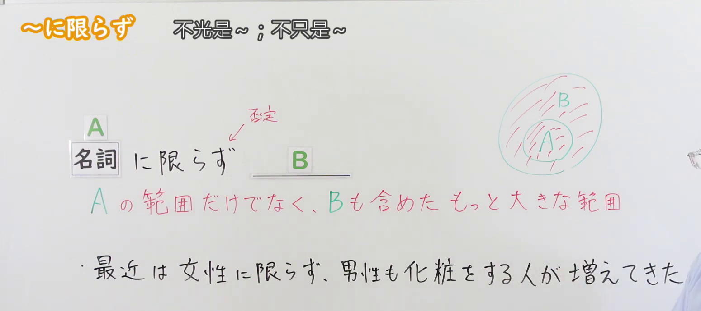
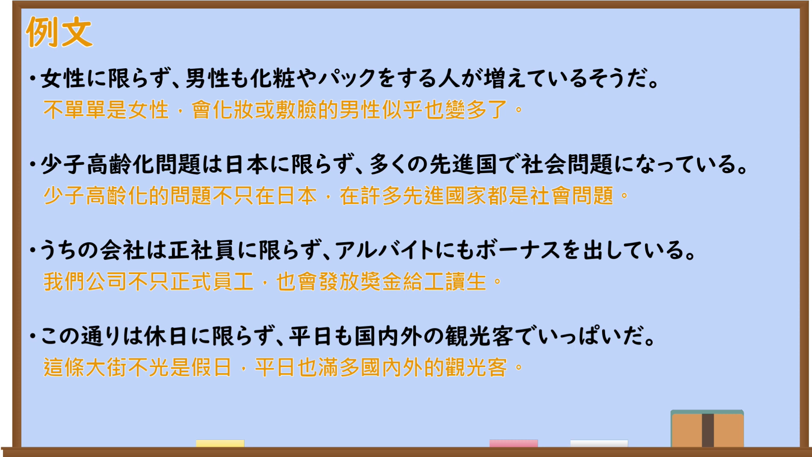

---
{
  "id": "N2-G-0056",
  "kind": "grammar",
  "level": "N2",
  "title": "～にかぎらず(限らず)：不限于……",
  "card_revision": 1,
  "schema_version": 1,
  "source": {
    "lesson": "N2 第56个语法",
    "material": "出口日語原视频板书、日语自动字幕与 Hagoromo「にかぎらず」实际条目",
    "video": "https://www.youtube.com/watch?v=KzLjPSdmKDU",
    "screenshot": "assets/grammar/n2/N2-G-0056-connection.png",
    "screenshot_seconds": 65.87,
    "screenshot_crop": {"x": 0, "y": 0, "width": 1550, "height": 690}
  },
  "tags": ["にかぎらず", "非限定", "N2"],
  "confusions": ["～にかぎって(限って)：唯独某情况", "～にかぎり(限り)：限定对象"]
}
---

# N2 第56个语法：～にかぎらず(限らず)

# 视频学习资料整理

[出口日語第56课原视频](https://www.youtube.com/watch?v=KzLjPSdmKDU)讲解「～にかぎらず(限らず)」。板书以 A、B 标示：不只限于 A，还包括 B 所在的更大范围。日语自动字幕将「名詞」识别为「名刺」；语法形式和板书内容以原视频画面为准。

- 接续图：视频 **1:05.87**；原图 **1920 × 1080**；从左上角裁切 **(x=0, y=0, width=1550, height=690)**。0:01 画面中讲师遮住了部分说明，因此选用较清晰的后续板书画面，保留语法形式、红色解释、范围图及课程例句。

  

- 例句图：视频 **2:25.00**；原图 **1920 × 1080**；从左上角裁切 **(x=0, y=0, width=1900, height=1070)**。保留四条课程例句和画面中的中文释义。

  

# 核心

## 功能一：不只限于 A，还包括 B 所在的更大范围

**最上位意味カテゴリー：**

- **～にかぎらず(限らず)：** ものごとの関係（事物之间的关系）

**中位意味カテゴリー：**

- **～にかぎらず(限らず)：** 非限定（不限定）

**意味：**

- **～にかぎらず(限らず)：** 非限定（不限定）

**くわしい意味記述：**

- **～にかぎらず(限らず)：** Nだけでなく，Nが属するグループの他のものにも当てはまる，という意味。（表示“不仅适用于 N，也适用于 N 所属群体中的其他事物”。）

**派生語：** にかぎって，にかぎり，にかぎる

### 例句

1. 男性に限らず女性も新型車に興味を持っている。

   （不仅男性，女性也对新款车感兴趣。）

2. 人体に限らず、すべての生物は細胞からできている。

   （不仅人体，所有生物都由细胞构成。）

3. 富士山に限らず、かけがえのない景観を残していくことは大きな課題だ。

   （不只是富士山，保护无可替代的景观是一项重大课题。）

# 来源

- [出口日語第56课原视频](https://www.youtube.com/watch?v=KzLjPSdmKDU)
- [Hagoromo「にかぎらず（非限定）」](https://hagoromo-text.work/)（站内实际条目；查询日期：2026-09-23）
