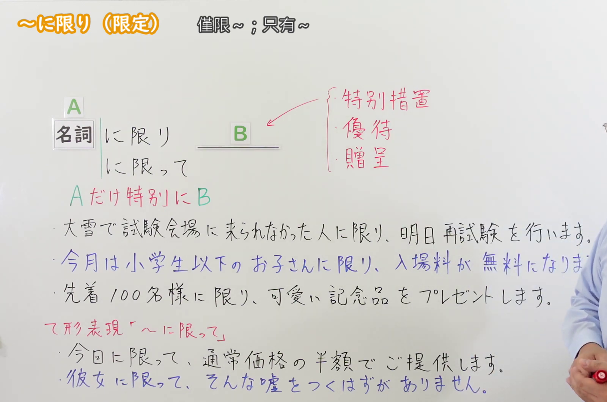
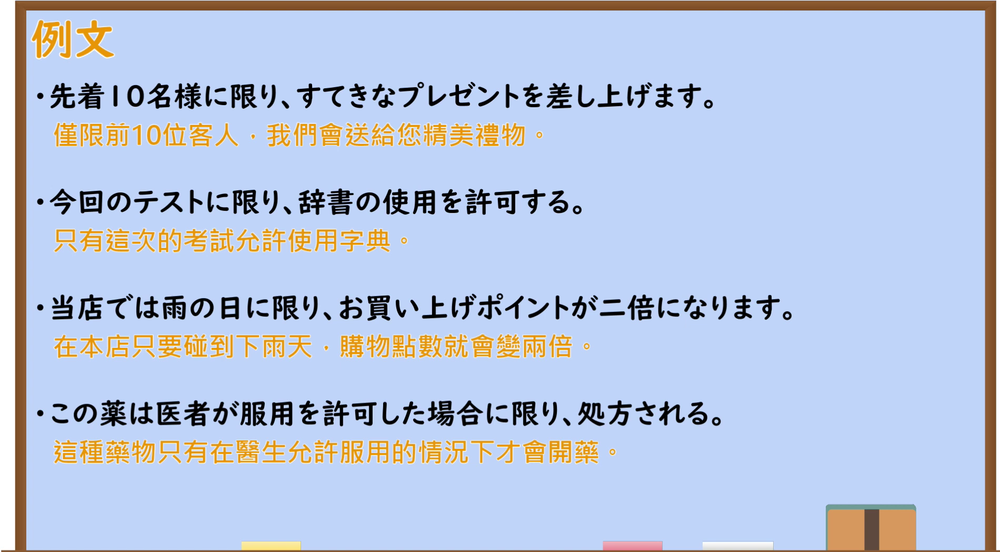

---
{
  "id": "N2-G-0057",
  "kind": "grammar",
  "level": "N2",
  "title": "～にかぎり(限り)：仅限于……",
  "card_revision": 1,
  "schema_version": 1,
  "source": {
    "lesson": "N2 第57个语法",
    "material": "出口日語原视频板书、日语自动字幕与 Hagoromo「にかぎり」实际条目",
    "video": "https://www.youtube.com/watch?v=B-jscsXjwpk",
    "screenshot": "assets/grammar/n2/N2-G-0057-connection.png",
    "screenshot_seconds": 260.0,
    "screenshot_crop": {"x": 0, "y": 0, "width": 1600, "height": 1060}
  },
  "tags": ["にかぎり", "限定", "N2"],
  "confusions": ["～にかぎって(限って)：偏偏或为某人辩护", "～にかぎらず(限らず)：不限定于某范围"]
}
---

# N2 第57个语法：～にかぎり(限り)

# 视频学习资料整理

[出口日語第57课原视频](https://www.youtube.com/watch?v=B-jscsXjwpk)讲解公告、优待等场合用「～にかぎり(限り)」限定对象或条件。板书也列出「～にかぎって(限って)」作为相关形式；本课的重点是限定条件的用法。日语自动字幕将「名詞」识别为「名刺」，卡片以原视频板书为准。

- 接续图：视频 **4:20.00**；原图 **1920 × 1080**；从左上角裁切 **(x=0, y=0, width=1600, height=1060)**。0:01 画面中讲师遮住右侧板书，因此选用较清楚的后续画面。语法形式、红色含义和主要例句可见；一条板书例句的末尾仍被讲师遮挡。

  

- 例句图：视频 **4:36.97**；原图 **1920 × 1080**；从左上角裁切 **(x=0, y=0, width=1900, height=1050)**。保留「例文」页的四条课程例句及画面中的中文释义。

  

# 核心

## 功能一：只对 A 特别适用 B

**最上位意味カテゴリー：**

- **～にかぎり(限り)：** ものごとの関係（事物之间的关系）

**中位意味カテゴリー：**

- **～にかぎり(限り)：** 限定（限定）

**意味：**

- **～にかぎり(限り)：** 限定（限定）

**くわしい意味記述：**

- **～にかぎり(限り)：** 「〜だけ」の意味。何かが適用される条件を明示する。案内など，硬い書き言葉で用いられる。（表示“仅限于～”，明确某事适用的条件；用于告示等较正式的书面表达。）

**派生語：** にかぎって，にかぎる，にかぎらず

### 例句

1. この遊園地は、５歳以下の子供に限り無料です。

   （这座游乐园仅对五岁及以下儿童免费。）

2. 通常は１プレイ１００円ですが、平日の午前中に限り２００円３プレイ、３００円５プレイのサービスを実施中です。

   （平时每玩一次收费一百日元；仅限工作日的上午，现推出二百日元玩三次、三百日元玩五次的优惠。）

3. やむを得ない理由により、この期間内に申請をすることができなかったときは、その理由のやんだ日から6月以内に限り、申請をすることができます。

   （因不得已的原因未能在规定期间内申请时，仅可在该原因消除后的六个月内提出申请。）

# 来源

- [出口日語第57课原视频](https://www.youtube.com/watch?v=B-jscsXjwpk)
- [Hagoromo「にかぎり（限定）」](https://hagoromo-text.work/)（站内实际条目；查询日期：2026-09-23）
