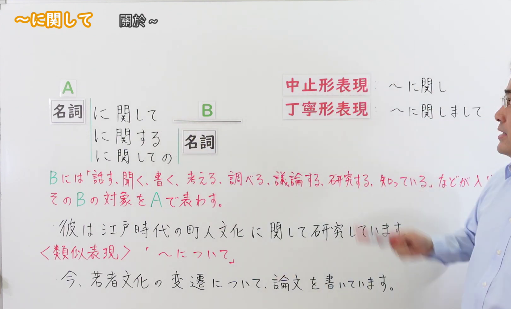
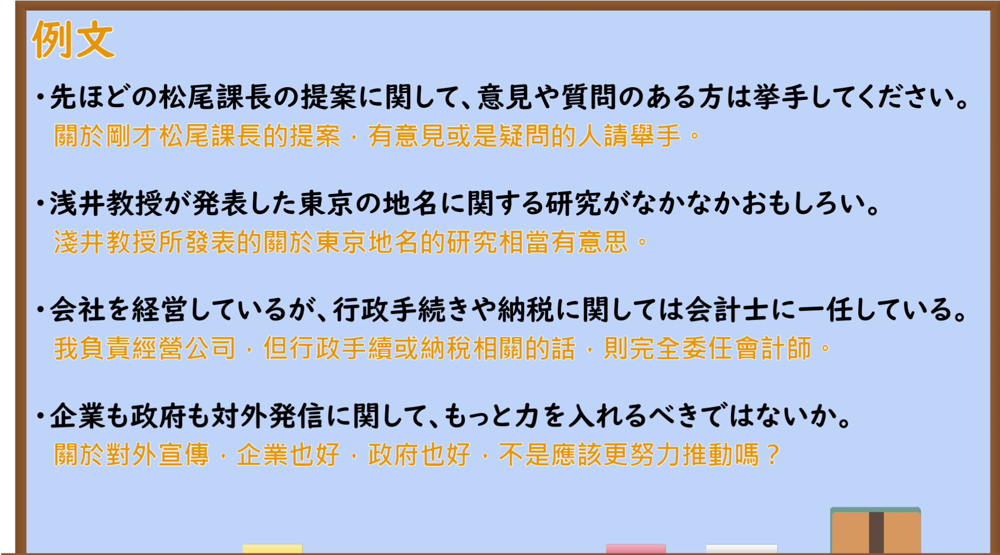

---
{
  "id": "N2-G-0058",
  "kind": "grammar",
  "level": "N2",
  "title": "にかんして(に関して)：关于、涉及",
  "card_revision": 1,
  "schema_version": 1,
  "source": {
    "lesson": "N2 第58个语法",
    "material": "出口日語原视频板书、日语自动字幕与 Hagoromo「にかんして」条目正文",
    "video": "https://www.youtube.com/watch?v=GS6viANd0NU",
    "screenshot": "assets/grammar/n2/N2-G-0058-connection.png",
    "screenshot_seconds": 35,
    "screenshot_crop": {
      "x": 0,
      "y": 0,
      "width": 1620,
      "height": 980
    }
  },
  "tags": [
    "关联对象",
    "N2"
  ],
  "confusions": [
    "について"
  ]
}
---

# N2 第58个语法：にかんして(に関して)

# 视频学习资料整理

- [出口日語原视频「～に関して」](https://www.youtube.com/watch?v=GS6viANd0NU)，时长 4 分 14 秒。
- 接续图：原视频 00:35.00；原图 1920 × 1080；从左上角裁切，区域 x=0、y=0、宽 1620、高 980。板书展示名词与「に関して／に関する／に関しての」的接续、后项类型和与「について」的比较；右侧少量板书仍有教师遮挡。

- 例句图：原视频 03:10.40；原图 1920 × 1080；从左上角裁切，区域 x=0、y=0、宽 1890、高 1050。保留四句原视频例句及其画面中的中文翻译。

# 核心

## 功能一：B 放入说、听、写、思考、调查、讨论、研究、知道等内容，用 A 表示 B 所涉及的对象

**最上位意味カテゴリー：**

- **にかんして(に関して)：** ものごとの関係（事物之间的关系）

**中位意味カテゴリー：**

- **にかんして(に関して)：** 関連・対応（关联与对应）

**意味：**

- **にかんして(に関して)：** 関連（关联）

**くわしい意味記述：**

- **にかんして(に関して)：** 「〜に関係する」という意味。後の内容は思考や発言に関するものが多い。（意思是“与……有关”。后面的内容多与思考或发言有关。）

**派生語：** にかんし，にかんする，にかんしては，にかんしても

### 例句

1. 私は音楽はわからないが、ファッションに関してはよく知っている。

   （我不懂音乐，但对时尚很了解。）

2. 教授は生物の進化に関し、最終講義をされた。

   （教授就生物的进化作了最后一次讲课。）

3. 警察では、事件に関する情報を寄せてほしいと呼びかけている。

   （警方呼吁民众提供与该事件有关的信息。）

# 来源

- [出口日語原视频「～に関して」](https://www.youtube.com/watch?v=GS6viANd0NU)
- [Hagoromo 文型检索「にかんして（関連）」](https://hagoromo-text.work/)（站内条目无独立网址；查询日期：2026-09-23）
