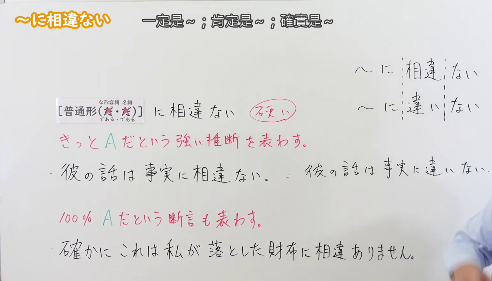
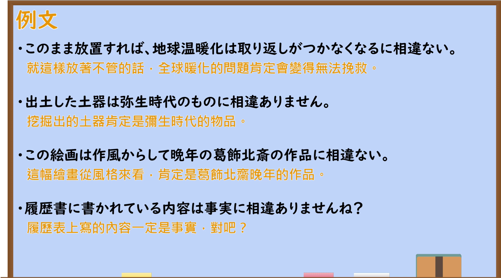

---
{
  "id": "N2-G-0059",
  "kind": "grammar",
  "level": "N2",
  "title": "にそういない(に相違ない)：一定、肯定",
  "card_revision": 1,
  "schema_version": 1,
  "source": {
    "lesson": "N2 第59个语法",
    "material": "出口日語原视频板书、日语自动字幕与毎日のんびり日本語教師「～に相違ない」条目正文",
    "video": "https://www.youtube.com/watch?v=2k-Y5QYwQxY",
    "screenshot": "assets/grammar/n2/N2-G-0059-connection.png",
    "screenshot_seconds": 180,
    "screenshot_crop": {
      "x": 0,
      "y": 0,
      "width": 1540,
      "height": 880
    }
  },
  "tags": [
    "强烈确信",
    "书面语",
    "N2"
  ],
  "confusions": [
    "にちがいない(に違いない)",
    "にきまっている(に決まっている)"
  ]
}
---

# N2 第59个语法：にそういない(に相違ない)

# 视频学习资料整理

- [出口日語原视频「～に相違ない」](https://www.youtube.com/watch?v=2k-Y5QYwQxY)，时长 4 分 53 秒。
- 接续图：原视频 03:00.00；原图 1920 × 1080；从左上角裁切，区域 x=0、y=0、宽 1540、高 880。保留接续、红色含义说明、板书例句及与「に違いない」的比较；裁去底部空白和大部分右侧人物。

- 例句图：原视频 03:18.27；原图 1920 × 1080；从左上角裁切，区域 x=0、y=0、宽 1890、高 1050。保留四句原视频例句及画面中的中文翻译。

# 核心

## 功能一：表达“必定是 A”的强烈推断，也表达确信 A 的断言

**くわしい意味記述：**

- **にそういない(に相違ない)：** 話し手の自信に満ちた強めの判断・断定を表します。書き言葉として用いられます。（表示说话人充满自信的较强判断或断定。用于书面语。）

### 例句

1. あの人が犯人に相違ない。

   （那个人一定是犯人。）

2. どれだけ釈明したとしても、罪を犯したことに相違ない。

   （无论怎样辩解，他犯了罪这一点都毋庸置疑。）

3. 今回の事件と、５年前の事件は何か深い関係があるに相違ない。

   （这次的事件与五年前的事件之间一定有某种深层联系。）

4. これは先日盗まれたものに相違ありません。

   （这一定是前几天被盗的东西。）

# 来源

- [出口日語原视频「～に相違ない」](https://www.youtube.com/watch?v=2k-Y5QYwQxY)
- [毎日のんびり日本語教師「～に相違ない」](https://mainichi-nonbiri.com/grammar/n2-nisouinai/)（采用解说及例句；查询日期：2026-09-23）
