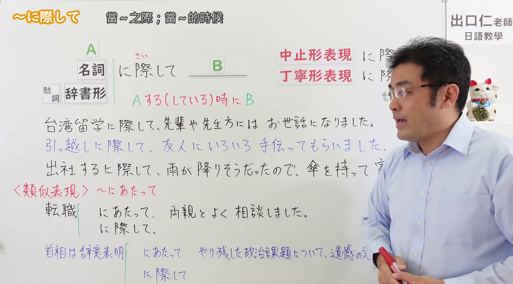
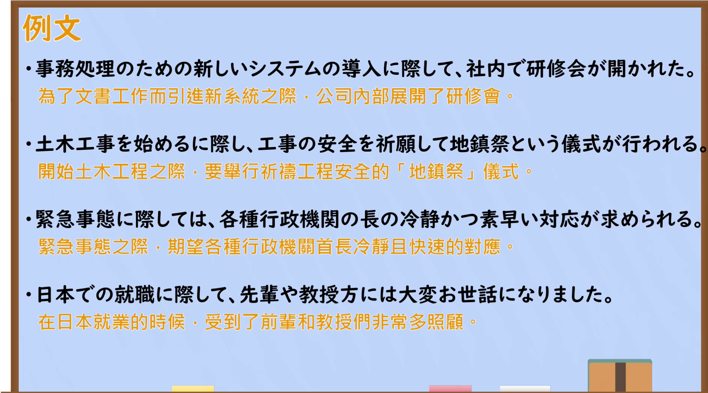

---
{
  "id": "N2-G-0060",
  "kind": "grammar",
  "level": "N2",
  "title": "にさいして(に際して)：在……之际",
  "card_revision": 1,
  "schema_version": 1,
  "source": {
    "lesson": "N2 第60个语法",
    "material": "出口日語原视频板书、日语自动字幕与日本語NET「〜に際して」条目正文",
    "video": "https://www.youtube.com/watch?v=qJNyZNXW2yc",
    "screenshot": "assets/grammar/n2/N2-G-0060-connection.png",
    "screenshot_seconds": 60,
    "screenshot_crop": {
      "x": 0,
      "y": 0,
      "width": 1890,
      "height": 1050
    }
  },
  "tags": [
    "特定场合",
    "正式表达",
    "N2"
  ],
  "confusions": [
    "にあたって"
  ]
}
---

# N2 第60个语法：にさいして(に際して)

# 视频学习资料整理

- [出口日語原视频「～に際して」](https://www.youtube.com/watch?v=qJNyZNXW2yc)，时长 7 分 42 秒。
- 接续图：原视频 01:00.00；原图 1920 × 1080；从左上角裁切，区域 x=0、y=0、宽 1890、高 1050。板书展示接续、红色含义说明、例句及与「にあたって」的比较。画面右侧仍有教师遮挡，保留完整教学内容优先。

- 例句图：原视频 05:45.83；原图 1920 × 1080；从左上角裁切，区域 x=0、y=0、宽 1890、高 1050。保留四句原视频例句及画面中的中文翻译。

# 核心

## 功能一：在做 A（或正在做 A）的时候发生 B

**くわしい意味記述：**

- **にさいして(に際して)：** 「〜するときに / 〜に先立ち」（在……的时候／在……之前）。特別な何かをする始めるときに使う言葉。（用于开始做某件特别事情的时候。）硬い表現（较正式的表达）；これから起こることに対して使う（用于将要发生的事）。

### 例句

1. お二人の門出に際して、お祝いの言葉を申し上げます。

   （值此二位踏上新征程之际，谨致以祝贺。）

2. 入居に際しての注意事項を説明します。

   （现在说明入住时的注意事项。）

3. 面接に際して、しっかりと練習しておいた方がいいですよ。

   （面试前最好充分练习。）

4. 当サイトを利用するに際して、まず利用規約をご一読ください。

   （使用本站前，请先阅读使用条款。）

# 来源

- [出口日語原视频「～に際して」](https://www.youtube.com/watch?v=qJNyZNXW2yc)
- [日本語NET「〜に際して」](https://nihongokyoshi-net.com/2019/06/04/jlptn2-grammar-nisaishite/)（采用意义说明及例句；查询日期：2026-09-23）
