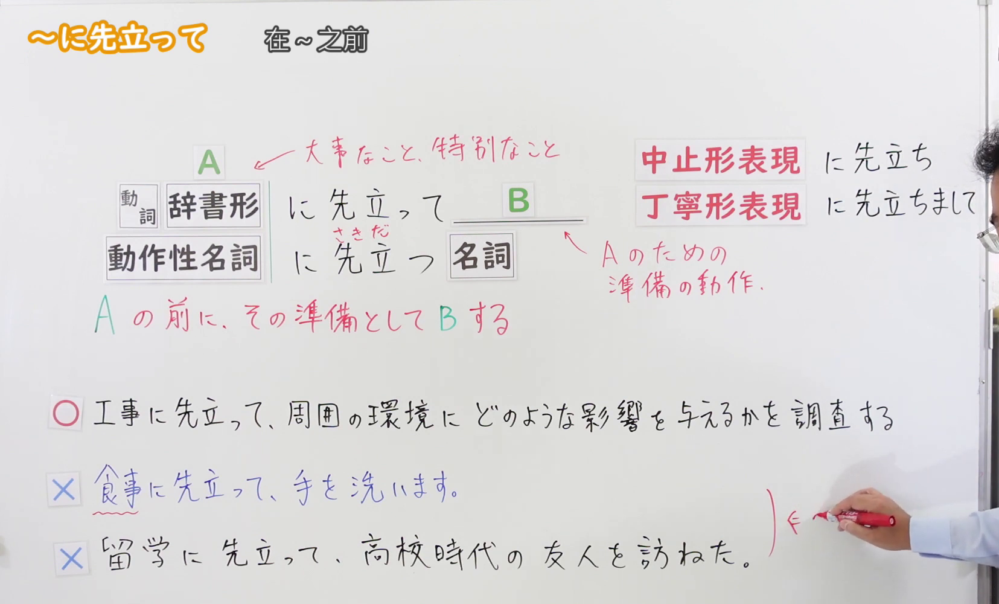
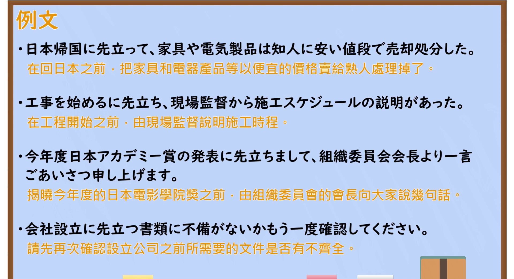

---
{
  "id": "N2-G-0061",
  "kind": "grammar",
  "level": "N2",
  "title": "～に先立って｜在A之前，作为其准备做B（在……之前）",
  "card_revision": 1,
  "schema_version": 1,
  "source": {
    "lesson": "N2 第61个语法",
    "material": "出口日語原视频板书、日语自动字幕与毎日のんびり日本語教師正文",
    "video": "https://www.youtube.com/watch?v=OStTHd-Z9Is",
    "screenshot": "assets/grammar/n2/N2-G-0061-connection.png",
    "screenshot_seconds": 220,
    "screenshot_crop": {
      "x": 0,
      "y": 0,
      "width": 1655,
      "height": 1000
    }
  },
  "tags": [
    "に先立って",
    "N2"
  ],
  "confusions": [
    "～に先駆け／に先駆けて"
  ]
}
---

# N2 第61个语法：～に先立って

## 视频学习资料整理

- 原视频：[出口日語 第61个语法 ～に先立って](https://www.youtube.com/watch?v=OStTHd-Z9Is)

### 接续图

- 画面时间 220.0 秒；原图尺寸 1920×1080，裁切区域 (0, 0, 1655, 1000)。固定左上角、收拢右下角，裁去右上角频道标识与多余画面；该时点老师让开板书，接续表、红色注释、右侧「中止形表現／丁寧形表現」两行形式与板书例句均完整可读。右下角保留老师持笔的手部，未遮挡任何板书文字。
- 0:01 与 18.3 秒的画面右侧「に先立ちまして」末字被头部遮挡，120 秒仅可见「に先立ちまし」，故改用 220.0 秒画面。

### 例句图

- 画面时间 270.2 秒；原图尺寸 1920×1080，裁切区域 (0, 0, 1920, 1045)。仅裁去画面底部黑色边框，例句页四条例句及中文注释完整，无人像遮挡。

# 核心

## 功能一：在A之前，作为其准备做B

**くわしい意味記述：**

- **～に先立ち／～に先立って：** 在…之前；在…开始之前；先于…。しておかなければならないことをまずしておくことを表します。「～する前に～をしておく」という意味です。後項に名詞が接続される場合は必ず「名詞＋に先立つ＋名詞」の形を取ります。「動詞辞書形＋に先立つ＋名詞」という形はありません。「～に先駆け／に先駆けて」に言い換えられます。（在……之前；在……开始之前；先于……。表示先把必须做好的事情提前做掉，即“在做某事之前先把某事做好”。后项接名词时，必须采用「名词＋に先立つ＋名词」的形式，不存在「动词辞书形＋に先立つ＋名词」的说法。可以替换为「～に先駆け／～に先駆けて」。）

### 例句

1. 開演に先立ち、いくつかの注意事項をご説明いたします。

   （演出开始之前，我先说明几项注意事项。）

2. 年末に先立って部屋の掃除をしている。

   （临近岁末之前，我正在打扫房间。）

3. マラソン大会の開催に先立って街の清掃活動が行われた。

   （马拉松大赛举办之前，开展了街道清扫活动。）

4. 個人情報を収集するに先立って、その利用目的を明示しなければならない。

   （收集个人信息之前，必须明示其使用目的。）

5. 通常授業を開始するに先立って、４月１日に入学式を行います。

   （正式开始常规课程之前，将于4月1日举行入学典礼。）

# 来源

- [出口日語原视频](https://www.youtube.com/watch?v=OStTHd-Z9Is)
- [毎日のんびり日本語教師「【Ｎ２文法】～に先立ち／に先立って」](https://mainichi-nonbiri.com/grammar/n2-nisakidachi/)（查询日期：2026-09-23）
