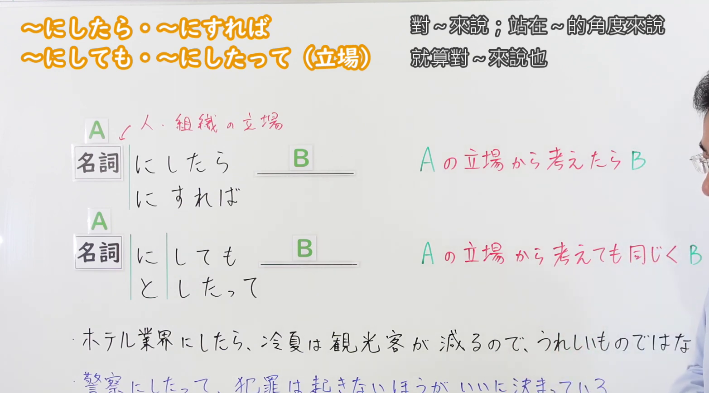
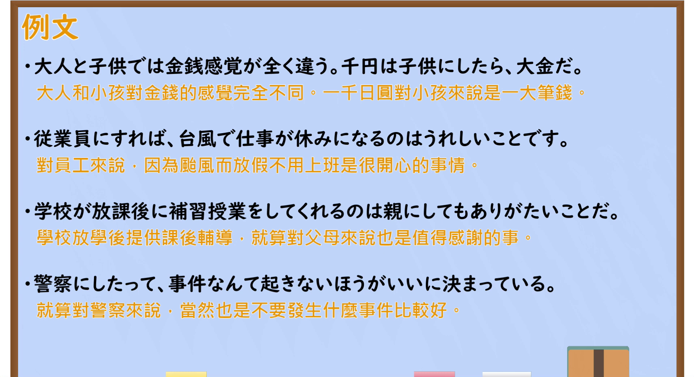

---
{
  "id": "N2-G-0062",
  "kind": "grammar",
  "level": "N2",
  "title": "～にしたら・～にすれば／～にしても・～にしたって（立場）｜站在～的立场来说；就算对～来说也一样",
  "card_revision": 1,
  "schema_version": 1,
  "source": {
    "lesson": "N2 第62个语法",
    "material": "出口日語原视频板书、日语自动字幕与はごろも文型例文データベース正文",
    "video": "https://www.youtube.com/watch?v=HjVR0zXxQPM",
    "screenshot": "assets/grammar/n2/N2-G-0062-connection.png",
    "screenshot_seconds": 180,
    "screenshot_crop": {
      "x": 0,
      "y": 0,
      "width": 1565,
      "height": 870
    }
  },
  "tags": [
    "にしたら",
    "N2"
  ],
  "confusions": [
    "～にしたら／～にすれば（判断の立場）与～にしても／～にしたって（逆接・譲歩）"
  ]
}
---

# N2 第62个语法：～にしたら・～にすれば／～にしても・～にしたって（立場）

## 视频学习资料整理

- 原视频：[出口日語 第62个语法 ～にしたら・～にすれば／～にしても・～にしたって](https://www.youtube.com/watch?v=HjVR0zXxQPM)

### 接续图

- 画面时间 180.0 秒；原图尺寸 1920×1080，裁切区域 (0, 0, 1565, 870)。固定左上角、收拢右下角，裁去右上角频道标识、老师身体与底部空白；标题、两种接续形式、两行红色解释与中文注释均完整可读。
- 遮挡说明：第一条板书例句末尾约一个字被老师头部遮挡，裁剪无法恢复；150／210／240 秒候选帧遮挡更多，故采用 180.0 秒画面。

### 例句图

- 画面时间 279.6 秒；原图尺寸 1920×1080，裁切区域 (0, 0, 1920, 1045)。仅裁去画面底部黑色边框，例句页四条例句及中文注释完整，无人像遮挡。

# 核心

## 功能一：从A的立场考虑的话，B

**最上位意味カテゴリー：**

- **～にしたら：** ものごとの関係（事情与关系）
- **～にすれば：** ものごとの関係（事情与关系）

**中位意味カテゴリー：**

- **～にしたら：** 判断の立場（判断的立场）
- **～にすれば：** 判断の立場（判断的立场）

**意味：**

- **～にしたら：** 立場・視点（立场与视角）
- **～にすれば：** 立場・視点（立场与视角）

**くわしい意味記述：**

- **～にしたら：** 話し手がある人の立場に立って考えると，どのように考えられるかを言うときに使う。人を表す名詞につく。（说话人站在某个人的立场上考虑，表示会怎么看、会怎么想。接在表示人的名词后面。）
- **～にすれば：** 話し手がある人の立場に立って考えると，どのように考えられるかを言うときに使う。人を表す名詞につく。（说话人站在某个人的立场上考虑，表示会怎么看、会怎么想。接在表示人的名词后面。）

**派生語：** 未列出

### 例句

1. 私は彼のためを思って忠告したのだが、彼にしたら迷惑だったのだろう。

   （我是为他好才忠告他的，但站在他的立场来看，那大概是一种麻烦。）

2. 太陽政策を掲げる金大統領にすれば、不満もあるかもしれない。

   （站在推行太阳政策的金大总统的立场来看，也许也有不满。）

3. 方夫妻の出国許可は、中国指導部にすれば最大限の譲歩だ。

   （方氏夫妇的出国许可，对中国领导部来说已是最大程度的让步。）

4. 名門の家にしたら、できない子。

   （站在名门望族的立场来看，他是个没出息的孩子。）

## 功能二：即使从A的立场考虑也同样，B

**最上位意味カテゴリー：**

- **～にしても：** ものごとの関係（事情与关系）
- **～にしたって：** ものごとの関係（事情与关系）

**中位意味カテゴリー：**

- **～にしても：** 逆接・譲歩（逆接与让步）
- **～にしたって：** 逆接・譲歩（逆接与让步）

**意味：**

- **～にしても：** 立場（立场）
- **～にしたって：** 逆接：仮定（逆接：假定）

**くわしい意味記述：**

- **～にしても：** 複数の立場を並べ，どの立場でも結果は同じであると主張する。（并列多个立场，主张无论从哪个立场出发结果都一样。）
- **～にしたって：** 「にしたって」に前接する要素を例にして，それ以外のことでも同様だという意味を持つ。「にしても」より砕けた話し言葉。（以前接的成分为例，表示其他情况也同样如此。是比「にしても」更随便的口语说法。）

**派生語：** 未列出

### 例句

1. 産業界にしても、消費者にしても、ゴミ問題は重要だと考えている。

   （不管是产业界还是消费者，从哪个立场看都认为垃圾问题很重要。）

2. また、官軍のほうにしても、城を残そうとする意図はまったくなかったようである。

   （另外，就算是官军一方，似乎也完全没有要保留城堡的意图。）

3. ニュートンにしても、数学、物理学は勿論、錬金術や歴史、神学にまで足を踏み入れました。

   （就拿牛顿来说，他不仅涉足数学、物理学，还涉足了炼金术、历史和神学。）

4. 休み取るにしたって、小さい会社じゃ取りにくいんですよ。

   （就算说休假，在小公司也很难休成。）

# 来源

- [出口日語原视频](https://www.youtube.com/watch?v=HjVR0zXxQPM)
- [はごろも文型例文データベース「にしたら」](https://www.hagoromo-text.work/lookup?vid=1268)（查询日期：2026-09-23）
- [はごろも文型例文データベース「にすれば」](https://www.hagoromo-text.work/lookup?vid=1282)（查询日期：2026-09-23）
- [はごろも文型例文データベース「にしても」](https://www.hagoromo-text.work/lookup?vid=1274)（查询日期：2026-09-23）
- [はごろも文型例文データベース「にしたって」](https://www.hagoromo-text.work/lookup?vid=1265)（查询日期：2026-09-23）
