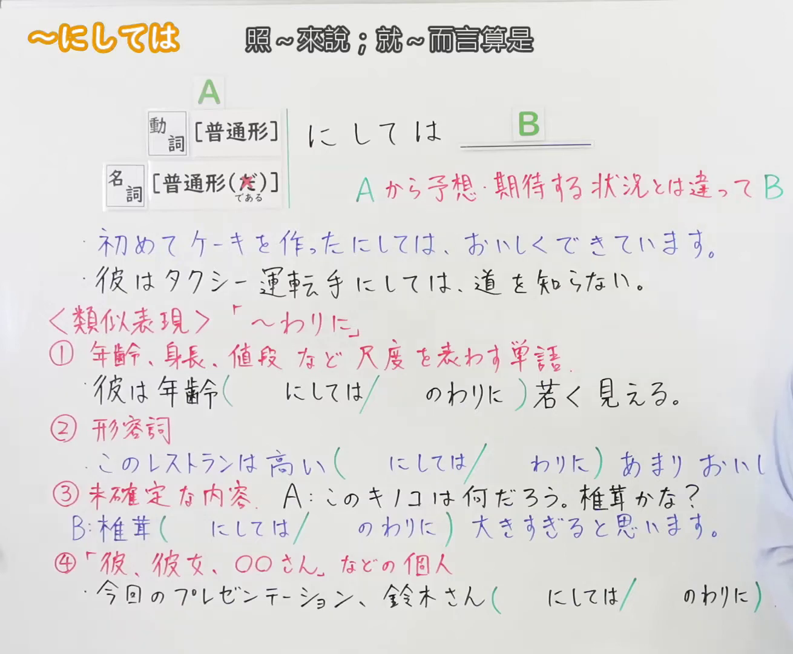
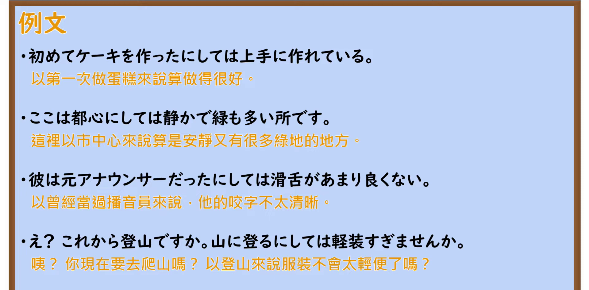

---
{
  "id": "N2-G-0063",
  "kind": "grammar",
  "level": "N2",
  "title": "～にしては｜照～来说；就～而言算是",
  "card_revision": 1,
  "schema_version": 1,
  "source": {
    "lesson": "N2 第63个语法",
    "material": "出口日語原视频板书、日语自动字幕与はごろも文型例文データベース正文",
    "video": "https://www.youtube.com/watch?v=wOiqC27LiH4",
    "screenshot": "assets/grammar/n2/N2-G-0063-connection.png",
    "screenshot_seconds": 1,
    "screenshot_crop": {
      "x": 0,
      "y": 0,
      "width": 1310,
      "height": 1080
    }
  },
  "tags": [
    "にしては",
    "N2"
  ],
  "confusions": [
    "～にしては 与 ～わりに（类似表现：尺度词、形容词后多用「わりに」；未确定内容、具体个人后用「にしては」）"
  ]
}
---

# N2 第63个语法：～にしては

## 视频学习资料整理

- 原视频：[出口日語 第63个语法 ～にしては](https://www.youtube.com/watch?v=wOiqC27LiH4)

### 接续图

- 画面时间 1.0 秒；原图尺寸 1920×1080，裁切区域 (0, 0, 1310, 1080)。视频开场即为完整板书页，无需替换时点；固定左上角、收拢右下角，裁去老师人像与右上角频道标识；标题「～にしては 照～來說；就～而言算是」、动词／名词两种接续与后项 B 的接续框架、红色解释行「A から予想・期待する状況とは違って B」、两条蓝色板书例句与〈類似表現〉「～わりに」整节均完整可读。
- 遮挡说明：〈類似表現〉第②、④条练习句的尾部在原画面即被老师身体遮挡，裁剪无法恢复；核心接续与红色释义不受影响。

### 例句图

- 画面时间 512.4 秒；原图尺寸 1920×1080，裁切区域 (0, 0, 1920, 945)。仅裁去画面底部装饰边框与板擦，例句页「例文」标题下四条例句及中文注释完整，无人像遮挡。

# 核心

## 功能一：与从A所预料、所期待的情况不同，B

**最上位意味カテゴリー：**

- **～にしては：** 考え・感情（思考与感情）

**中位意味カテゴリー：**

- **～にしては：** 主張・断定的評価（主张与断定评价）

**意味：**

- **～にしては：** 評価（评价）

**くわしい意味記述：**

- **～にしては：** 「〜にしては…」の「〜」の部分から考えると，「…」部分が当然とは言えない状態であることを表す。（从「〜にしては…」中「〜」的部分来考虑的话，表示「…」部分并不是理所当然会那样的状态。）

**派生語：** 未列出

### 例句

1. かれの日本語は、外国人にしてはうまい。

   （他的日语，就外国人而言算是很好了。）

2. 最終報告は、とかく抽象的な文言の多いこの種の提言にしては、異例と思われるほどの歯切れのよさで貫かれている。

   （这份最终报告，在措辞往往抽象的这一类建议书中，可说贯穿着一种堪称例外的干脆利落。）

3. 安全保障という国の根幹政策への与党の取り組みにしては、お粗末だ。

   （作为执政党在安全保障这一国家根本政策上的应对，实在是太过拙劣。）

# 来源

- [出口日語原视频](https://www.youtube.com/watch?v=wOiqC27LiH4)
- [はごろも文型例文データベース「にしては」](https://www.hagoromo-text.work/lookup?vid=1272)（查询日期：2026-09-23）
