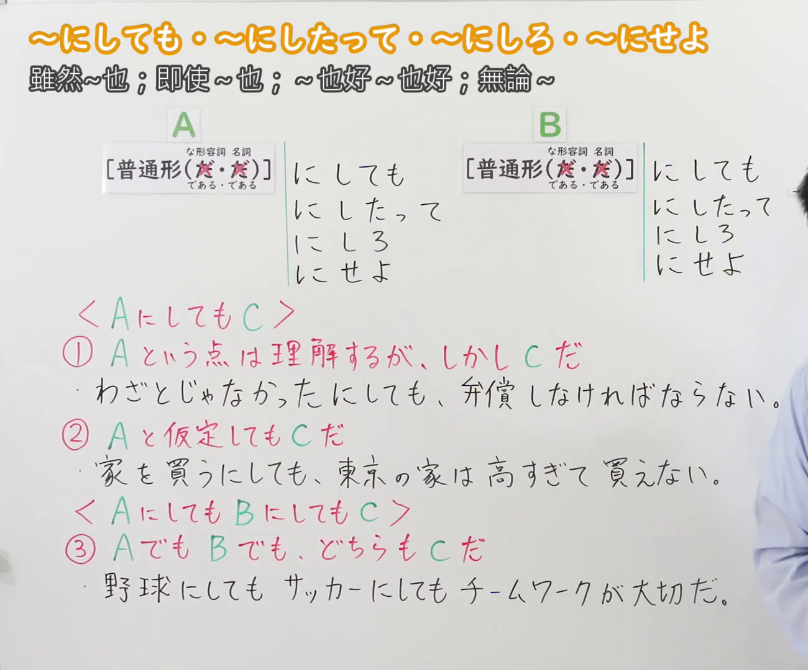
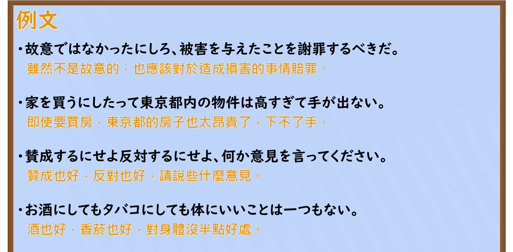

---
{
  "id": "N2-G-0064",
  "kind": "grammar",
  "level": "N2",
  "title": "～にしても・～にしたって・～にしろ・～にせよ｜虽然～也；即使～也；～也好～也好；无论～",
  "card_revision": 1,
  "schema_version": 1,
  "source": {
    "lesson": "N2 第64个语法",
    "material": "出口日語原视频板书、日语自动字幕与はごろも文型例文データベース正文",
    "video": "https://www.youtube.com/watch?v=xBgYY2T4NL0",
    "screenshot": "assets/grammar/n2/N2-G-0064-connection.png",
    "screenshot_seconds": 1,
    "screenshot_crop": {
      "x": 0,
      "y": 0,
      "width": 1300,
      "height": 1080
    }
  },
  "tags": [
    "にしても",
    "N2"
  ],
  "confusions": [
    "～にしても・～にしろ・～にせよ（逆接・譲歩）与～にしたら／～にすれば（判断の立場）；四个形式的文体差异：にしても标准、にしたって随便口语、にしろ・にせよ较硬"
  ]
}
---

# N2 第64个语法：～にしても・～にしたって・～にしろ・～にせよ

## 视频学习资料整理

- 原视频：[出口日語 第64个语法 ～にしても・～にしたって・～にしろ・～にせよ](https://www.youtube.com/watch?v=xBgYY2T4NL0)

### 接续图

- 画面时间 1.0 秒；原图尺寸 1920×1080，裁切区域 (0, 0, 1300, 1080)。视频开场即为完整板书页，无需替换时点；固定左上角、收拢右下角，裁去右侧老师人像与右上角频道标识；标题「～にしても・～にしたって・～にしろ・～にせよ 雖然~也；即使~也；~也好~也好；無論~」、A／B 两侧的四种接续形式、〈AにしてもC〉〈AにしてもBにしてもC〉两个框架、红字解释①②③与三条蓝色板书例句均完整可读，无遮挡。

### 例句图

- 画面时间 437.0 秒；原图尺寸 1920×1080，裁切区域 (0, 0, 1920, 945)。仅裁去画面底部装饰边框与板擦，例句页「例文」标题下四条例句及中文注释完整，无人像遮挡。

# 核心

## 功能一：A这一点可以理解，但却是C

**最上位意味カテゴリー：**

- **～にしろ：** ものごとの関係（事情与关系）
- **～にせよ：** ものごとの関係（事情与关系）

**中位意味カテゴリー：**

- **～にしろ：** 逆接・譲歩（逆接与让步）
- **～にせよ：** 逆接・譲歩（逆接与让步）

**意味：**

- **～にしろ：** 逆接（逆接）
- **～にせよ：** 逆接（逆接）

**くわしい意味記述：**

- **～にしろ：** 「〜であるが、結論は変わらず」の意味。「〜」の部分はあまり重要でない問題が来ることが多い。（表示"～确实如此，但结论不变"。「〜」部分往往是不太重要的问题。）
- **～にせよ：** 「〜であるが，結論は変わらず」の意味。「〜の」部分はあまり重要でない問題が来ることが多い。書き言葉では「にしろ」よりもよく使われる。（表示"～确实如此，但结论不变"。「〜」部分往往是不太重要的问题。书面语中比「にしろ」更常用。）

**派生語：**

- **～にしろ：** にしても，にせよ
- **～にせよ：** にしろ，にしても

### 例句

1. 冗談にしろ、人に向かってバカなどと言ってはいけない。

   （就算是开玩笑，也不可以对着别人说什么"笨蛋"之类的话。）

2. 仮に、理念・政策の違いを無視して連立を維持したにしろ、亀裂は埋まらず、早晩、連立政権が崩壊するのは避けられまい。

   （即使假设无视理念和政策的差异维持了联合，裂痕也无法弥合，联合政权的崩溃迟早不可避免。）

3. 何も知らなかったにせよ、そんなひどいいい方をするのは許せない。

   （就算什么都不知道，那样说话也太过分了，令人无法原谅。）

4. いくつかの過ちもあったにせよ、これらの成果は、有権者に訴えかけるための十分な基礎となる。

   （虽然也犯了一些错误，但这些成果足以成为向选民陈情的基础。）

## 功能二：即使假定A，也是C

**最上位意味カテゴリー：**

- **～にしたって：** ものごとの関係（事情与关系）
- **～にしろ：** ものごとの関係（事情与关系）

**中位意味カテゴリー：**

- **～にしたって：** 逆接・譲歩（逆接与让步）
- **～にしろ：** 逆接・譲歩（逆接与让步）

**意味：**

- **～にしたって：** 逆接：仮定（逆接：假定）
- **～にしろ：** 無関係（无关）

**くわしい意味記述：**

- **～にしたって：** 「にしたって」に前接する要素を例にして，それ以外のことでも同様だという意味を持つ。「にしても」より砕けた話し言葉。（以前接的成分为例，表示其他情况也同样如此。是比「にしても」更随便的口语说法。）
- **～にしろ：** 「どちらであっても，結論は変わらず」の意味。（表示"无论哪一种，结论都不变"。）

**派生語：**

- **～にしたって：** 未列出
- **～にしろ：** にしても，にせよ

### 例句

1. A:休み取らないの？ B:休み取るにしたって、小さい会社じゃ取りにくいんですよ。

   （A：你不休假吗？B：就算要休，在小公司也很难休得成。）

2. 課長にしろ、新人のあなたを教育しようと思って厳しいこと言ってるんだと思うよ。

   （就算他是课长，我觉得他也是在说狠话，因为想教育你这个新人。）

3. 就職、進学いずれを選ぶにしろ、大半の生徒がここで学んだ専門を生かす。

   （无论选择就业还是升学，大多数学生都会用上在这里学到的专业知识。）

## 功能三：无论A还是B，两者都是C

| 语法 | 侧重 |
|---|---|
| **第64：Aにしろ、Bにしろ** | **不管选哪种情况，结论／要求不变。** A、B可以相反，也可以是同类例子，搭配较自由。 |
| **第67：Aにつけ、Bにつけ** | **每逢A或B，都会有同样的反应／表现。** 多用对照、惯用搭配，如「いいにつけ悪いにつけ」，常带感慨，但不限于感情。 |

依据：[日本語NET](https://nihongokyoshi-net.com/2019/05/25/jlptn3-grammar-nishitemo-nishitemo/)；[日本語教師のN1et（两者比较）](https://jn1et.com/nituke/)。

**最上位意味カテゴリー：**

- **～にしても（1274）：** ものごとの関係（事情与关系）
- **～にしても（1276）：** ものごとの関係（事情与关系）
- **～にしろ〜にしろ：** ものごとの関係（事情与关系）
- **～にせよ〜にせよ：** ものごとの関係（事情与关系）

**中位意味カテゴリー：**

- **～にしても（1274）：** 逆接・譲歩（逆接与让步）
- **～にしても（1276）：** 逆接・譲歩（逆接与让步）
- **～にしろ〜にしろ：** 逆接・譲歩（逆接与让步）
- **～にせよ〜にせよ：** 逆接・譲歩（逆接与让步）

**意味：**

- **～にしても（1274）：** 立場（立场）
- **～にしても（1276）：** 例示（例示）
- **～にしろ〜にしろ：** 並立（并列）
- **～にせよ〜にせよ：** 並立（并列）

**くわしい意味記述：**

- **～にしても（1274）：** 複数の立場を並べ，どの立場でも結果は同じであると主張する。（并列多个立场，主张无论从哪个立场出发结果都一样。）
- **～にしても（1276）：** 「〜の場合でも〜の場合でも」の意味。複数の例を挙げて，どちらでも結果が同じであることを示し，自分の主張を強化する時に使う。（表示"即使～的情况，即使～的情况"。列举多个例子，表明无论哪种结果都相同，用于强化自己的主张。）
- **～にしろ〜にしろ：** 「どちらであっても，結論は変わらず」の意味。（表示"无论哪一种，结论都不变"。）
- **～にせよ〜にせよ：** XでもYでも。似たような例を二つ以上挙げたり，対立する例を二つ挙げたりして，「どのような場合でもすべて」という意味を表す。「XにしろYにしろ」「XにしてもYにしても」という言い方もある。（X也好Y也好。举出两个以上相似的例子，或举出两个对立的例子，表示"无论哪种情况都是如此"。也有「XにしろYにしろ」「XにしてもYにしても」的说法。）

**派生語：**

- **～にしても（1274）：** 未列出
- **～にしても（1276）：** にしろ，にせよ
- **～にしろ〜にしろ：** 未列出
- **～にせよ〜にせよ：** 未列出

### 例句

1. 産業界にしても、消費者にしても、ゴミ問題は重要だと考えている。

   （无论是产业界还是消费者，都认为垃圾问题很重要。）

2. インドの核実験にしても、インドネシアの経済危機にしても、日本の経済政策にしても、ＥＵ（欧州連合）の通貨統合にしても、米国の株式の臨界的騰貴にしても、話し合うことはたくさんある。

   （无论是印度的核试验、印度尼西亚的经济危机、日本的经济政策、欧盟的货币统一，还是美国股市的临界暴涨，可讨论的事情都很多。）

3. メールにしろ、電話にしろ、すぐに連絡が取れるのはうれしい。

   （不管是邮件还是电话，能马上取得联系令人高兴。）

4. 仕事を辞めるにせよ、続けるにせよ、後悔のないようにすることが必要だ。

   （无论是辞职还是继续干下去，都需要做到让自己不后悔。）

# 来源

- [出口日語原视频](https://www.youtube.com/watch?v=xBgYY2T4NL0)
- [はごろも文型例文データベース「にしろ」（逆接）](https://www.hagoromo-text.work/lookup?vid=1279)（查询日期：2026-09-23）
- [はごろも文型例文データベース「にせよ」（逆接）](https://www.hagoromo-text.work/lookup?vid=1283)（查询日期：2026-09-23）
- [はごろも文型例文データベース「にしたって」](https://www.hagoromo-text.work/lookup?vid=1265)（查询日期：2026-09-23）
- [はごろも文型例文データベース「にしろ」（無関係）](https://www.hagoromo-text.work/lookup?vid=1278)（查询日期：2026-09-23）
- [はごろも文型例文データベース「にしても」（立場）](https://www.hagoromo-text.work/lookup?vid=1274)（查询日期：2026-09-23）
- [はごろも文型例文データベース「にしても」（例示）](https://www.hagoromo-text.work/lookup?vid=1276)（查询日期：2026-09-23）
- [はごろも文型例文データベース「にしろ〜にしろ」](https://www.hagoromo-text.work/lookup?vid=1280)（查询日期：2026-09-23）
- [はごろも文型例文データベース「にせよ〜にせよ」](https://www.hagoromo-text.work/lookup?vid=1284)（查询日期：2026-09-23）
