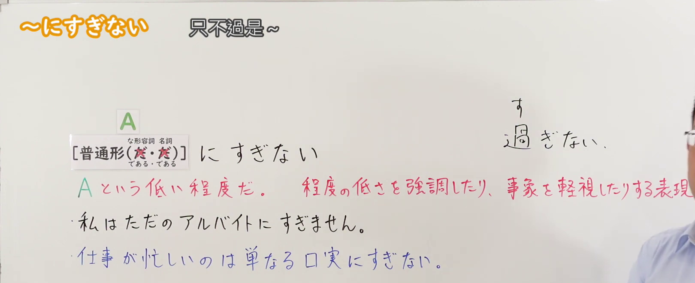
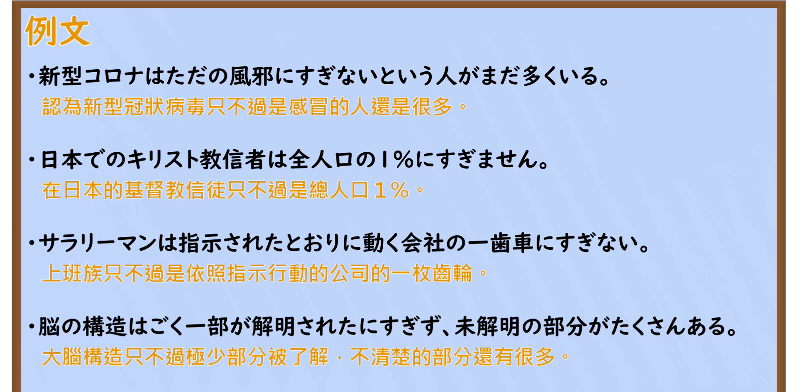

---
{
  "id": "N2-G-0065",
  "kind": "grammar",
  "level": "N2",
  "title": "～にすぎない｜只不过是～",
  "card_revision": 1,
  "schema_version": 1,
  "source": {
    "lesson": "N2 第65个语法",
    "material": "出口日語原视频板书、日语自动字幕与はごろも文型例文データベース正文",
    "video": "https://www.youtube.com/watch?v=_XAb3lMwq70",
    "screenshot": "assets/grammar/n2/N2-G-0065-connection.png",
    "screenshot_seconds": 70,
    "screenshot_crop": {
      "x": 0,
      "y": 0,
      "width": 1620,
      "height": 660
    }
  },
  "tags": [
    "にすぎない",
    "N2"
  ],
  "confusions": [
    "～にすぎない（只不过是～，低估评价）与动词～すぎる（过度、超出）意义不同；语法结构中多写平假名「にすぎない」"
  ]
}
---

# N2 第65个语法：～にすぎない

## 视频学习资料整理

- 原视频：[出口日語 第65个语法 ～にすぎない](https://www.youtube.com/watch?v=_XAb3lMwq70)

### 接续图

- 画面时间 70.0 秒；原图尺寸 1920×1080，裁切区域 (0, 0, 1620, 660)。固定左上角、收拢右下角，裁去底部空白与右侧人像；标题「～にすぎない 只不過是～」、A 的接续框架、红字解释「A という低い程度だ。 程度が低さを強調したり、事象を軽視したりする表現」、两条蓝色板书例句与手写「す／過ぎない」笔记均完整可读。
- 遮挡说明：0:01 开场画面中红字中后段被老师头部遮挡，故采用 70.0 秒红字完整露出的时点。

### 例句图

- 画面时间 155.5 秒；原图尺寸 1920×1080，裁切区域 (0, 0, 1920, 945)。仅裁去画面底部装饰边框与板擦，例句页「例文」标题下四条例句及中文注释完整，无人像遮挡。

# 核心

## 功能一：只不过是A这样低的程度，是强调程度之低、或轻视某事象的表达

**最上位意味カテゴリー：**

- **～にすぎない：** 考え・感情（思考与感情）

**中位意味カテゴリー：**

- **～にすぎない：** 主張・断定的評価（主张与断定评价）

**意味：**

- **～にすぎない：** 評価（评价）

**くわしい意味記述：**

- **～にすぎない：** ある物事の程度が低いことを言うときに使う。「単に〜だ」「それ以上のものではない」という意味。（用于说某事物的程度很低。表示"单纯就是〜""并不是比那更多的东西"的意思。）

**派生語：** 未列出

### 例句

1. 助けてくれといわれたって、僕は一介の社員にすぎない。なにもできないよ。

   （就算说让我帮忙，我也只不过是一个普通职员罢了。什么也做不了。）

2. 漢字を知ってるといったって、100字程度を覚えたにすぎない。

   （虽说认识汉字，也只不过是记住了100字左右的程度。）

3. インドと違って中国は独立国であったが、独立は名目にすぎなかったため、ここでも強烈な民族主義運動が燃え上がった。

   （与印度不同，中国曾是独立国家，但独立只不过是名义而已，因此这里同样燃起了强烈的民族主义运动。）

4. 世界の穀物貿易量は年間約二億トンであるが、これは生産量全体の一割程度に過ぎない。

   （世界谷物贸易量为每年约两亿吨，但这只不过占总产量的一成左右。）

5. 病気になったといっても、ただの風邪にすぎない。

   （虽说说是病了，也不过是普通感冒而已。）

# 来源

- [出口日語原视频](https://www.youtube.com/watch?v=_XAb3lMwq70)
- [はごろも文型例文データベース「にすぎない」](https://www.hagoromo-text.work/lookup?vid=1281)（查询日期：2026-09-23）
