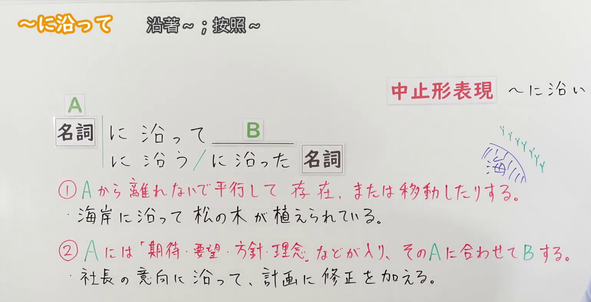
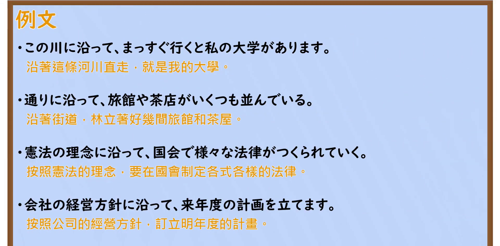

---
{
  "id": "N2-G-0066",
  "kind": "grammar",
  "level": "N2",
  "title": "～に沿って／～に沿う／～に沿った｜沿着～；按照～",
  "card_revision": 1,
  "schema_version": 1,
  "source": {
    "lesson": "N2 第66个语法",
    "material": "出口日語原视频板书、日语自动字幕与毎日のんびり日本語教師正文",
    "video": "https://www.youtube.com/watch?v=ELS9zp0m7_w",
    "screenshot": "assets/grammar/n2/N2-G-0066-connection.png",
    "screenshot_seconds": 105,
    "screenshot_crop": {
      "x": 0,
      "y": 0,
      "width": 1540,
      "height": 790
    }
  },
  "tags": [
    "に沿って",
    "N2"
  ],
  "confusions": [
    "～に沿って（沿著、按照既有对象或方针）与～に応じて（根据情况变化而相应调整）"
  ]
}
---

# N2 第66个语法：～に沿って／～に沿う／～に沿った

## 视频学习资料整理

- 原视频：[出口日語 第66个语法 ～に沿って](https://www.youtube.com/watch?v=ELS9zp0m7_w)

### 接续图

- 画面时间 105.0 秒；原图尺寸 1920×1080，裁切区域 (0, 0, 1540, 790)。固定左上角、收拢右下角，裁去右侧老师人像与底部空白；标题「～に沿って 沿著～；按照～」、名词接续与后项 B 的接续框架（に沿って／に沿う／に沿った＋名词）、红字解释①②（含「そのAに合わせてBする」尾部）、两条蓝色板书例句、红框「中止形表現」与手写「〜に沿い」及海岸示意图均完整可读，无遮挡。
- 遮挡说明：0:01 开场画面中红字②尾部被老师头部遮挡，故采用 105.0 秒两条红字完整露出的时点。

### 例句图

- 画面时间 164.8 秒；原图尺寸 1920×1080，裁切区域 (0, 0, 1920, 945)。仅裁去画面底部装饰边框与板擦，例句页「例文」标题下四条例句及中文注释完整，无人像遮挡。

# 核心

## 功能一：不离开A、与A平行地存在，或者移动

**くわしい意味記述：**

- **～に沿って／～に沿った：** ①道路や河川、建造物の沿線上、あるいはそれまでの流れ（道路、河流、建筑物的沿线之上，或者其间的流向。）

### 例句

1. 運命に沿って生きる。

   （按照命运生存。）

2. 川に沿って歩く。

   （沿河行走。）

3. この辺りは川に面した崖に沿って建てられている家が多い。

   （这一带沿着面向河的悬崖建造的房子很多。）

4. 通りに沿って３階建ての建物が建ち並んでいる。

   （沿着街道排列着3层楼的建筑物。）

## 功能二：A填入期待、要求、方针、理念等，配合该A做B

**くわしい意味記述：**

- **～に沿って／～に沿った：** ②状況や方針に応じること、あるいはマニュアル、説明書などの操作手順に従うこと（顺应状况或方针，或者遵从手册、说明书等的操作步骤。）

### 例句

1. お客様のご意向に沿った最適な提案をいたします。

   （按照顾客的意愿提出最合适的建议。）

2. 成功するイメージを思い描き、そのシナリオに沿って行動する。

   （想象成功的印象，并按照想象的内容行动。）

3. マニュアルに沿って作業しなければ大事故を招く恐れがある。

   （如果不按照说明书进行作业的话，有可能导致大事故。）

4. 改善案も出されたが、原点に立ち戻り当初の方針に沿って行われることになった。

   （虽然也提出了改善方案，但还是回到原点按照当初的方针进行。）

# 来源

- [出口日語原视频](https://www.youtube.com/watch?v=ELS9zp0m7_w)
- [毎日のんびり日本語教師「【Ｎ２文法】～に沿って／に沿った」](https://mainichi-nonbiri.com/grammar/n2-nisotte/)（查询日期：2026-09-23）
