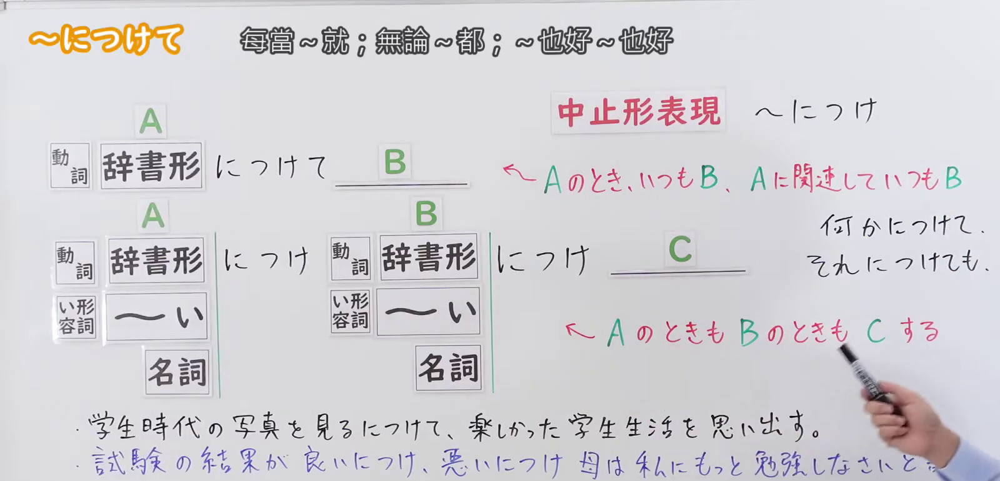
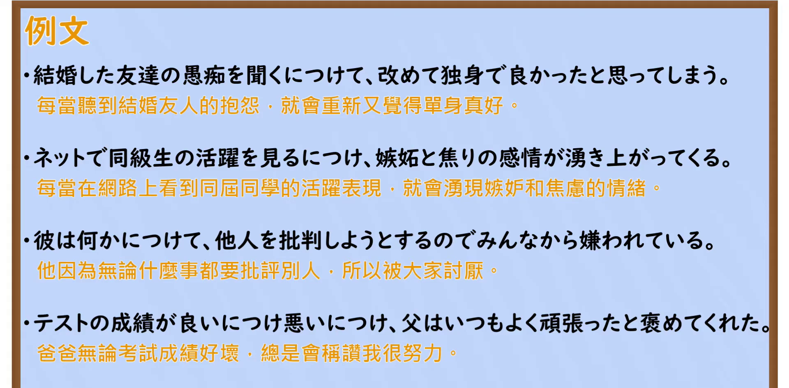

---
{
  "id": "N2-G-0067",
  "kind": "grammar",
  "level": "N2",
  "title": "～につけて／～につけ｜每当～就；无论～都；～也好～也好",
  "card_revision": 1,
  "schema_version": 1,
  "source": {
    "lesson": "N2 第67个语法",
    "material": "出口日語原视频板书、日语自动字幕与はごろも文型例文データベース正文",
    "video": "https://www.youtube.com/watch?v=YflLkrjOtJ0",
    "screenshot": "assets/grammar/n2/N2-G-0067-connection.png",
    "screenshot_seconds": 115,
    "screenshot_crop": {
      "x": 0,
      "y": 0,
      "width": 1600,
      "height": 770
    }
  },
  "tags": [
    "につけて",
    "N2"
  ],
  "confusions": [
    "～につけて 与 ～たびに（板书类似表现）；中止形～につけ 更硬，多用于惯用表现"
  ]
}
---

# N2 第67个语法：～につけて／～につけ

## 视频学习资料整理

- 原视频：[出口日語 第67个语法 ～につけて](https://www.youtube.com/watch?v=YflLkrjOtJ0)

### 接续图

- 画面时间 115.1 秒；原图尺寸 1920×1080，裁切区域 (0, 0, 1600, 770)。固定左上角、收拢右下角，裁去右侧老师人像与底部空白；标题「～につけて 每當~就；無論~都；~也好~也好」、动词辞书形＋につけて B 与 A につけ A につけ C 两个接续框架、红字解释①「〜A のとき、いつも B、A に関連していつも B」与②「A のときも B のときも C する」、红框「中止形表現 〜につけ」、手写「何かに付けて、それに付けても、」及两条蓝色板书例句均完整可读。
- 遮挡说明：0:01 开场画面中两条红字尾部被老师头部遮挡，故采用 115.1 秒红字完整露出的时点；第二条板书例句「試験の結果が良いにつけ、悪いにつけ…」的句尾在原画面即被老师手部遮挡，裁剪无法恢复。

### 例句图

- 画面时间 358.4 秒；原图尺寸 1920×1080，裁切区域 (0, 0, 1920, 945)。仅裁去画面底部装饰边框与板擦，例句页「例文」标题下四条例句及中文注释完整，无人像遮挡。

# 核心

## 功能一：A的时候，总是B；与A相关联总是B

**最上位意味カテゴリー：**

- **～につけて：** ものごとの関係（事情与关系）

**中位意味カテゴリー：**

- **～につけて：** 関連・対応（关联与对应）

**意味：**

- **～につけて：** 関連（关联）

**くわしい意味記述：**

- **～につけて：** 「Xをするたびに，いつも」という意味を表す。「何かにつけ（て）」「何事につけ（て）」は慣用表現で，「どんなときでも」「何かの機会があるたびに」「何かの機会といつも関連付けて」という意味を表す。動詞は「を見るにつけて（も）」の形でよく使われる。（表示"每当做X，总是"的意思。「何かにつけ（て）」「何事につけ（て）」是惯用表现，表示"无论什么时候""每当有什么机会""总与某个机会相关联"。动词常用「を見るにつけて（も）」的形式。）

**派生語：** につけ，につけては，につけても

### 例句

1. 争いが起こるにつけ、人間の愚かさを思い知らされる。

   （每当发生争斗，就让我切身感受到人类的愚蠢。）

2. 娘の成長した姿を見るにつけても、なくなった妻を思い出す。

   （每当看到女儿成长的姿态，我就想起去世的妻子。）

3. こうした現状を見るにつけ、改めて政治の抜本的な改革の必要性を痛感する。

   （看到这种现状，我再次深切感受到政治根本性改革的必要性。）

4. 娘が成長するにつけ、「主人にひと目見せてあげたい」との思いが募るという。

   （她说，随着女儿一天天长大，"想让丈夫看一眼"的念头越来越强烈。）

## 功能二：A的时候也，B的时候也，都C

**最上位意味カテゴリー：**

- **～につけ〜につけ：** ものごとの関係（事情与关系）

**中位意味カテゴリー：**

- **～につけ〜につけ：** 並列・反復（并列与反复）

**意味：**

- **～につけ〜につけ：** 並立（并列）

**くわしい意味記述：**

- **～につけ〜につけ：** 対照的なことがらを並べ，両方の側面があることを示す。「良きにつけ，悪しきにつけ」など限られたコロケーションでのみ使われる。（并列对照的事物，表示两方面的情况都存在。只用于「良きにつけ，悪しきにつけ」等有限的搭配。）

**派生語：** 未列出

### 例句

1. 子どもは、よきにつけあしきにつけ、親を手本として育つ。

   （孩子无论好坏，都以父母为榜样成长。）

2. たとえば、イギリス、フランス、アメリカ、中国、インドなどのような国々は、よきにつけ、あしきにつけ、その国のソトにいる多くの人々によって、よく知られている。

   （例如英国、法国、美国、中国、印度这样的国家，无论好坏，都为该国之外的许多人们所熟知。）

3. 暑いにつけ涼しいにつけ、好きな時に好きな所でごろ寝をするくらい気楽で快いことはないだろう。

   （无论炎热还是凉爽，没有什么比想睡就睡、想躺哪儿就躺哪儿更自在舒服的了。）

# 来源

- [出口日語原视频](https://www.youtube.com/watch?v=YflLkrjOtJ0)
- [はごろも文型例文データベース「につけて」](https://www.hagoromo-text.work/lookup?vid=1313)（查询日期：2026-09-23）
- [はごろも文型例文データベース「につけ〜につけ」](https://www.hagoromo-text.work/lookup?vid=1312)（查询日期：2026-09-23）
