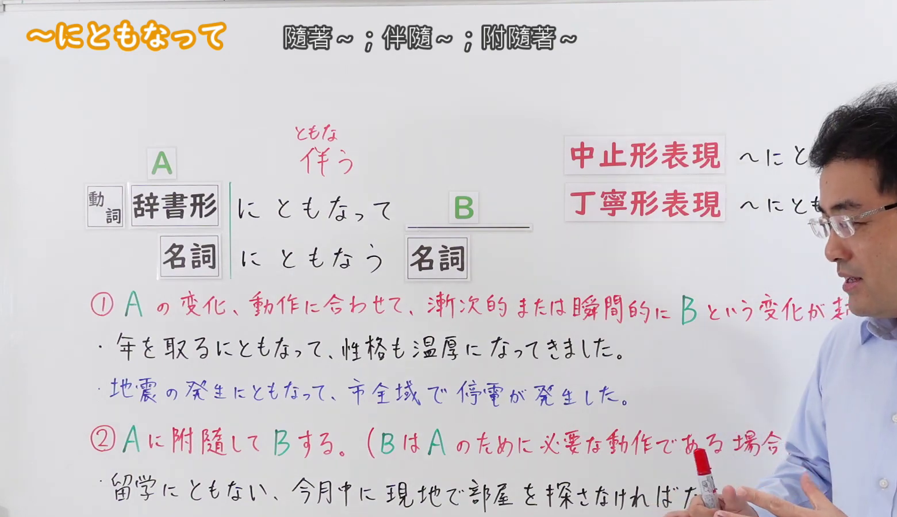
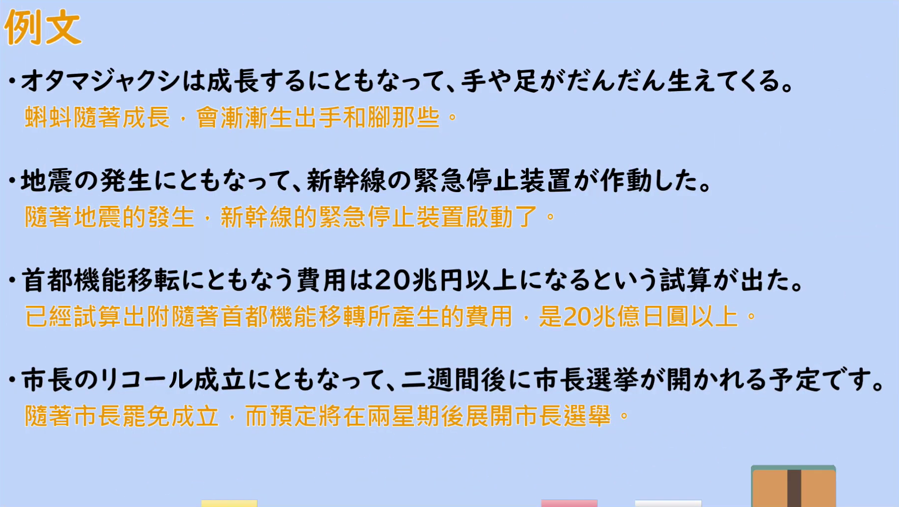

---
{
  "id": "N2-G-0068",
  "kind": "grammar",
  "level": "N2",
  "title": "にともなって(伴って)（伴随……；随着……）",
  "card_revision": 1,
  "schema_version": 1,
  "source": {
    "lesson": "N2 第68个语法",
    "material": "出口日語原视频板书、日语自动字幕与Hagoromo文型検索、Japanese Exercises正文",
    "video": "https://www.youtube.com/watch?v=YK8b4gwS_qQ",
    "screenshot": "assets/grammar/n2/N2-G-0068-connection.png",
    "screenshot_seconds": 210,
    "screenshot_crop": {
      "x": 0,
      "y": 0,
      "width": 1560,
      "height": 900
    }
  },
  "tags": [
    "伴随",
    "变化",
    "N2"
  ],
  "confusions": [
    "〜につれて（侧重逐渐变化，不能用于「付随」用法）",
    "〜とともに（另有「和……一起」的用法）",
    "〜にしたがって（另有「按照、遵从」的用法）"
  ]
}
---

# にともなって(伴って)（伴随……；随着……）

## 视频学习资料整理

[出口日語原视频](https://www.youtube.com/watch?v=YK8b4gwS_qQ)（N2 第68个语法「にともなって」，时长 5:36）

**接续图（3:30，即 210 秒）**

原图 1920×1080，裁切区域 x=0、y=0、width=1560、height=900（固定左上角，收拢右下角裁去底部空白与右侧多余画面）。

板书内容：接续表「動詞　辞書形＋にともなって B」「名詞＋にともなう＋名詞」；接续表右上标注「中止形表現」「丁寧形表現」两个更文雅的接续形式；板书中段用红字列出的两个用法——用法①「Aの変化、動作に合わせて、漸次的または瞬間的にBという変化が起こる」、用法②「Aに附随してBする。(BはAのために必要な動作である場合が多い)」，每个用法下方另附板书例句。

说明：0:01 的画面同样完整，但老师头部正好挡住用法①的句尾与用法②的句尾；改用遮挡更少的 3:30（210 秒）时点。该时点老师仍站在板书右侧，用法①的句尾「変化が起こる」与用法②的句尾「場合が多い」被其头部遮挡，无法完全避免；①②的主要文句均可读出，接续表完整清晰。

**例句图（3:52，即 232 秒）**

原图 1920×1080，裁切区域 x=52、y=20、width=1816、height=1024（裁去四周的木质边框与画面底部）。该时点画面为视频的「例文」页，无人物遮挡，列出 4 个例句并附有视频自带的中文翻译，涵盖「変化」与「付随」两类用法。

# 核心

## 功能一：随着 A 的变化、动作，逐渐地或瞬间地发生 B 的变化

**最上位意味カテゴリー：**

- **にともなって(伴って)：** ものごとの関係（事物的关系）

**中位意味カテゴリー：**

- **にともなって(伴って)：** 関連・対応（关联・对应）

**意味：**

- **にともなって(伴って)：** 関連（关联）

**くわしい意味記述：**

- **にともなって(伴って)：** 「〜が変化すると，それとともに〜も変化する」という意味を表す。（表示“当～发生变化时，与之一起～也发生变化”的意思。）

**派生語：** にともない，にともなう，にともなった

### 例句

1. 風に伴って雨も強くなってきた。

   （随着刮风，雨也变大了。）

2. 戦争に伴い多大の犠牲を払った。

   （伴随着战争，付出了巨大的牺牲。）

3. 消費税増税に伴う国民の不満は増大している。

   （随着消费税增税，国民的不满正在增大。）

4. 制度をこのまま放置すれば、高齢者の増加にともなって、社会保険料負担はさらに重くなる。

   （如果制度就这样搁置不管，随着高龄者的增加，社会保险费的负担会进一步加重。）

## 功能二：伴随 A 同时做 B（B 多为 A 所必需的动作）

**くわしい意味記述：**

- **にともなって(伴って)：** AのときにBが起こる（处于 A 的情况时，B 也发生）

### 例句

1. 姉は結婚にともなって、仕事を辞めた。

   （姐姐随着结婚，辞掉了工作。）

2. 父は退職にともなって、海外移住をした。

   （父亲随着退休，移居到了海外。）

3. 大学卒業にともない、東京に引っ越しした。

   （随着大学毕业，搬到了东京。）

4. 台風の接近にともない、学校が休校になった。

   （随着台风的接近，学校停课了。）

# 来源

- [出口日語原视频](https://www.youtube.com/watch?v=YK8b4gwS_qQ)（查询日期：2026-09-23）
- [Hagoromo 文型検索「にともなって」](https://www.hagoromo-text.work/lookup?vid=1328)（查询日期：2026-09-23）
- [Japanese Exercises「JLPT N2 ～にともなって　文法解説・問題」](https://japaneseexercises.com/2024/12/23/%E3%80%90jlpt-n2-%EF%BD%9E%E3%81%AB%E3%81%A8%E3%82%82%E3%81%AA%E3%81%A3%E3%81%A6%E3%80%80%E6%96%87%E6%B3%95%E8%A7%A3%E8%AA%AC%E3%83%BB%E5%95%8F%E9%A1%8C%E3%80%91/)（查询日期：2026-09-23）
