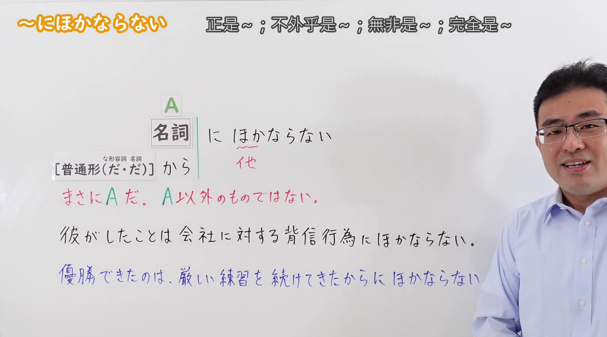
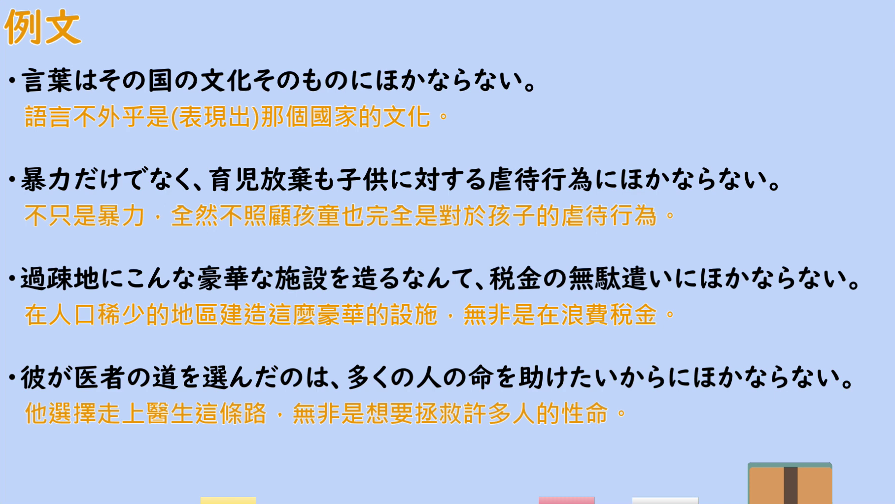

---
{
  "id": "N2-G-0069",
  "kind": "grammar",
  "level": "N2",
  "title": "にほかならない(に他ならない)（正是……；不外乎是……）",
  "card_revision": 1,
  "schema_version": 1,
  "source": {
    "lesson": "N2 第69个语法",
    "material": "出口日語原视频板书、日语自动字幕与Hagoromo文型検索正文",
    "video": "https://www.youtube.com/watch?v=qOWCVa_tcl4",
    "screenshot": "assets/grammar/n2/N2-G-0069-connection.png",
    "screenshot_seconds": 120,
    "screenshot_crop": {
      "x": 0,
      "y": 0,
      "width": 1620,
      "height": 900
    }
  },
  "tags": [
    "断定",
    "评价",
    "N2"
  ],
  "confusions": [
    "〜にすぎない（表示「不过是、仅仅是」，侧重程度低，不是强调断定）",
    "〜に違いない（表示推测「一定是」，而にほかならない表示断定）",
    "〜ほかない／〜しかない（表示「只好、只能」，侧重别无选择）"
  ]
}
---

# にほかならない(に他ならない)（正是……；不外乎是……）

## 视频学习资料整理

[出口日語原视频](https://www.youtube.com/watch?v=qOWCVa_tcl4)（N2 第69个语法「にほかならない」，时长 3:37）

**接续图（2:00，即 120 秒）**

原图 1920×1080，裁切区域 x=0、y=0、width=1620、height=900（固定左上角，收拢右下角裁去底部空白与右侧多余画面）。

板书内容：接续表「名詞＋にほかならない」，以及「[普通形(だ・だ)] から＋にほかならない」——后者板注「な形容詞　名詞」，说明普通形后接「から」时表示原因理由；接续表内另有老师补写的红色「他」字，标出「にほかならない」的汉字写法。板书中段用红字给出的解释是「まさに A だ。A以外のものではない。」，下方跟两条板书例句。

说明：0:01 的画面同样完整，但老师头部正好挡住两条例句的句尾；改用 2:00（120 秒）时点，此时老师站到板书右侧画面边缘，接续表、红字解释与两条例句均完整可读，无遮挡。

**例句图（2:10，即 130 秒）**

原图 1920×1080，裁切区域 x=52、y=20、width=1816、height=1024（裁去四周的木质边框与画面底部）。该时点画面为视频的「例文」页，无人物遮挡，列出 4 个例句并附有视频自带的中文翻译。

# 核心

## 功能一：正是 A。不是 A 以外的东西

**最上位意味カテゴリー：**

- **にほかならない(に他ならない)：** 考え・感情（思想与感情）

**中位意味カテゴリー：**

- **にほかならない(に他ならない)：** 主張・断定的評価（主张・断定的评价）

**意味：**

- **にほかならない(に他ならない)：** 評価（评价）

**くわしい意味記述：**

- **にほかならない(に他ならない)：** 「それより他にない」「絶対に〜だ」という意味。書きことばで使う。（表示“除此之外没有别的”“绝对是～”的意思。用于书面语。）

**派生語：** 未列出

### 例句

1. 今回のストライキは、この制度に対する反感の表れにほかならない。

   （这次罢工无非是对这一制度反感的表现。）

2. 言い換えれば、他の要件がすべて満たされている以上、平和条約の策定とは、まさに領土問題の解決にほかならない。

   （换言之，既然其他条件都已满足，制定和平条约正是领土问题的解决。）

3. 予算編成とは、貴重な国民の税金をどのように用いるか、選択を行う作業に他ならない。

   （所谓编制预算，不外乎是就如何使用宝贵的国民税金做出选择的工作。）

4. 新聞倫理綱領や放送基準を設け、自らを厳しく律しているのは、民主主義の根幹である言論の自由を守るための努力にほかならない。

   （制定新闻伦理纲领和播出标准、严格自律，无非是为了守护作为民主主义根基的言论自由所做的努力。）

# 来源

- [出口日語原视频](https://www.youtube.com/watch?v=qOWCVa_tcl4)（查询日期：2026-09-23）
- [Hagoromo 文型検索「にほかならない」](https://www.hagoromo-text.work/lookup?vid=1340)（查询日期：2026-09-23）
