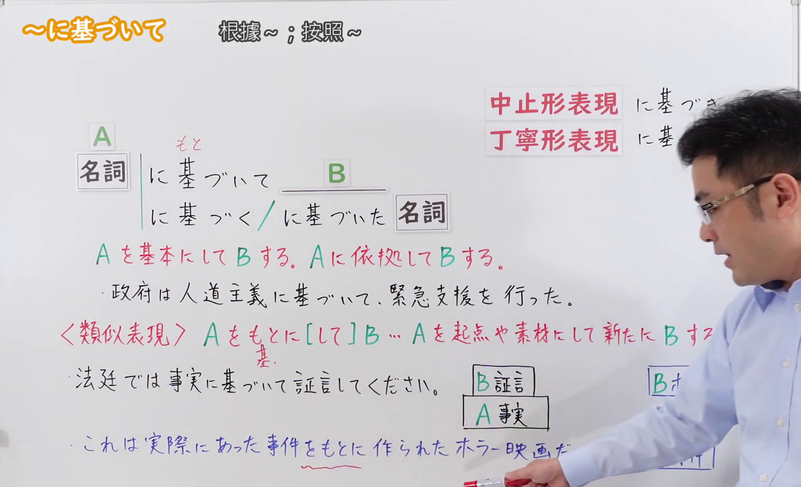
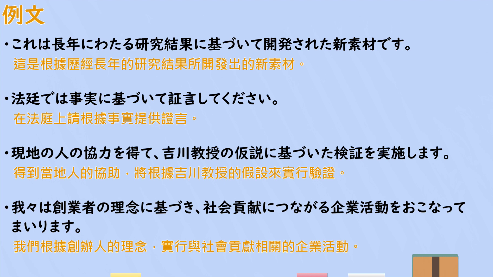

---
{
  "id": "N2-G-0070",
  "kind": "grammar",
  "level": "N2",
  "title": "にもとづいて(に基づいて)（根据……；按照……）",
  "card_revision": 1,
  "schema_version": 1,
  "source": {
    "lesson": "N2 第70个语法",
    "material": "出口日語原视频板书、日语自动字幕与Hagoromo文型検索正文",
    "video": "https://www.youtube.com/watch?v=ZZvwL9ovRqk",
    "screenshot": "assets/grammar/n2/N2-G-0070-connection.png",
    "screenshot_seconds": 200,
    "screenshot_crop": {
      "x": 0,
      "y": 0,
      "width": 1660,
      "height": 1010
    }
  },
  "tags": [
    "根据",
    "基准",
    "N2"
  ],
  "confusions": [
    "〜をもとに（して）（把A当作材料或素材做出新的B；板书列为〈類似表現〉，与「に基づいて」的「以A为根据」不同）",
    "〜に沿って（表示沿着、按照，侧重顺着既定的方针或期待）",
    "〜に従って（表示按照、遵从，也用于随着变化）"
  ]
}
---

# にもとづいて(に基づいて)（根据……；按照……）

## 视频学习资料整理

[出口日語原视频](https://www.youtube.com/watch?v=ZZvwL9ovRqk)（N2 第70个语法「に基づいて」，时长 6:25）

**接续图（3:20，即 200 秒）**

原图 1920×1080，裁切区域 x=0、y=0、width=1660、height=1010（固定左上角，收拢右下角裁去右侧多余画面与底部空白）。

板书内容：接续表「名詞＋に基づいて B」，以及「名詞＋に基づく／に基づいた＋名詞」（板上在「基」上标注读音「もと」）；接续表右上标注「中止形表現」「丁寧形表現」两个更文雅、更礼貌的接续形式；板书中段用红字给出的解释是「Aを基本にして B する。Aに依拠して B する。」，下方跟两条板书例句（政府は人道主義に基づいて、緊急支援を行った。／法廷では事実に基づいて証言してください。）；再下方另有红字标注的〈類似表現〉「Aをもとに[して]B… Aを起点や素材にして新たに B する」，并附例句（これは実際にあった事件をもとに作られたホラー映画だ。）。

说明：0:01 的画面同样完整，但老师头部挡住〈類似表現〉一行的句尾；改用 3:20（200 秒）时点。该时点老师仍站在板书右侧，〈類似表現〉句尾的「る」与右侧的「B ホラー映画」小框被其身体遮住，无法完全避免；接续表、红字解释、两条例句与〈類似表現〉的主要文句均可读出。裁切高度取到 1010 以保留板书最后一行例句。

**例句图（4:46，即 286 秒）**

原图 1920×1080，裁切区域 x=52、y=20、width=1816、height=1024（裁去四周的木质边框与画面底部）。该时点画面为视频的「例文」页，无人物遮挡，列出 4 个例句并附有视频自带的中文翻译，涵盖「に基づいて」「に基づいた」「に基づき」三种接续。

# 核心

## 功能一：以 A 为基础做 B；依据 A 做 B

**最上位意味カテゴリー：**

- **にもとづいて(に基づいて)：** ものごとの関係（事物的关系）

**中位意味カテゴリー：**

- **にもとづいて(に基づいて)：** 基準（基准）

**意味：**

- **にもとづいて(に基づいて)：** 根拠（根据）

**くわしい意味記述：**

- **にもとづいて(に基づいて)：** 「〜を基本にして」「判断や行動をするときに〜を拠り所にして」という意味を表す。前述の内容を示す「それ，これ」とともに使われたり，「法，規定，法律，契約，原則，基準，方針，原理，協定，合意，方針，ルール」などの決められた規則を表す言葉，「計画，データ，結果，情報，事実，根拠，証拠，資料，経験，体験」などの蓄積されたデータを表す言葉，「考え，意思，信念，理念，思想」などの考え方を表す言葉とともによく使われる。（表示“以～为基础”“进行判断或行动时以～为依据”的意思。常与指代前述内容的「それ、これ」一起使用；也常与「法、規定、法律、契約、原則、基準、方針、原理、協定、合意、ルール」等表示既定规则的说法，「計画、データ、結果、情報、事実、根拠、証拠、資料、経験、体験」等表示积累下来的数据的说法，「考え、意思、信念、理念、思想」等表示思想观念的说法一起使用。）

**派生語：** にもとづいた，にもとづき，にもとづく

### 例句

1. 裁判所はつねに法律に基づいて判断を下す。

   （法院始终基于法律做出判断。）

2. 部長の経験に基づいた意見は耳を傾ける価値がある。

   （基于部长经验的意见值得倾听。）

3. 委員会で決まった方針に基づき、具体案を考えた。

   （基于委员会决定的方针，考虑了具体方案。）

4. データに基づく分析の結果から、以下のことがいえる。

   （从基于数据的分析结果，可以得出以下结论。）

# 来源

- [出口日語原视频](https://www.youtube.com/watch?v=ZZvwL9ovRqk)（查询日期：2026-09-23）
- [Hagoromo 文型検索「にもとづいて」](https://www.hagoromo-text.work/lookup?vid=1347)（查询日期：2026-09-23）
