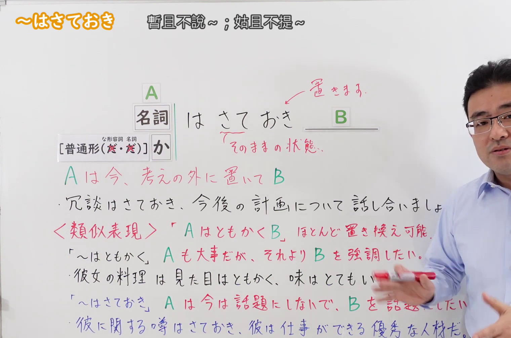
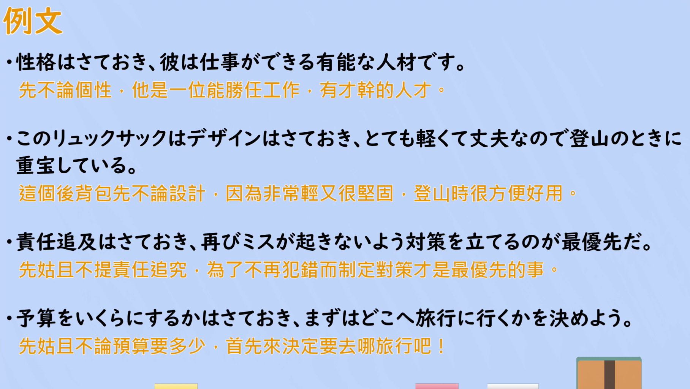

---
{
  "id": "N2-G-0071",
  "kind": "grammar",
  "level": "N2",
  "title": "はさておき（暂且不论……；姑且不提……）",
  "card_revision": 1,
  "schema_version": 1,
  "source": {
    "lesson": "N2 第71个语法",
    "material": "出口日語原视频板书、日语自动字幕与毎日のんびり日本語教師正文",
    "video": "https://www.youtube.com/watch?v=zlrlVzNI0mM",
    "screenshot": "assets/grammar/n2/N2-G-0071-connection.png",
    "screenshot_seconds": 200,
    "screenshot_crop": {
      "x": 0,
      "y": 0,
      "width": 1520,
      "height": 1005
    }
  },
  "tags": [
    "暂且不论",
    "话题转换",
    "N2"
  ],
  "confusions": [
    "〜はともかく（として）（板书列为〈類似表現〉，几乎可以互换；差别在于「はともかく」是「A 也重要，但更想强调 B」，「はさておき」是「现在不把 A 当话题，只想谈 B」）",
    "〜はさておいて（同一表现的另一形式，接续与意义相同）"
  ]
}
---

# はさておき（暂且不论……；姑且不提……）

## 视频学习资料整理

[出口日語原视频](https://www.youtube.com/watch?v=zlrlVzNI0mM)（N2 第71个语法「はさておき」，时长 5:19）

**接续图（3:20，即 200 秒）**

原图 1920×1080，裁切区域 x=0、y=0、width=1520、height=1005（固定左上角，收拢右下角裁去右侧多余画面与底部空白）。

板书内容：接续表「名詞＋はさておき B」，以及「[普通形(だ・だ)]＋か＋はさておき」——后者板注「な形容詞　名詞」，说明な形容词和名词要先用「か」转成疑问形式（如「実行するかはさておき」）；板上另有老师手写的红色「置きます」「そのままの状態。」，用箭头指向「さておき」，说明「さておき」来自「そのままの状態で置く」；板书中段用红字给出的解释是「A は今、考えの外に置いて B」，下方跟板书例句（冗談はさておき、今後の計画について話し合いましょう。）；再下方另有红字标注的〈類似表現〉「A はともかく B」ほとんど置き換え可能。，并分别写出两个表现的语感差异与各自例句。

说明：0:01 的画面同样完整，但老师身体挡住〈類似表現〉一行的句尾；改用 3:20（200 秒）时点，此时〈類似表現〉与「〜はともかく」两行完整可读。该时点老师仍站在板书右侧，三条例句的句尾（話し合いましょう／味はとてもいい／B を話題にしたい）被其身体与手部遮住，无法完全避免；接续表、红字解释、〈類似表現〉及其说明行、最后一行例句均可完整读出。裁切高度取 1005 以保留板书最后一行例句。

**例句图（3:58，即 238 秒）**

原图 1920×1080，裁切区域 x=52、y=20、width=1816、height=1024（裁去四周的木质边框与画面底部）。该时点画面为视频的「例文」页，无人物遮挡，列出 4 个例句并附有视频自带的中文翻译。

# 核心

## 功能一：把 A 暂时放在考虑之外，B

**くわしい意味記述：**

- **はさておき：** 取り上げる必要がないか、あるいは優先度が低い話題を後回しにし、最も重要な問題を提示するときに用いる文型です。単に話題転換として「それはさておき」を使ったりもします。（这是用于把没有必要提出、或优先度较低的话题往后放，先提出最重要问题的句型。有时也单纯作为话题转换来使用「それはさておき」。）

### 例句

1. 世間の評価はさておき、私は良かったと思う。

   （暂且不论世人的评价，我认为很好。）

2. そんな冗談はさておき、手伝ってくれませんか。

   （那样的玩笑暂且不提，能帮我一下吗？）

3. 外見はさておき、とても優しい人だった。

   （外表暂且不谈，他是个非常温柔的人。）

4. この事件に関与していたかどうかはさておき、彼は部下の監督不行き届きで処分されるだろう。

   （暂且不论他是否参与了这起事件，他会因对下属监督不力而受到处分吧。）

5. 実行するかはさておき、綿密な計画を立てておくことは悪いことではない。

   （暂且不论是否执行，事先制定周密的计划并不是坏事。）

# 来源

- [出口日語原视频](https://www.youtube.com/watch?v=zlrlVzNI0mM)（查询日期：2026-09-23）
- [毎日のんびり日本語教師「【Ｎ１文法】～はさておき／はさておいて」](https://mainichi-nonbiri.com/grammar/n1-hasateoki/)（查询日期：2026-09-23）
