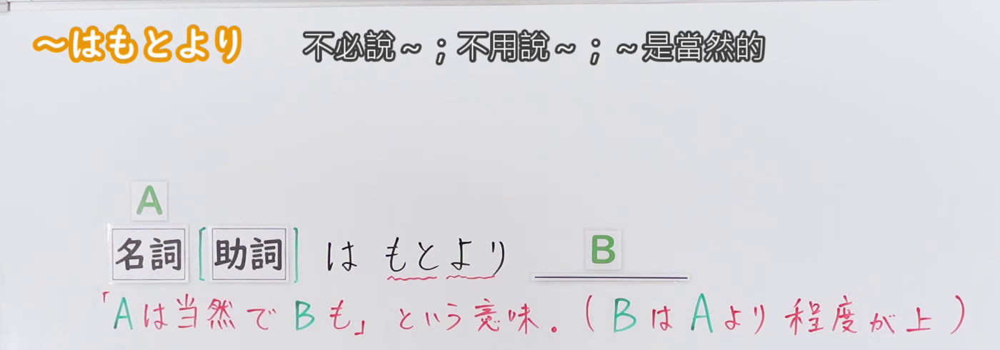
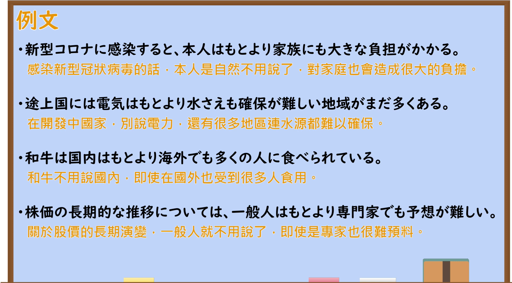

---
{
  "id": "N2-G-0072",
  "kind": "grammar",
  "level": "N2",
  "title": "はもとより：A理所当然，B也如此",
  "card_revision": 1,
  "schema_version": 1,
  "source": {
    "lesson": "N2 第72个语法",
    "material": "出口日語原视频板书、日语自动字幕与Hagoromo正文",
    "video": "https://www.youtube.com/watch?v=m3Re3SqFfdw",
    "screenshot": "assets/grammar/n2/N2-G-0072-connection.png",
    "screenshot_seconds": 155,
    "screenshot_crop": {
      "x": 0,
      "y": 0,
      "width": 1400,
      "height": 490
    }
  },
  "tags": ["はもとより", "付加", "N2"],
  "confusions": ["はもちろん"]
}
---

# はもとより：A理所当然，B也如此

# 视频学习资料整理

课程：[出口日語 N2 第72课「～はもとより」](https://www.youtube.com/watch?v=m3Re3SqFfdw)。日语自动字幕中的同音字已对照原视频板书核对。

- 接续图：原视频 **2:35（155秒）**，原图 1920×1080；固定左上角裁切区域 x=0、y=0、宽=1400、高=490。画面保留名词及可选助词的接续、红色含义说明，裁去下方被人物遮挡的例句板书。
- 例句图：原视频 **3:57.10（237.10秒）**，原图 1920×1080；固定左上角裁切区域 x=0、y=0、宽=1900、高=1050。画面保留四个日语例句及视频所附中文译文。

# 核心

## 功能一：A理所当然，B也如此（B比A程度更高）

**最上位意味カテゴリー：**

- **はもとより：** ものごとの関係（事物之间的关系）

**中位意味カテゴリー：**

- **はもとより：** 付加（追加）

**意味：**

- **はもとより：** 付加（追加）

**くわしい意味記述：**

- **はもとより：** Nのことは当然だが，Nよりさらに程度が上のことも加えて言いたい時に使う。「はもちろん」と同じ意味だが，「はもとより」のほうが書き言葉的。（用于表示 N 所指之事理所当然，还想补充比 N 程度更高的事物。与「はもちろん」意思相同，但「はもとより」更偏书面语。）

**派生語：** 未列出

### 例句

1. 田中氏は、日本国内はもとより、海外にまで広く知られている。

   （田中先生不仅在日本国内广为人知，在海外也享有盛名。）

2. こうなると個人はもとより、各集団の動きは大きく制限される。

   （这样一来，个人自不待言，各团体的行动也会受到很大限制。）

3. これだけの大型事業が集中して構想されている地域は、日本はもとより、世界的にも、おそらく例がないのではないか。

   （如此多的大型项目集中规划在同一地区，恐怕不只在日本，就连世界范围内也没有先例。）

# 来源

- [出口日語 N2 第72课原视频「～はもとより」](https://www.youtube.com/watch?v=m3Re3SqFfdw)
- [Hagoromo 文型检索「はもとより」实际条目](https://www.hagoromo-text.work/)（站内检索「はもとより」；查询日期：2026-09-23）
