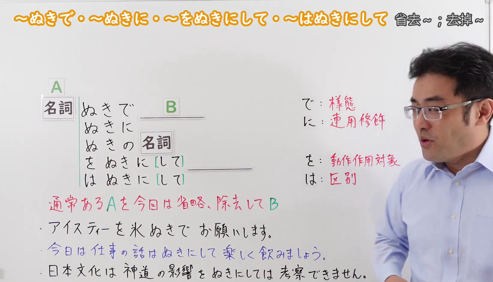
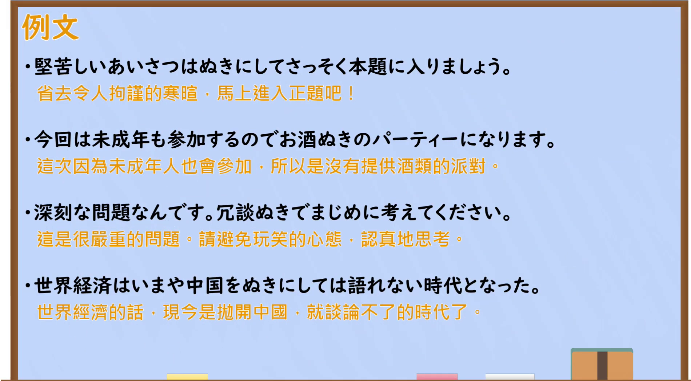

---
{
  "id": "N2-G-0073",
  "kind": "grammar",
  "level": "N2",
  "title": "ぬきで・ぬきに・ぬきの・をぬきにして・はぬきにして：省去A",
  "card_revision": 1,
  "schema_version": 1,
  "source": {
    "lesson": "N2 第73个语法",
    "material": "出口日語原视频板书、日语自动字幕与Hagoromo正文",
    "video": "https://www.youtube.com/watch?v=doE0RL2hpmA",
    "screenshot": "assets/grammar/n2/N2-G-0073-connection.png",
    "screenshot_seconds": 4,
    "screenshot_crop": {
      "x": 0,
      "y": 0,
      "width": 1640,
      "height": 940
    }
  },
  "tags": [
    "ぬきで",
    "ぬきに",
    "ぬきの",
    "をぬきにして",
    "はぬきにして",
    "N2"
  ],
  "confusions": [
    "なしで",
    "をのぞいて"
  ]
}
---

# ぬきで・ぬきに・ぬきの・をぬきにして・はぬきにして：省去A

# 视频学习资料整理

课程：[出口日語 N2 第73课「～ぬきで・～ぬきに・～をぬきにして・～はぬきにして」](https://www.youtube.com/watch?v=doE0RL2hpmA)。课程板书还列出「ぬきの」；日语自动字幕将「ぬき」误识为同音词时，以板书为准。

- 接续图：原视频 **0:04（4秒）**，原图 1920×1080；固定左上角裁切区域 x=0、y=0、宽=1640、高=940。画面保留左上角完整语法标题、五种形式、红色含义说明及板书例句。
- 例句图：原视频 **4:42（282秒）**，原图 1920×1080；固定左上角裁切区域 x=0、y=0、宽=1900、高=1050。画面保留四个日语例句及视频所附中文译文。

# 核心

## 功能一：省去、排除通常会有的A，再做B

**最上位意味カテゴリー：**

- **ぬきで：** ものごとの関係（事物之间的关系）

**中位意味カテゴリー：**

- **ぬきで：** 付帯状態・非付帯状態（伴随状态与非伴随状态）

**意味：**

- **ぬきで：** 非付帯状態（不伴随的状态）

**くわしい意味記述：**

- **ぬきで：** Nを入れない状態で。「Nを除いた状態でXする」「Nを除いた状態でXできない」という意味を表す。（表示不加入N的状态，意为“在除去N的情况下做X”或“在除去N的情况下无法做X”。）

**派生語：** ぬきでは，ぬきに，ぬきには，ぬきの

### 例句

1. これは、その部分だけを、余計な説明ぬきで引用することにしましょう。

   （这一处就只引用那一部分，省去多余的说明吧。）

2. 当事者ぬきの相談をしても解決にはならない。

   （即使不让当事人参与讨论，也解决不了问题。）

3. 彼はパレスチナ人代表を、パレスチナ解放機構（ＰＬＯ）抜きで出席させることに成功した。

   （他成功地让巴勒斯坦人代表在巴勒斯坦解放组织（PLO）不参与的情况下出席。）

## 功能二：省去、排除通常会有的A，便无法完成B

**最上位意味カテゴリー：**

- **をぬきにして：** ものごとの関係（事物之间的关系）

**中位意味カテゴリー：**

- **をぬきにして：** 条件（条件）

**意味：**

- **をぬきにして：** 除外（排除）

**くわしい意味記述：**

- **をぬきにして：** 「〜を除外しては」という意味。後には必ず「不可能だ」という内容が続き，「〜」にあたる人物が絶対に必要であるという意味を表す。後には「考えられない」「語れない」がコロケーションとして多い。（意为“若将～排除在外”，后项必定接“不可能”的内容，表示“～”所指的人物绝对不可缺少；常与「考えられない」「語れない」搭配。）

**派生語：** をぬきにしては，をぬきに，Nぬきに

### 例句

1. 山田氏をぬきにして、この町の将来は語れない。

   （撇开山田先生，就无法谈论这座城镇的未来。）

2. 法を抜きにして人間の生存がなりたたないことは、認めるほかない。

   （不得不承认，若没有法律，人类的生存便无法维系。）

3. 大相撲はもはや、外国人力士を抜きにしては語れない時代に入っている。

   （如今谈论大相扑，已到了无法避开外国力士的时代。）

# 来源

- [出口日語 N2 第73课原视频](https://www.youtube.com/watch?v=doE0RL2hpmA)
- [Hagoromo 文型检索「ぬきで」实际条目](https://www.hagoromo-text.work/)（含派生语「ぬきに」「ぬきの」；查询日期：2026-09-23）
- [Hagoromo 文型检索「をぬきにして」实际条目](https://www.hagoromo-text.work/)（查询日期：2026-09-23）
