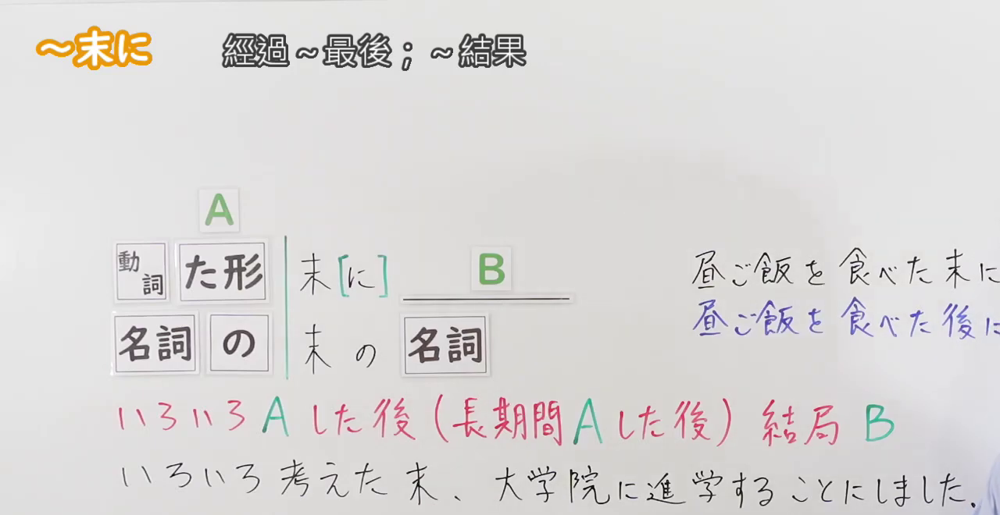
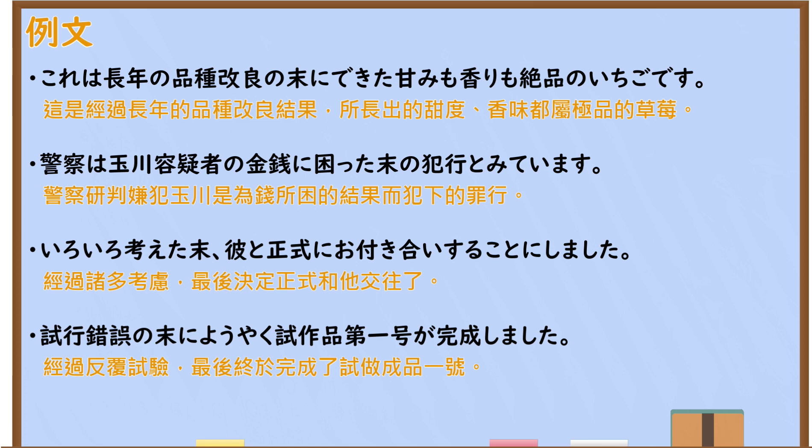

---
{
  "id": "N2-G-0074",
  "kind": "grammar",
  "level": "N2",
  "title": "すえ(末)に：经过一番过程后的结果",
  "card_revision": 1,
  "schema_version": 1,
  "source": {
    "lesson": "N2 第74个语法",
    "material": "出口日語原视频板书、日语自动字幕与Hagoromo正文",
    "video": "https://www.youtube.com/watch?v=-QjpUD9K6nY",
    "screenshot": "assets/grammar/n2/N2-G-0074-connection.png",
    "screenshot_seconds": 1,
    "screenshot_crop": {
      "x": 0,
      "y": 0,
      "width": 1280,
      "height": 660
    }
  },
  "tags": [
    "すえ(末)に",
    "結果",
    "N2"
  ],
  "confusions": [
    "あげく",
    "あとで"
  ]
}
---

# すえ(末)に：经过一番过程后的结果

# 视频学习资料整理

课程：[出口日語 N2 第74课「～末に」](https://www.youtube.com/watch?v=-QjpUD9K6nY)。日语自动字幕中的同音误识别已对照原视频板书校正。

- 接续图：原视频 **0:01（1秒）**，原图 1920×1080；固定左上角裁切区域 x=0、y=0、宽=1280、高=660。画面保留左上角语法标题、接续、红色含义说明及板书例句；右侧部分对比例句在原帧中受人物遮挡。
- 例句图：原视频 **6:05.27（365.27秒）**，原图 1920×1080；固定左上角裁切区域 x=0、y=0、宽=1900、高=1050。画面保留四个日语例句及视频所附中文译文。

# 核心

## 功能一：反复或长时间做A之后，最终出现B这个结果

**最上位意味カテゴリー：**

- **すえ（に）：** ものごとの関係（事物之间的关系）

**中位意味カテゴリー：**

- **すえ（に）：** 経過・結末（过程与结局）

**意味：**

- **すえ（に）：** 結果（结果）

**くわしい意味記述：**

- **すえ（に）：** 前の動作や行為を行った後で，ある結果になったことを表す。（表示在进行了前项动作或行为之后，出现了某种结果。）

**派生語：** すえに

### 例句

1. 悪戦苦闘の末に、何とか切り抜けた。

   （经过一番苦战，总算挺过来了。）

2. 大議論の末、法律が制定された。

   （经过激烈讨论，最终制定了法律。）

3. 悩んだ末、電車賃をけちって自転車で観光することにした。

   （纠结一番后，为了省车费，决定骑自行车游览。）

4. 山頂までロープウエーが通じているが、迷った末に石段を登り始めた。

   （虽然缆车直达山顶，但犹豫一番后，我还是开始爬石阶。）

# 来源

- [出口日語 N2 第74课原视频「～末に」](https://www.youtube.com/watch?v=-QjpUD9K6nY)
- [Hagoromo 文型检索「すえ（に）」实际条目](https://www.hagoromo-text.work/)（站内检索「すえに」；查询日期：2026-09-23）
