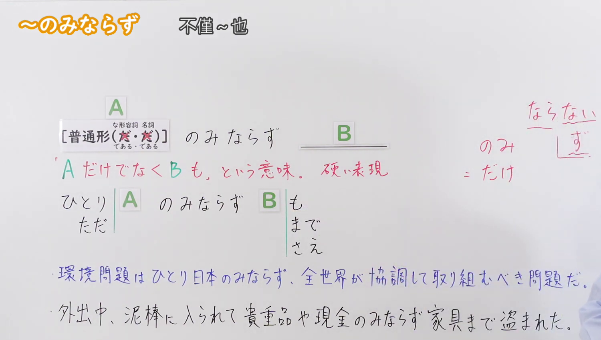
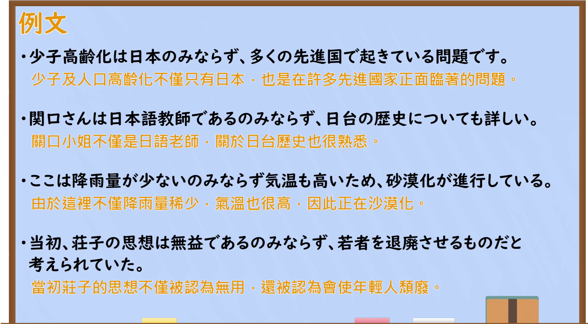

---
{
  "id": "N2-G-0075",
  "kind": "grammar",
  "level": "N2",
  "title": "のみならず・ただ〜のみならず・ひとり〜のみならず：不仅A，B也如此",
  "card_revision": 1,
  "schema_version": 1,
  "source": {
    "lesson": "N2 第75个语法",
    "material": "出口日語原视频板书、日语自动字幕与Hagoromo正文",
    "video": "https://www.youtube.com/watch?v=_Omsq9s7h7s",
    "screenshot": "assets/grammar/n2/N2-G-0075-connection.png",
    "screenshot_seconds": 95.5,
    "screenshot_crop": {
      "x": 0,
      "y": 0,
      "width": 1500,
      "height": 850
    }
  },
  "tags": [
    "のみならず",
    "ただ〜のみならず",
    "ひとり〜のみならず",
    "N2"
  ],
  "confusions": [
    "だけでなく",
    "ばかりか"
  ]
}
---

# のみならず・ただ〜のみならず・ひとり〜のみならず：不仅A，B也如此

# 视频学习资料整理

课程：[出口日語 N2 第75课「～のみならず」](https://www.youtube.com/watch?v=_Omsq9s7h7s)。日语自动字幕已对照原视频板书核对。

- 接续图：原视频 **1:35.50（95.50秒）**，原图 1920×1080；固定左上角裁切区域 x=0、y=0、宽=1500、高=850。画面保留左上角完整语法标题、接续、红色含义说明、对比板书及完整例句。
- 例句图：原视频 **3:35.80（215.80秒）**，原图 1920×1080；固定左上角裁切区域 x=0、y=0、宽=1900、高=1050。画面保留四个日语例句及视频所附中文译文。

# 核心

## 功能一：不仅A，B也如此（较郑重的表达）

**最上位意味カテゴリー：**

- **のみならず：** ものごとの関係（事物之间的关系）
- **ただ〜のみならず：** ものごとの関係（事物之间的关系）
- **ひとり〜のみならず：** ものごとの関係（事物之间的关系）

**中位意味カテゴリー：**

- **のみならず：** 非限定（非限定）
- **ただ〜のみならず：** 非限定（非限定）
- **ひとり〜のみならず：** 非限定（非限定）

**意味：**

- **のみならず：** 非限定（非限定）
- **ただ〜のみならず：** 非限定（非限定）
- **ひとり〜のみならず：** 非限定（非限定）

**くわしい意味記述：**

- **のみならず：** 「だけでなく」と同じ意味。「だけでなく」よりも硬い表現。（与「だけでなく」意思相同，但比「だけでなく」更郑重、更偏书面语。）
- **ただ〜のみならず：** 「だけでなく」と同じ意味。「だけでなく」よりも硬い表現。（与「だけでなく」意思相同，但比「だけでなく」更郑重、更偏书面语。）
- **ひとり〜のみならず：** 「だけでなく」と同じ意味。「だけでなく」よりも硬い表現。（与「だけでなく」意思相同，但比「だけでなく」更郑重、更偏书面语。）

**派生語：** 未列出（上述三个条目）

### 例句

1. 田中さんは英語のみならず、韓国語も中国語も話せる。

   （田中先生不仅会说英语，还会说韩语和中文。）

2. さらに日本は、アジアにおいて、政治的にのみならず、社会的、文化的にも孤立することになったのでした。

   （此外，日本在亚洲不仅在政治上，在社会和文化方面也陷入了孤立。）

3. 年金問題は、ただ高齢者のみならず、すべての人々の暮らしにかかわる問題である。

   （养老金问题不仅关乎老年人，也关系到所有人的生活。）

4. ひとり本校のみならず、わが国の高校全体の問題だ。

   （这不仅是本校的问题，也是全国所有高中的问题。）

# 来源

- [出口日語 N2 第75课原视频「～のみならず」](https://www.youtube.com/watch?v=_Omsq9s7h7s)
- [Hagoromo 文型检索「のみならず」实际条目](https://www.hagoromo-text.work/)（查询日期：2026-09-23）
- [Hagoromo 文型检索「ただ〜のみならず」实际条目](https://www.hagoromo-text.work/)（查询日期：2026-09-23）
- [Hagoromo 文型检索「ひとり〜のみならず」实际条目](https://www.hagoromo-text.work/)（查询日期：2026-09-23）
