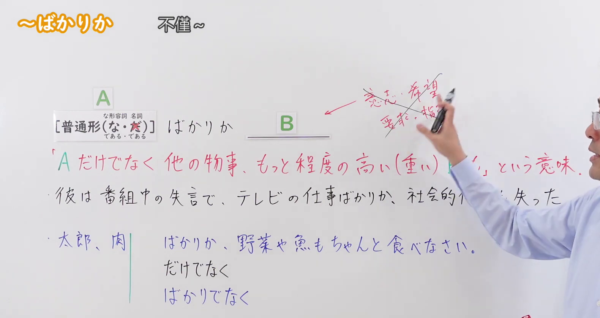
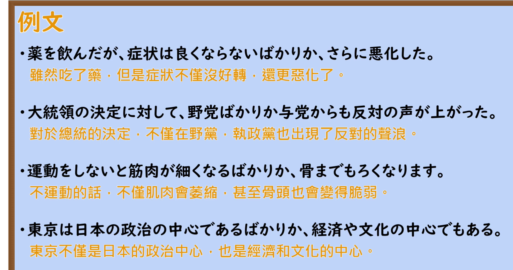

---
{
  "id": "N2-G-0076",
  "kind": "grammar",
  "level": "N2",
  "title": "ばかりか｜不但如此，而且还",
  "card_revision": 1,
  "schema_version": 1,
  "source": {
    "lesson": "N2 第76个语法",
    "material": "出口日語原视频板书、日语自动字幕与 Hagoromo 文型检索正文",
    "video": "https://www.youtube.com/watch?v=fNMTK6JX1VE",
    "screenshot": "assets/grammar/n2/N2-G-0076-connection.png",
    "screenshot_seconds": 65,
    "screenshot_crop": {
      "x": 0,
      "y": 0,
      "width": 1580,
      "height": 840
    }
  },
  "tags": [
    "ばかりか",
    "累加",
    "N2"
  ],
  "confusions": [
    "だけでなく",
    "ばかりでなく"
  ]
}
---

# 第76课：ばかりか

# 视频学习资料整理

- [出口日語原视频](https://www.youtube.com/watch?v=fNMTK6JX1VE)（课程时长 4 分 05 秒）。日语自动字幕用于辅助定位，语法形式及红字说明以画面为准。
- 接续与讲解板书：视频 **01:05**；原图 **1920 × 1080**；从左上角裁至 **(0, 0, 1580, 840)**。保留接续、红字意义说明、对比例句及「だけでなく／ばかりでなく」板书；教师遮住了黑字例句的末尾，红字说明和蓝字对比例句可辨。

- 例句页：视频 **02:35.03**；原图 **1920 × 1080**；从左上角裁至 **(0, 0, 1750, 925)**。四条例句及画面自带的中文译文完整可见。

# 核心

## 功能一：不只是 A，程度更高或更严重的 B 也成立

**最上位意味カテゴリー：**

- **ばかりか：** ものごとの関係（事物之间的关系）

**中位意味カテゴリー：**

- **ばかりか：** 非限定（不只限于前项）

**意味：**

- **ばかりか：** 非限定（不只限于前项）

**くわしい意味記述：**

- **ばかりか：** 「ばかりか」の前に述べるＰだけでなく，もっと程度の高いものもある，という意味。「ばかりか」の後に来る文は，発話者の意志・希望や，相手への命令などではなく，状況を説明する文が多い。（意思是，除了「ばかりか」前面所述的 P，还有程度更高的事物。「ばかりか」后面的句子多用于说明情况，而非表达说话人的意志、愿望或对对方的命令等。）

**派生語：** 未列出

### 例句

1. 田中さんは英語ばかりかフランス語も得意だ。

   （田中先生不仅擅长英语，也擅长法语。）

2. が、見上げる天頂だけに星があり、あとは山々だけという情景が「高嶺星」で、この語が地形を暗示するばかりか、人里を遠く離れた奥深い、静かな山国であることを感じさせます。

   （不过，「高岭星」描绘的是仰望时只有头顶有星、四周尽是群山的景象；这个词不仅暗示地形，还让人感受到那是远离人烟、幽深寂静的山乡。）

3. 第二句も“雪と雪相剋かぎりなく白し”の定型では舌足らずで意味が不明瞭になるばかりか、「相剋」が観念的に浮き上がってしまう危険があります。

   （第二句如果也套用“雪与雪相克，无限洁白”这个固定形式，不仅表达不足、意思含糊，还可能使「相剋」显得过于抽象、与上下文脱节。）

# 来源

- [出口日語原视频「〜ばかりか」](https://www.youtube.com/watch?v=fNMTK6JX1VE)
- [Hagoromo 文型检索「ばかりか（非限定）」](https://hagoromo-text.work/)（站内检索「ばかりか」后打开该条目；查询日期：2026-09-23）
