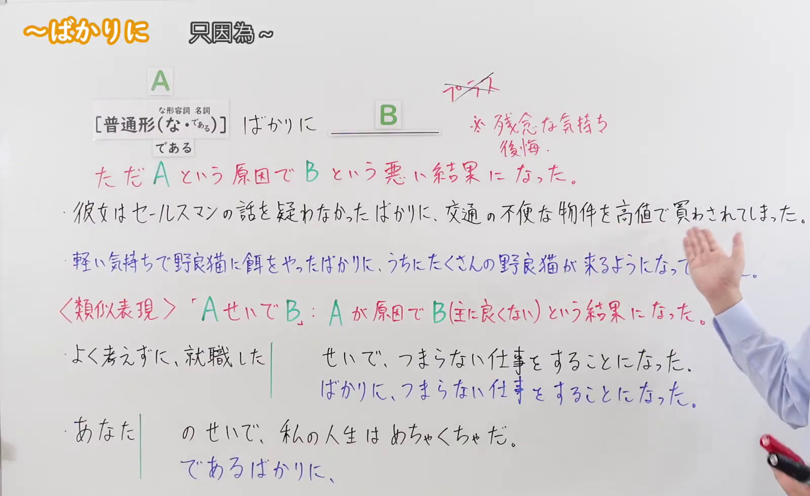
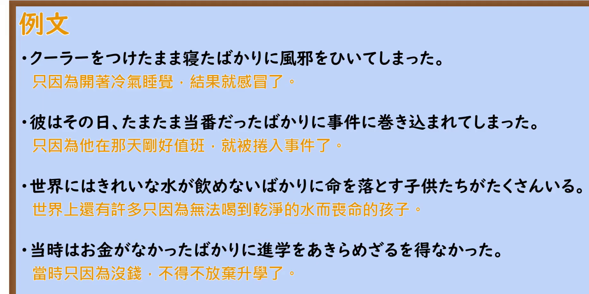

---
{
  "id": "N2-G-0077",
  "kind": "grammar",
  "level": "N2",
  "title": "ばかりに｜仅因……而导致坏结果",
  "card_revision": 1,
  "schema_version": 1,
  "source": {
    "lesson": "N2 第77个语法",
    "material": "出口日語原视频板书、日语自动字幕与 Hagoromo 文型检索正文",
    "video": "https://www.youtube.com/watch?v=6rrKLjF47e8",
    "screenshot": "assets/grammar/n2/N2-G-0077-connection.png",
    "screenshot_seconds": 125,
    "screenshot_crop": {
      "x": 0,
      "y": 0,
      "width": 1600,
      "height": 980
    }
  },
  "tags": [
    "ばかりに",
    "原因・理由",
    "N2"
  ],
  "confusions": [
    "せいで",
    "たいばかりに"
  ]
}
---

# 第77课：ばかりに

# 视频学习资料整理

- [出口日語原视频](https://www.youtube.com/watch?v=6rrKLjF47e8)（课程时长 7 分 26 秒）。日语自动字幕仅辅助定位，语法形式和讲解内容以画面为准。
- 接续与讲解板书：视频 **02:05**；原图 **1920 × 1080**；从左上角裁至 **(0, 0, 1600, 980)**。保留接续、红字意义说明、例句及与「せいで」的对比；教师的手遮住蓝字例句的一小段，其余主要板书可辨。

- 例句页：视频 **06:18.40**；原图 **1920 × 1080**；从左上角裁至 **(0, 0, 1850, 925)**。四条例句及画面自带的中文译文完整可见。

# 核心

## 功能一：仅因 A，导致 B 这样的坏结果

**最上位意味カテゴリー：**

- **ばかりに：** ものごとの関係（事物之间的关系）

**中位意味カテゴリー：**

- **ばかりに：** 原因・理由（原因与理由）

**意味：**

- **ばかりに：** 理由（理由）

**くわしい意味記述：**

- **ばかりに：** Xという状態・性質・行為・出来事が原因で。「Xだけのために，望ましくないYになっている/Yになった」という意味を表す。「XばかりにY」のXには「Vた」の形が多く使われ，可能形の否定の形や，「Vたい」の形も使われる。Yには，望ましくない結果や，普通ならしないようなことをするという意味の文が続き，「になった」や「てしまった」といった表現が使われる。話し言葉では「ばっかりに」になることもある。（以 X 这一状态、性质、行为或事件为原因，表示“仅仅因为 X，就出现了不理想的 Y／落到了不理想的 Y 状态”。X 常用动词「た」形，也可用可能形的否定形式或「Vたい」形；Y 接不理想的结果，或做了平常不会做的事，常见「になった」「てしまった」等表达。口语中有时说成「ばっかりに」。）

**派生語：** 未列出

### 例句

1. あの魚を食べたばかりにひどい目にあった。

   （就因为吃了那条鱼，结果倒了大霉。）

2. えん罪であることがわかり無罪が確定した弘前大学教授夫人殺し事件の那須さんは、事件当夜のアリバイがすぐ思い出せなかったばかりに“犯人”にされてしまった。

   （弘前大学教授夫人遇害案中的那须后来被证实蒙冤并宣告无罪；仅仅因为他当时没能马上想起案发当夜的不在场证明，就被当作“犯人”。）

3. 目の前に灰皿がないばかりに、大切なインタビューをこちらから打ち切ったことも何度かあった。

   （就因为眼前没有烟灰缸，我甚至有好几次主动中断了重要采访。）

# 来源

- [出口日語原视频「〜ばかりに」](https://www.youtube.com/watch?v=6rrKLjF47e8)
- [Hagoromo 文型检索「ばかりに（理由）」](https://hagoromo-text.work/)（站内检索「ばかりに」后打开该条目；查询日期：2026-09-23）
