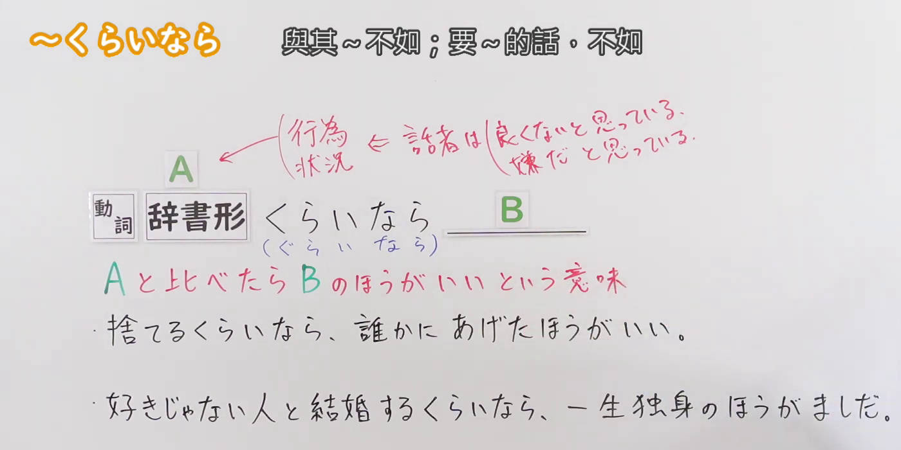
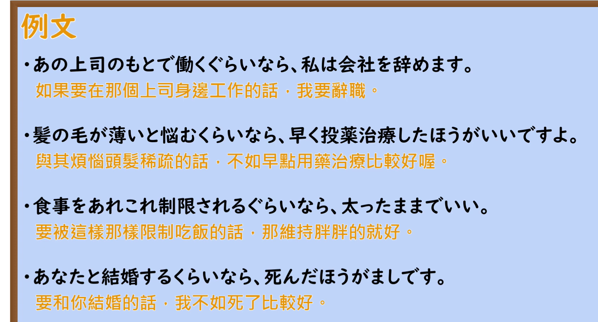

---
{
  "id": "N2-G-0078",
  "kind": "grammar",
  "level": "N2",
  "title": "くらいなら・ぐらいなら｜与其 A，不如 B",
  "card_revision": 1,
  "schema_version": 1,
  "source": {
    "lesson": "N2 第78个语法",
    "material": "出口日語原视频板书、日语自动字幕与毎日のんびり日本語教師正文",
    "video": "https://www.youtube.com/watch?v=OdP9Pd5wW54",
    "screenshot": "assets/grammar/n2/N2-G-0078-connection.png",
    "screenshot_seconds": 105,
    "screenshot_crop": {
      "x": 0,
      "y": 0,
      "width": 1400,
      "height": 700
    }
  },
  "tags": [
    "くらいなら",
    "ぐらいなら",
    "比较",
    "N2"
  ],
  "confusions": [
    "なら",
    "くらいならむしろ"
  ]
}
---

# 第78课：くらいなら・ぐらいなら

# 视频学习资料整理

- [出口日語原视频](https://www.youtube.com/watch?v=OdP9Pd5wW54)（课程时长 4 分 38 秒）。日语自动字幕用于定位，语法形式与意义说明以板书为准。视频说明「くらいなら」也可以说成「ぐらいなら」。
- 接续与讲解板书：视频 **01:45**；原图 **1920 × 1080**；从左上角裁至 **(0, 0, 1400, 700)**。接续、红字比较意义、两种说法及板书例句完整可见。

- 例句页：视频 **03:07.43**；原图 **1920 × 1080**；从左上角裁至 **(0, 0, 1700, 915)**。四条例句及画面自带的中文译文完整可见。

# 核心

## 功能一：与 A 相比，B 更好

**くわしい意味記述：**

- **くらいなら・ぐらいなら：** 二つの物事を比較し、話し手にとって前件よりも後件のほうが望ましいことを表します。「むしろ」がつくとより強調された表現となります。（比较两件事，表示对说话人而言，后项比前项更可取。加上「むしろ」时，表达更强调。）

### 例句

1. 嫌々やるぐらいなら初めからやらないほうがましだ。

   （与其不情愿地做，不如从一开始就不做。）

2. 遊びに散財するくらいなら貯金したい。

   （与其把钱挥霍在玩乐上，我更想存起来。）

3. 数万円かけて修理するくらいなら、新しいパソコン買った方がいい。

   （与其花几万日元修理，不如买台新电脑。）

# 来源

- [出口日語原视频「〜くらいなら」](https://www.youtube.com/watch?v=OdP9Pd5wW54)
- [毎日のんびり日本語教師「～くらいなら／ぐらいなら／くらいならむしろ／ぐらいならむしろ」](https://mainichi-nonbiri.com/grammar/n1-kurainara/)（查询日期：2026-09-23）
