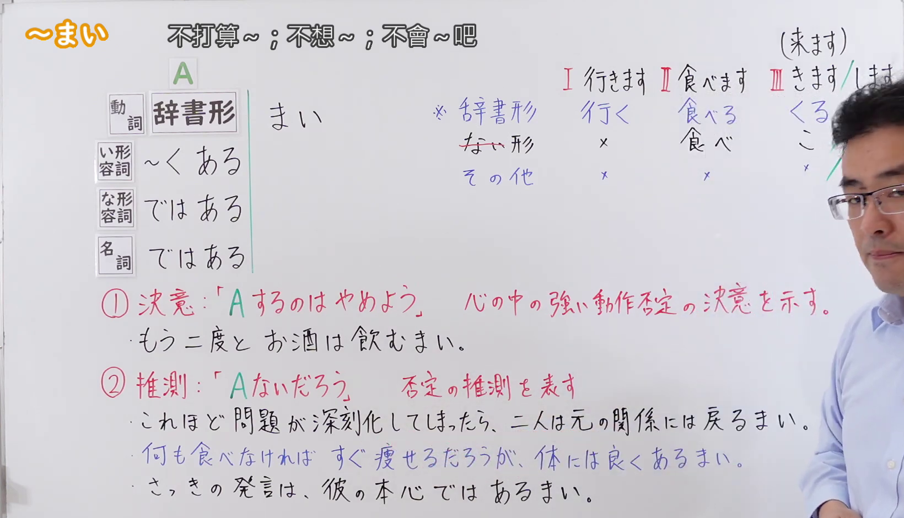
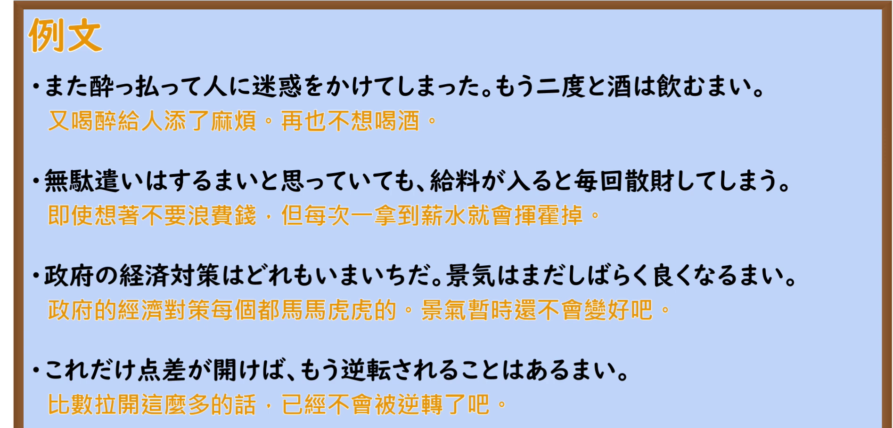

---
{
  "id": "N2-G-0079",
  "kind": "grammar",
  "level": "N2",
  "title": "〜まい：不做的决心／否定推测",
  "card_revision": 1,
  "schema_version": 1,
  "source": {
    "lesson": "N2 第79个语法",
    "material": "出口日語原视频板书、日语自动字幕与Hagoromo正文",
    "video": "https://www.youtube.com/watch?v=rxuqNdJk4N4",
    "screenshot": "assets/grammar/n2/N2-G-0079-connection.png",
    "screenshot_seconds": 225.0,
    "screenshot_crop": {
      "x": 0,
      "y": 0,
      "width": 1640,
      "height": 940
    }
  },
  "tags": [
    "まい",
    "否定意志",
    "否定推测",
    "N2"
  ],
  "confusions": [
    "〜まい的否定意志与否定推测"
  ]
}
---

# 〜まい

# 视频学习资料整理

- 课程：[出口日語《【Ｎ２文法】～まい》](https://www.youtube.com/watch?v=rxuqNdJk4N4)。板书分别讲解“决意”和“推測”；日语自动字幕中的同音识别字以画面为准。
- 接续图：03:45.00，原图 1920×1080；固定左上角裁切区域 `(0, 0, 1640, 940)`。板书展示接续、两种意义及例句；教师遮住右侧部分动词变形示例。

  

- 例句图：05:37.27，原图 1920×1080；固定左上角裁切区域 `(0, 0, 1895, 910)`，保留四条课程例句及画面中的中文翻译。

  

# 核心

## 功能一：决心不做 A；表示心中强烈的否定行动的决心

**最上位意味カテゴリー：**

- **まい（否定の意志）：** 考え・感情（想法与感情）

**中位意味カテゴリー：**

- **まい（否定の意志）：** 意志（意志）

**意味：**

- **まい（否定の意志）：** 否定の意志（否定的意志）

**くわしい意味記述：**

- **まい（否定の意志）：** ある行為をしないという話し手の気持ちを表す。「〜まい。」という言い切りの形で使われることはほとんどなく，「〜まいと思う。」といった形で使われる。書き言葉でよく使われる。（表示说话人不做某事的心情。几乎不以「〜まい。」的断定形式使用，常用「〜まいと思う。」之类的形式。常见于书面语。）

**派生語：** 未列出

### 例句

1. あの不愉快な店には、二度と行くまい。

   （那家让人不愉快的店，我再也不去了。）

2. ロシア帝国はたえず民衆の暴動が起きていた弱体国だったのだが、それは偶然の産物として今は問うまい。

   （俄罗斯帝国当时是不断发生民众暴动的弱国，但关于那是否是偶然的产物，此刻就不追究了。）

3. 質量保存の法則などというヤボなことは言うまい。

   （质量守恒定律之类扫兴的话，我就不说了。）

## 功能二：推测 A 大概不会发生；表示否定的推测

**最上位意味カテゴリー：**

- **まい（推量）：** 考え・感情（想法与感情）

**中位意味カテゴリー：**

- **まい（推量）：** 推量（推测）

**意味：**

- **まい（推量）：** 推量（推测）

**くわしい意味記述：**

- **まい（推量）：** 「ないだろう」という意味。かたい表現で，書きことばでよく使う。（意思是“大概不会”。属于较郑重的表达，常见于书面语。）

**派生語：** 未列出

### 例句

1. そんなことはあるまい。

   （大概不会有那种事吧。）

2. 昭和二一、二二年当時からすれば隔世の感があるが、それが日本に憲法や民主主義が確立され根をおろした結果とは言えまい。

   （与昭和二十一、二年那时相比，确实恍如隔世，但恐怕不能说这是宪法或民主主义在日本确立并扎根的结果。）

3. もし中国が真に豊かな、真に近代的な経済大国に成長しようとするなら、ほぼ間違いなくこうした事態は避けられまい。

   （如果中国要发展成真正富裕、真正现代化的经济大国，这种情况几乎肯定无法避免。）

# 来源

- [出口日語原视频《【Ｎ２文法】～まい》](https://www.youtube.com/watch?v=rxuqNdJk4N4)
- [Hagoromo 文型检索「まい（否定の意志）」「まい（推量）」](https://hagoromo-text.work/)（站内检索「まい」并打开两条实际条目；查询日期：2026-09-23）
