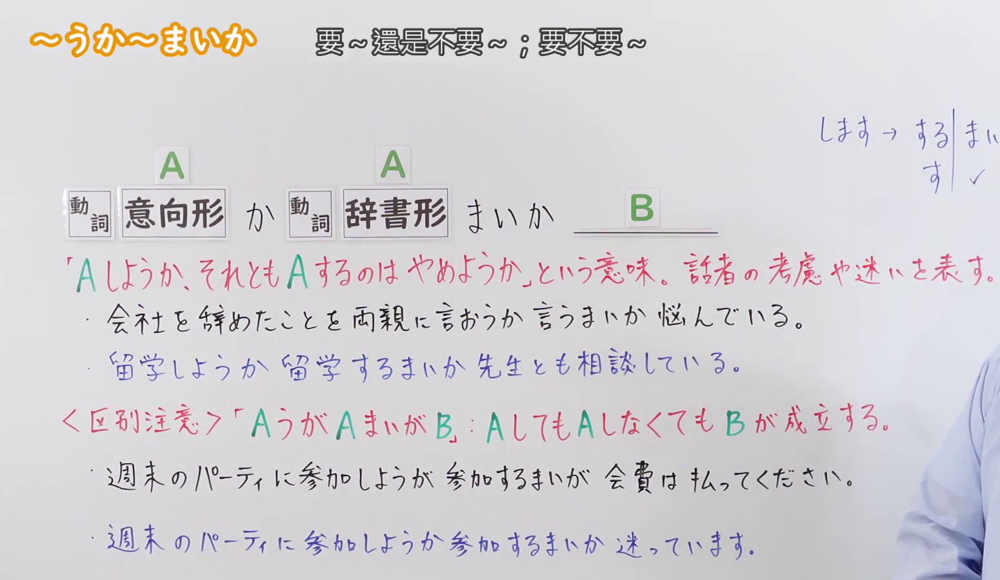
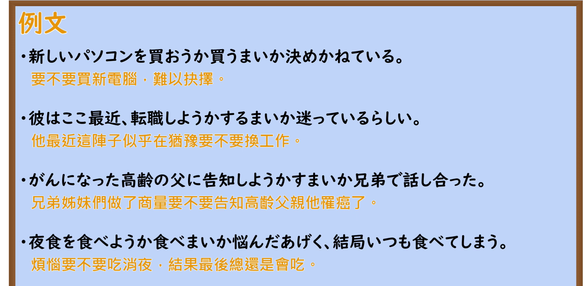

---
{
  "id": "N2-G-0080",
  "kind": "grammar",
  "level": "N2",
  "title": "～うか～まいか：做还是不做，犹豫不决",
  "card_revision": 1,
  "schema_version": 1,
  "source": {
    "lesson": "N2 第80个语法",
    "material": "出口日語原视频板书、日语自动字幕与 Japanese Exercises 正文",
    "video": "https://www.youtube.com/watch?v=NpU7LaKARZY",
    "screenshot": "assets/grammar/n2/N2-G-0080-connection.png",
    "screenshot_seconds": 76.63,
    "screenshot_crop": {
      "x": 0,
      "y": 0,
      "width": 1550,
      "height": 900
    }
  },
  "tags": ["选择犹豫", "N2"],
  "confusions": ["～ようが～まいが：表示无论做不做，结果或判断都不变；本课文型表示在做与不做之间犹豫。"]
}
---

# ～うか～まいか：做还是不做，犹豫不决

# 视频学习资料整理

- [出口日語第80课原视频](https://www.youtube.com/watch?v=NpU7LaKARZY)；课程长度约 6 分 44 秒。
- 接续及讲解板书：原视频 **1:16.63**，原图 **1920 × 1080**，从左上角裁切 **(x=0, y=0, width=1550, height=900)**。保留左上角语法标题、接续、红色释义和区分提示；画面右缘仍有少量教师衣袖。

- 例句页：原视频 **5:43.20**，原图 **1920 × 1080**，从左上角裁切 **(x=0, y=0, width=1900, height=930)**。保留四条例句及视频原有的中文译文。

# 核心

## 功能一：要不要做 A，或者干脆不做 A；表示说话人斟酌、犹豫

**くわしい意味記述：**

- **～うか～まいか：** どうしようか迷っている時に使う。（用于表示对该怎么做感到犹豫的时候。）

### 例句

1. 新しいスマホを買おうか買うまいか悩んでいる。

   （正为要不要买新手机而烦恼。）

2. 彼に真実を話そうか話すまいか、考えあぐねている。

   （我正为要不要告诉他真相而反复思量。）

3. 上司に辞表を出そうか出すまいか、悩んでいる。

   （我正为要不要向上司递交辞呈而犹豫。）

4. この家を買おうか買うまいか、家族と相談中だ。

   （我正在和家人商量要不要买这栋房子。）

5. 彼は店に入ろうか入るまいか、店の前をうろうろしている。

   （他在店门口徘徊，犹豫着要不要进去。）

# 来源

- [出口日語第80课原视频](https://www.youtube.com/watch?v=NpU7LaKARZY)
- [Japanese Exercises「JLPT N2 ～か～まいか 文法解説・問題」](https://japaneseexercises.com/2025/01/26/%E3%80%90jlpt-n2-%EF%BD%9E%E3%81%8B%EF%BD%9E%E3%81%BE%E3%81%84%E3%81%8B%E3%80%80%E6%96%87%E6%B3%95%E8%A7%A3%E8%AA%AC%E3%83%BB%E5%95%8F%E9%A1%8C%E3%80%91/)（查询日期：2026-09-23；采用意义说明及例句）
