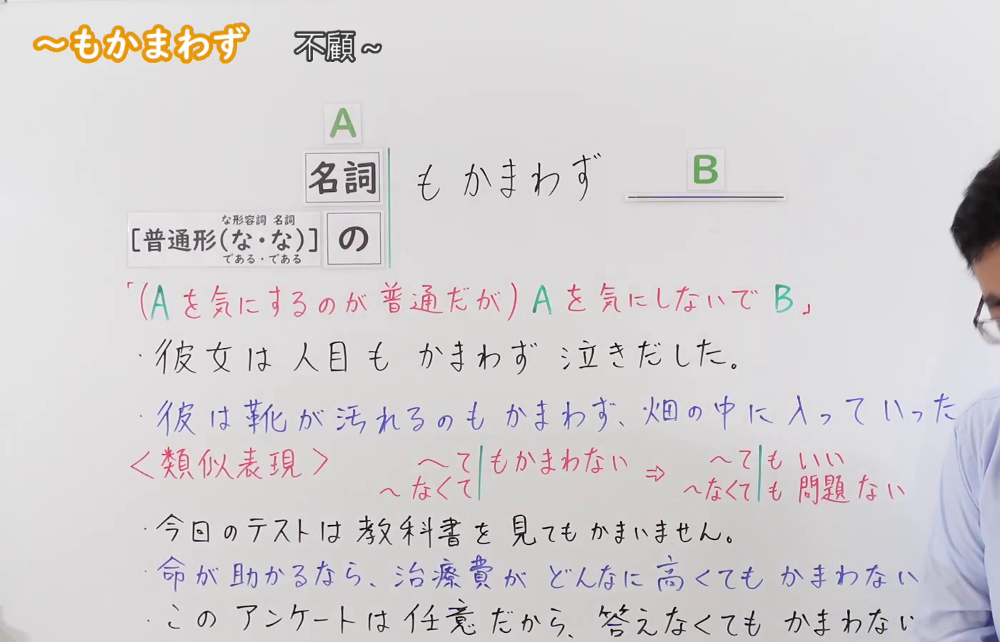
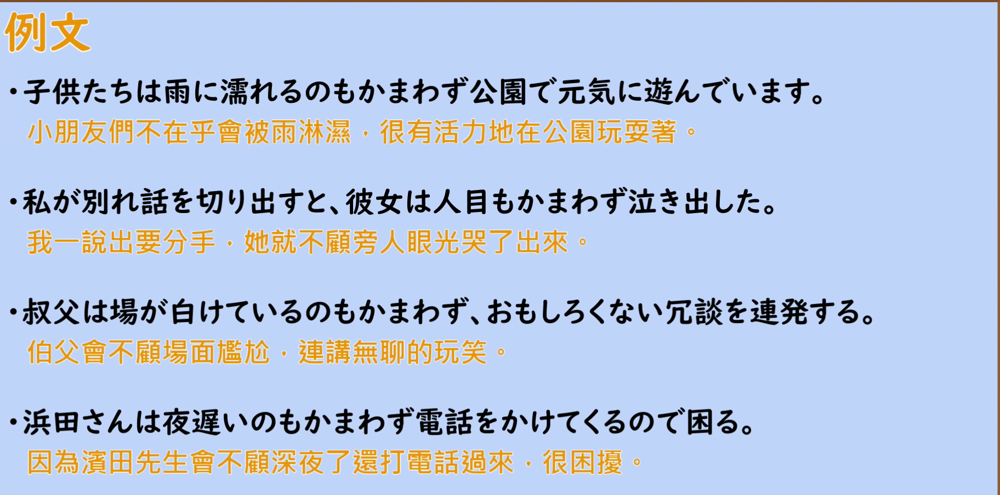

---
{
  "id": "N2-G-0081",
  "kind": "grammar",
  "level": "N2",
  "title": "もかまわず(も構わず)：不顧…；不把…放在心上",
  "card_revision": 1,
  "schema_version": 1,
  "source": {
    "lesson": "N2 第81个语法",
    "material": "出口日語原视频板书、日语自动字幕与Hagoromo・毎日のんびり日本語教師正文",
    "video": "https://www.youtube.com/watch?v=_U87u1OhmKM",
    "screenshot": "assets/grammar/n2/N2-G-0081-connection.png",
    "screenshot_seconds": 1,
    "screenshot_crop": {
      "x": 0,
      "y": 0,
      "width": 1400,
      "height": 900
    }
  },
  "tags": [
    "もかまわず",
    "N2"
  ],
  "confusions": [
    "〜てもかまわない（表示「…也可以、…也没关系」，与本语法「不顾…」意思不同）",
    "〜をよそに／〜を顧みず（N1 同类「不顾」表达，接续与语感不同）"
  ]
}
---

# N2 第81個語法：もかまわず(も構わず) —— 不顧…；不把…放在心上

# 视频学习资料整理

- 原视频：[出口日語 N2 第81個語法～もかまわず](https://www.youtube.com/watch?v=_U87u1OhmKM)
- 视频中讲到的接续：名词直接＋もかまわず；普通形（动词、イ形容词、ナ形容词な／ナ形容词である、名词な／名词である）＋の＋もかまわず。
- 板书把句式写作「A もかまわず B」，并用红色标出含义说明「(Aを気にするのが普通だが) Aを気にしないで B」。
- 板书下半部分另外列出类似表现「〜てもかまわない／〜なくても（問題ない）」，这是近义表达，属于另一组句型，不是もかまわず自身的用法。

**接续图（视频 0:01 画面，原图 1920×1080，裁切区域 x=0, y=0, width=1400, height=900）**

**例句图（视频 4:05 例句页，原图 1920×1080，裁切区域 x=52, y=16, width=1824, height=904）**

# 核心

## 功能一：（虽然通常会在意 A，但）不在意 A 而做 B

**最上位意味カテゴリー：**

- **もかまわず：** ものごとの関係（事物的关系）

**中位意味カテゴリー：**

- **もかまわず：** 無関係・除外（无关・除外）

**意味：**

- **もかまわず：** 無関係（无关）

**くわしい意味記述：**

- **もかまわず：** 「〜もかまわず」の形で，「普通は〜に注意を払うものだが，それを気にしないで」という意味を表す。（以「〜もかまわず」的形式，表示「通常是该去在意〜的，却不加理会」之意。）

**派生語：** もかまわないで

### 例句

1. 友人は雨で濡れるのも構わず、私に傘をさしかけてくれた。

   （朋友不顾自己被雨淋湿，为我撑起了伞。）

2. お互い駆け寄って人目も構わず抱き合った。

   （两人朝对方跑过去，不顾旁人的目光相拥在一起。）

3. 叱られているのも構わず、へらへら笑っている。

   （明明正在挨骂，却满不在乎地嘻皮笑脸。）

4. 膝の痛みもかまわず、痛み止めを注射しながらフルマラソンした。

   （不顾膝盖的疼痛，一边打止痛针一边跑完了全程马拉松。）

5. 夜も構わず作業を続ける。

   （不顾夜色，继续作业。）

# 来源

- [出口日語原视频](https://www.youtube.com/watch?v=_U87u1OhmKM)
- [Hagoromo 文型检索「もかまわず」](https://www.hagoromo-text.work/lookup?vid=1600)（查询日期：2026-09-23，用于最上位・中位意味カテゴリー、意味、くわしい意味記述、派生語及作例1条）
- [毎日のんびり日本語教師「【Ｎ２文法】～も構わず（かまわず）」](https://mainichi-nonbiri.com/grammar/n2-mokamawazu/)（查询日期：2026-09-23，Hagoromo 该条目仅收录一条作例，其余4条例句取自该条目）
